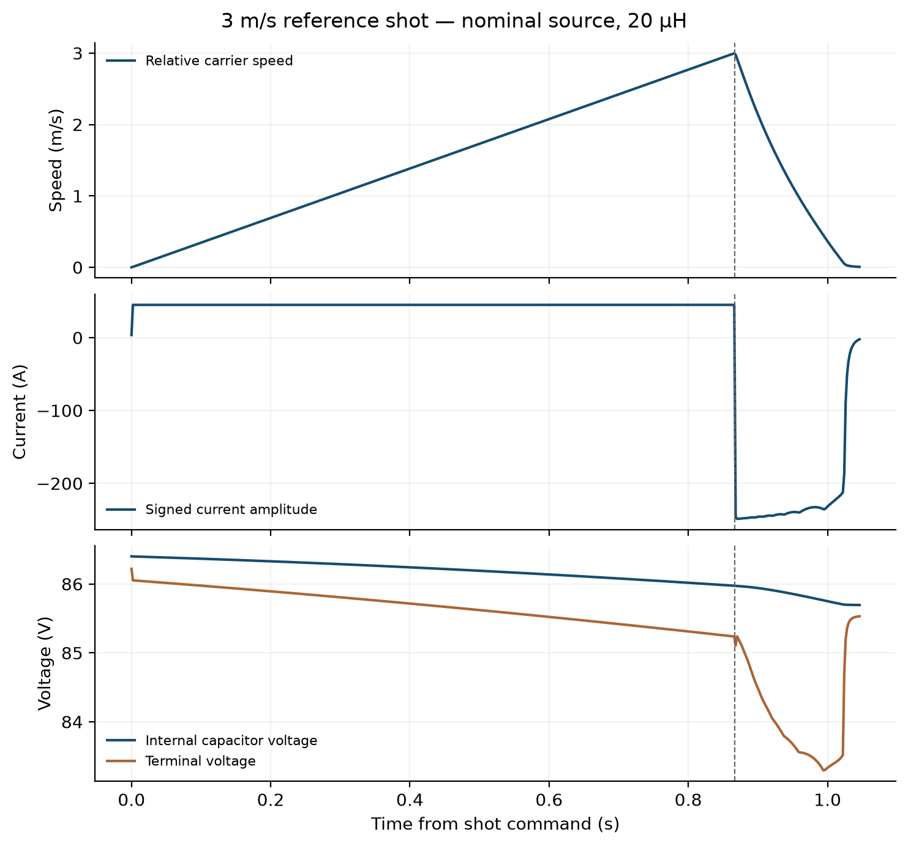

# VOLLEY
### Commanded electromagnetic CubeSat deployment

**One host. Sequential deployment. A commanded release for each spacecraft.**

VOLLEY combines individually restrained satellite storage, guided feed and a reusable electromagnetic launch sled. The host provides the major orbital manoeuvres; VOLLEY supplies the local departure condition. The project began in 2021 and has developed through coilgun concepts, successive CAD generations, linear synchronous motor studies and integrated deployment mechanisms. Its record includes native CAD and STEP, finite-field calculations, source-coupled dynamics, structural analysis and orbital mission studies. **Gen5 ACR1** is the current integrated computational reference within that larger programme.

[Explore the project](https://aaaaaaaaaaaavm.github.io/VOLLEY/) · [Watch the deployment film](https://aaaaaaaaaaaavm.github.io/VOLLEY/delivery-film.html) · [Engineering package](validation/acr1/README.md) · [CAD and drawings](cad/README.md)

<p><a href="docs/assets/acr1/polish/assembly_hero.png"></a></p>

*CAD-derived Blender render · Gen5 ACR1 home state. Teal identifies the feed and captive-pallet path. [Geometry and render provenance](docs/assets/acr1/polish/POLISH_PROVENANCE.json).*

## The project and its evolution

The central idea is commanded delivery from a shared orbital host: the host supplies coarse manoeuvres and attitude control, while VOLLEY sets the local release event. The research follows the complete machine and its mission burden, from stored spacecraft to independent flight.

| Development stage | Engineering focus | Record |
|:--|:--|:--|
| **2021 concept** | Electromagnetic deployment and the initial coilgun architecture | [Project history](docs/HISTORY.md) |
| **Gen1** | Initial linear-motor geometry and storage/rail arrangement | [Generation record](docs/generations/GEN1.md) · [11 STEP exports](cad/step/gen1/) |
| **Gen2** | Structured mechanical revision and increasing mechanism detail | [Generation record](docs/generations/GEN2.md) · [9 STEP exports](cad/step/gen2/) |
| **Gen3** | Reconciled parameter set and CAD-derived component mass | [Generation record](docs/generations/GEN3.md) · [10 STEP exports](cad/step/gen3/) |
| **Gen4** | Finite-stator placement, the actual sled envelope and brake interaction | [Generation record and render boundary](docs/generations/GEN4.md) |
| **Gen5** | Finite-force and installed-system evaluation, followed by the integrated ACR1 storage/feed/release/recovery reference | [Original study identity](docs/GEN5_TECHNICAL_BASELINE.json) · [ACR1 engineering package](validation/acr1/README.md) |
| **Gen6 and successor research** | Mixed-size mechanisms, prototype preparation, revised high-speed launchers and broader delivery architectures | [Research laboratory](https://github.com/aaaaaaaaaaaavm/VOLLEY-lab) · [Prototype roadmap](docs/GEN6_PROTOTYPE_TO_FLIGHT_ROADMAP.md) |

Generation labels identify design lineage, rather than interchangeable performance ratings. The [history record](docs/HISTORY.md) distinguishes documented milestones from reconstructed approximate periods; the [CAD index](cad/README.md) identifies the available native models, exchange files and renders.

## Current integrated reference

| Reference configuration | Gen5 ACR1 |
|:--|:--|
| Payload manifest | Twelve 4 kg 3U envelope surrogates |
| Evaluated release commands | **1, 2 and 3 m/s** |
| Powered travel | **1.300 m** |
| Architecture | Two fixed six-cell banks; guided lead-screw feed; indexed lift; captive pallet and retained magnetic carrier |
| Installed mass basis | **149.556720 kg** represented dry CAD + **7 kg** electrical/control allowance |
| Mission reference | Manoeuvring host in nominal 500 km SSO; common target-state epoch 24 hours after the final release |

## From storage to commanded release

1. **Retain** each satellite independently in its storage cell.
2. **Feed** the selected payload into the guided transfer cradle.
3. **Dock** the captive pallet to the launch carrier and prove receiving custody.
4. **Accelerate** using the finite linear synchronous motor and local energy source.
5. **Release** the satellite at the commanded departure condition.
6. **Arrest and recover** the retained carrier and pallet for the next cycle.

<p><a href="docs/assets/acr1/polish/operating_sequence.png"></a></p>

*CAD-derived operating sequence. The animation explains the mechanism; the linked motion and interlock records contain its computational checks.*

[Feeder detail](docs/assets/acr1/polish/feeder_detail_annotated.png) · [Native assembly states](validation/acr1/cad/release/FINAL_CAD_MANIFEST.json) · [Motion checks](validation/acr1/cad/release/MOTION_VERIFICATION.json) · [Command and fault specification](validation/acr1/analysis/TRANSFER_INTERLOCKS.json)

## Engineering results

| Study | Result | Inspect |
|:--|:--|:--|
| Mechanical integration | Eight native/STEP assembly states; 154 accepted sampled motion/refinement cases | [CAD exchange and verification](validation/acr1/cad/release/) |
| Launch and recovery | Eighteen source-coupled cases across nominal/adverse source conditions and 3/20/100 µH sensitivities | [Coupled shot and numerical audit](validation/acr1/verification/COUPLED_SHOT_REVIEW.md) |
| Chassis response | Matched ANSYS/CalculiX bare-chassis static comparison: 0.143% primary peak-displacement difference | [Loads, meshes and native-result readback](docs/ACR1_ANSYS_CROSSCHECK.md) |
| Orbital delivery | Twelve-release, common-target campaigns with changing host mass and recoil; nine native Orekit replay cases | [Mission study](validation/acr1/mission/MISSION_REPORT.md) |
| Installed-resource trade | No propellant or initial wet-mass advantage over ideal ground-pretrimmed springs in the tested preplanned cases | [Same-target comparison](validation/acr1/mission/MISSION_RESULTS.csv) |

The study evaluates the complete retained-carrier system boundary, including its installed burden. It is a **computational design study**; measured release distributions, environmental qualification and provider acceptance belong to physical development. Each linked analysis states its assumptions and numerical checks.

### Finite motor geometry

The launch model integrates the force of the represented magnet arrays and conductors along the stroke. This supplies the position-dependent force used by the circuit and motion calculation.


*Computed result · Gen5 ACR1. [Finite-field inputs and result](validation/acr1/analysis/FINITE_MOTOR.json) · [Source-face comparison](validation/acr1/analysis/SURFACE_CHARGE_CHECK.json). Shared magnetic assumptions are identified in the source.*

### Launch, release and recovery

The coupled history connects motion to phase current and source voltage. It includes payload departure and arrest of the retained carrier, so the electrical burden covers the shot and its stopping phase.



*Computed result · nominal 3 m/s reference. [Case data](validation/acr1/analysis/COUPLED_SHOT.json) · [Timestep and energy audit](validation/acr1/verification/COUPLED_SHOT_REVIEW.md). These histories are simulation output, not measured release data.*

### Structural and orbital checks


*Computed solver comparison · matched bare-chassis geometry, loads and restraints. [Native result interpretation and three meshes](docs/ACR1_ANSYS_CROSSCHECK.md). Agreement under this boundary is separate from assembled hardware qualification.*


*Numerical replay comparison · declared synthetic target families and common epoch. [Mission methods, commands and replay checks](validation/acr1/mission/MISSION_REPORT.md). The plotted agreement describes numerical consistency, rather than flight delivery accuracy.*

## CAD, source and reproducibility

[Dimensioned A3 drawing set](cad/drawings/acr1/ACR1_DRAWING_SET.pdf) · [Drawing/BOM index](docs/ACR1_DRAWING_INDEX.md) · [Numerical methods](docs/SKILLS.md) · [Reproduction guide](validation/acr1/REPRODUCTION.md)

```bash
python3 validation/acr1/check_capture.py
python3 validation/acr1/reproduce.py interlocks --output /tmp/volley-acr1-interlocks
```

The engineering package contains configuration parameters, native CAD/STEP states, source, captured numerical outputs, software identities and manifests. The interlock example uses Python 3.12; native and scientific examples list their additional dependencies.

## Research beyond the academic reference

Higher-speed launchers and alternative payload interfaces are evaluated as separate configurations. The [research overview](docs/HIGHER_SPEED_DESIGN_SPACE.md) connects the current-model speed envelope, published experimental comparison, new 10 m/s designs and ideal lunar-delivery calculations. These studies preserve the Gen5 reference and its **1–3 m/s** evaluated command cases.

[Structural dynamics](docs/ACR1_STRUCTURAL_DYNAMICS.md) · [Release dynamics](docs/ACR1_RELEASE_DYNAMICS.md) · [Thermal study](docs/ACR1_THERMAL_ENVIRONMENT.md) · [First-test fixtures and procedures](docs/ACR1_FIRST_TEST_PACKAGE.md)

## Explore the project

| Repository | Purpose |
|:--|:--|
| **[VOLLEY](https://github.com/aaaaaaaaaaaavm/VOLLEY)** | Integrated system, engineering results, CAD and project website |
| **[VOLLEY Labs](https://github.com/aaaaaaaaaaaavm/VOLLEY-lab)** | Research experiments, mechanism alternatives and design lineage |
| **[VOLLEY Thesis](https://github.com/aaaaaaaaaaaavm/VOLLEY-thesis)** | Standalone academic report, presentation and supporting engineering record |
| **[VOLLEY Paper](https://github.com/aaaaaaaaaaaavm/VOLLEY-paper)** | IEEE-formatted manuscript, local methods, data and reproduction |

[Repository and archive map](docs/REPOSITORY_MAP.md) · [Design history](docs/HISTORY.md) · [Scientific figure conventions](docs/FIGURE_STANDARD.md) · [Citation](CITATION.cff) · [Licensing](LICENSING.md)
