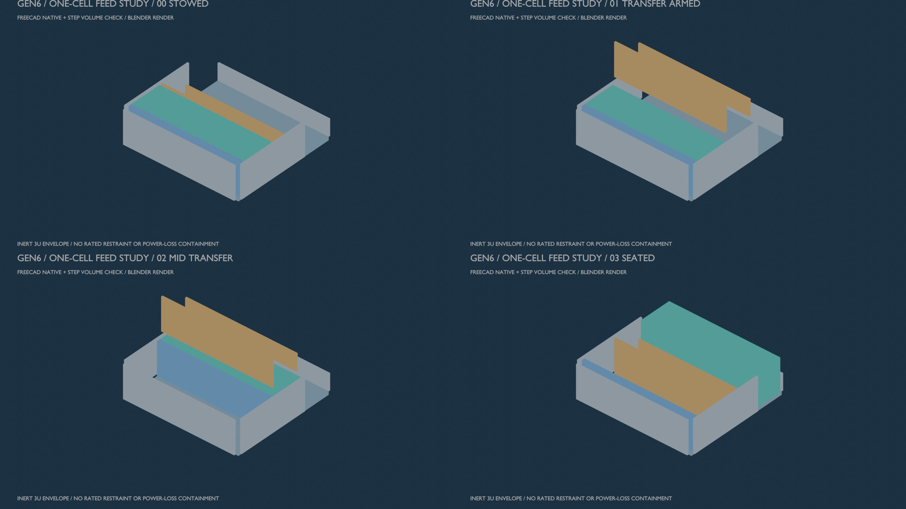

# Gen6 fixed-cassette feeder, one-cell study

**Status:** unselected mechanism study for one inert 3U envelope. This is a separate Gen6 geometry revision. It is not a Gen5 repair, manufacturing release, qualified restraint, or four-satellite magazine.

The original one-cell feeder was checked only against its own solids. The [cross-assembly audit](../GEN6_INTEGRATION_AUDIT_2026_10_12.md) shows that its bridge and transferring payload intersect the separately modeled first-article guide. Unselected [integrated R1](../gen6_integration_r1/README.md) clears sampled nominal STEP intersections but leaves a 10 mm handoff gap. [R2](../gen6_integration_r2/README.md) nominally bridges that gap; contact, extension sequencing and positive mid-transfer restraint remain unverified. The [weighted trade screen](WEIGHTED_TRADE_SCREEN_2026_10_12.md) gives a comparison order, not a selected feed mechanism.

The [cycle and fault record](cycle_and_faults.md) defines the state sequence and the condition that must precede a powered shot. The [concept decision](concept_decision.md) compares fixed-cassette transfer drives using the same criteria. The reference drive is a captive lead-screw pusher; its thread, motor, bearings, latch, sensor, structural rating and space compatibility are **not** modeled.

The [FreeCAD builder](build.py) creates editable Part primitives in four transfer-state documents. It exports STEP and a JSON report containing exact-solid overlap, clearance and export readback checks. All dimensions are in millimetres. The surrogate spacecraft is a 340.5 × 100 × 100 mm box, not a real CubeSat interface.

The [Blender review images](release/) are labeled renders of geometry tessellated from the saved FreeCAD state documents, with per-part mesh hashes and bounds verified before rendering. They are not tool screenshots or test observations.



```bash
PYTHONPATH=/usr/lib/freecad-python3/lib /usr/bin/python3 cad/gen6_feeder/build.py
python3 cad/gen6_feeder/tolerance_screen.py
PYTHONPATH=/usr/lib/freecad-python3/lib /usr/bin/python3 cad/gen6_feeder/export_meshes.py
blender -b --factory-startup -P cad/gen6_feeder/render.py
python3 cad/gen6_feeder/make_storyboard.py
```

## Study boundaries

- The original Gen5 cassette/track conflict remains a failed criterion of the evaluated Gen5 configuration.
- This original study contains one fixed 3U cell. A separate paired/staggered four-cell 1U/3U packaging screen now exists, but no complete working feeder, positive launch restraint, loaded clearance or selected hardware exists.
- The cassette gate lifts clear of the transfer corridor in the model. Its actuator, fail-safe return, debris behavior and launch lock are unknown.
- The cradle side guide retracts during transfer. The reference model has no selected launch restraint or proof of power-loss containment during a partly transferred payload.
- The static solids are envelope and contact proxies. A zero-overlap result is only a nominal geometry screen; it is not a tolerance, load, jam, thermal, shock or reliability result.
- The [interval sensitivity screen](release/Gen6_Feed_Assumed_Tolerance_Screen.json) uses declared hypothetical dimensional perturbations. Its positive clearance numbers are conditional on those assumptions and do not cover thermal growth, launch deflection or real spacecraft tolerance.

The exit criterion for this study is a useful, inspectable geometry and a precise list of what prevents a feed-ready or flight-ready claim. It does not close the feeder design by itself.
