# One-cell feed cycle and fault boundaries

**Basis:** a fixed side cassette holding one passive 3U surrogate. The pusher drive is a study reference, not a selected flight mechanism. Every state below needs a mechanical implementation and verification before it can be called a working feeder.

```mermaid
stateDiagram-v2
  [*] --> Stowed
  Stowed --> TransferArmed: select cell; carrier and brake latched
  TransferArmed --> Transferring: gate clear; guide withdrawn
  Transferring --> Seated: seat and cradle lock proven
  Seated --> Ready: pusher home; gate shut; guide locked
  Ready --> Shot: all inhibits cleared
  Shot --> Reset: carrier captured
  Reset --> Stowed: home and cell state checked
  TransferArmed --> FaultHold: bad position or power loss
  Transferring --> FaultHold: stall or power loss
  Seated --> FaultHold: latch or sensor mismatch
  Ready --> FaultHold: any inhibit returns
  FaultHold --> Stowed: supervised recovery only
```

| State | Required retained condition | Transition guard | Open evidence |
| --- | --- | --- | --- |
| 0. Stowed | Cell restraint engaged; gate shut; carrier home and captured; pusher home | Select this cell while all other cells remain locked | Launch-rated restraint and independent cell isolation unmodeled |
| 1. Transfer armed | Carrier cannot energize; magazine gate open; side guide withdrawn | Gate and guide positions confirmed by independent means | Actuators, stops and sensors unselected |
| 2. Transferring | Captive pusher advances exactly one payload; shot inhibited | Payload reaches seated datum without excessive force | Payload can become only partly supported on loss of power; containment is **not closed** |
| 3. Seated | Cradle restraint engaged; gate barrier still open; pusher retracts | Seat, restraint and pusher-home proven | Cradle restraint and contact force not designed |
| 4. Ready | Gate shut; guide deployed; pusher home; carrier brake ready | Two independent inhibits removed only after all conditions true | No implemented interlock or launch-rated proof |
| 5. Shot | All cassette cells isolated; no feed motion; carrier accelerates | Carrier captured and stopped | Motor, release edge, brake and host reaction are separate open systems |
| 6. Reset | Brake latched; carrier returns home; payload cell remains empty | Home and locked conditions proven | Return drive and jam recovery unmodeled |

**Hard inhibit logic for a future design:** `SHOT_ENABLE = carrier_home_or_launch_ready AND brake_ready AND cradle_locked AND pusher_home AND gate_closed AND guide_locked AND all_unselected_cells_locked AND no_fault_latched`. The statement is a requirement, not software or circuitry that currently exists. A single switch should not be the only proof of payload seated, gate closed or pusher home.

The acceptance condition for every fault transition is **no powered shot and no second cell release**. Retaining a partly transferred payload after power loss is an unmet mechanical acceptance condition, so the current study cannot pass the full feed cycle.

| Fault | Required safe behavior | Current study result |
| --- | --- | --- |
| Power loss while stowed | Every spacecraft remains independently restrained | Requirement only; no rated hardware |
| Power loss or jam during transfer | Pusher and spacecraft remain captured; no shot; recover without creating debris | **Open critical gap:** geometry does not provide positive retention of a partly transferred spacecraft |
| Gate fails open or position switch lies | Shot inhibited by physical barrier/independent sensing | No physical interlock or sensor redundancy |
| Second cell opens | Mechanically block double feed | One-cell model cannot verify this |
| Pusher fails to retract | Shot physically inhibited and carrier path clear | Inhibit requirement stated; actuation unmodeled |
| Cradle seat/lock fails | No shot; spacecraft remains contained | Cradle launch restraint unselected |
| Carrier fails to stop/return | No new feed command; contain carrier energy | Brake and return remain separate open work |

**Reliability claim:** none. A comparison to P-POD operational reliability requires repeated builds, cycling, launch-load and environmental tests with recorded failures and confidence bounds. Nominal CAD and software state logic alone cannot provide such a claim.
