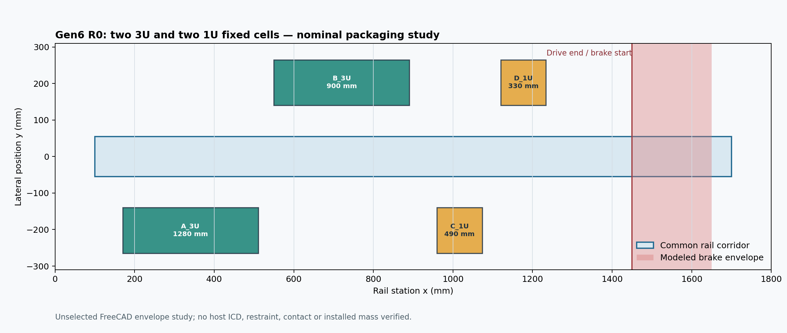

# Gen6 four-cell packaging R0

**Status: unselected, nominal geometry screen.** This controlled Gen6 study retains the evaluated Gen5 failure and the one-cell R1/R2 studies unchanged. It places two 3U and two 1U passive envelopes in fixed side cells around one rail. No provider host envelope, working feed drive, launch restraint, actuator, brake or approved payload interface is defined.

The [builder](build.py) exports 13 native FreeCAD states and matching STEP files: one four-cell stowed state, and armed, mid-transfer and seated states for each cell. All 13 contain 54 or 57 valid leaf solids with zero nominal exact-solid intersection. Each armed cell is sampled at 81 positions along its 200 mm lateral transfer; no sampled solid penetration occurs. STEP readback checks solid count, shape validity and source/export volume; an [independent STEP pair census](release/Four_Cell_R0_STEP_Verification.json) checks every exported solid pair. These checks address only the represented boxes and sampled motion. They do not establish load-bearing contact, continuous clearance, dimensional tolerance, safe sequencing or independent cell isolation. [Results and hashes](release/Four_Cell_R0_Report.json).



| Cell | Payload | Side | Rail start x | Available nominal drive length before modeled brake | Ideal mean acceleration for 6 m/s |
|:--|:--|:--|--:|--:|--:|
| A | 3U | Left | 170 mm | 1,280 mm | 1.43 g |
| B | 3U | Right | 550 mm | 900 mm | 2.04 g |
| C | 1U | Left | 960 mm | 490 mm | 3.75 g |
| D | 1U | Right | 1,120 mm | 330 mm | 5.56 g |

The 6 m/s values are **ideal mean** values from `v²/(2s)`, with no force ripple, starting losses, carrier mass, release edge or speed-control reserve. The last cell already exceeds the provisional 5 g sensitivity case in this idealized calculation. A 5 g cap would imply at least 367 mm for 6 m/s. The existing 1,300 mm first-article stroke therefore cannot be assigned to all four loading stations. A moving carrier dock and several starting stations also require a reworked motor/commutation and shot-control architecture. No speed is demonstrated.

The modeled outermost lateral faces are y = ±280 mm, a 560 mm span **before** mounting, fasteners, harness, thermal isolation or access allowance. This is not a fit claim for any OTV or launch vehicle. The source geometry uses a nominal 100 mm-wide passive payload box for both sizes; actual 1U/3U form-factor limits, rail contact and inserts require a payload interface decision and drawings.

## Paired-side packaging challenger

A second [FreeCAD/STEP variant](release_paired/Four_Cell_R0_Report.json) places the two 3U cells opposite each other at x = 170 mm and the two 1U cells opposite each other at x = 550 mm. It uses the same 1,800 mm rail, 1,450 mm brake boundary and 560 mm lateral study span. Its 13 states, four sampled transfer paths and [independent STEP pair census](release_paired/Four_Cell_R0_STEP_Verification.json) also show zero nominal solid penetration. [Same-boundary comparison](Four_Cell_Layout_Comparison.json).

| Study layout | Longitudinal occupied cell group | Shortest nominal drive travel | Greatest ideal mean acceleration for 6 m/s |
|:--|--:|--:|--:|
| Staggered R0 | x = 170–1,233.5 mm | 330 mm | 5.56 g |
| Paired sides R0 | x = 170–663.5 mm | 900 mm | 2.04 g |

The paired variant removes the **idealized short-drive-distance conflict** of the staggered layout without changing the current rail length. A separate nominal [staggered carrier travel sweep](release/Carrier_Docking_Sweep.json) checks 191 positions across 950 mm; the [paired sweep](release_paired/Carrier_Docking_Sweep.json) checks 77 positions across 380 mm. Both find zero represented-solid penetration while all cells are stowed. These sweeps do not establish motor positioning, docking lock, loaded motion, safe return or tolerance clearance.

No 6 m/s achievable speed is established: real peak acceleration, motor force, structural loads, contact, thermal effects and speed reserve have not been calculated. Nor does a nominal fit prove access to two opposing cassettes, containment of all stored payloads or compatibility with a host. The layouts remain comparative packaging studies, not selected feeder hardware.

The next correction is a same-boundary mechanism trade: a captive lead screw, spring/two-gate follower and pantograph challenger must each demonstrate cell selection, positive isolation, carrier docking, bridge/guide sequence and abort states within the paired boundary. An extended drive or cell-specific lower speed remain alternatives if that boundary fails. Each choice changes mass, time, contact and failure modes and must be compared with spring-plus-host delivery at equal installed resources. CAD-13 is recorded in the [integration issue record](../GEN6_INTEGRATION_AUDIT_2026_10_12.md) and BB-58/61 in the AVM Work Index.

```bash
PYTHONPATH=/usr/lib/freecad-python3/lib /usr/bin/python3 cad/gen6_four_cell_r0/build.py
PYTHONPATH=/usr/lib/freecad-python3/lib /usr/bin/python3 cad/gen6_four_cell_r0/verify_step.py
PYTHONPATH=/usr/lib/freecad-python3/lib /usr/bin/python3 cad/gen6_four_cell_r0/audit_carrier_docking.py
MPLCONFIGDIR=/tmp/volley-mpl python cad/gen6_four_cell_r0/plot_layout.py
PYTHONPATH=/usr/lib/freecad-python3/lib /usr/bin/python3 cad/gen6_four_cell_r0/build_paired.py
PYTHONPATH=/usr/lib/freecad-python3/lib /usr/bin/python3 cad/gen6_four_cell_r0/verify_step.py --release cad/gen6_four_cell_r0/release_paired
PYTHONPATH=/usr/lib/freecad-python3/lib /usr/bin/python3 cad/gen6_four_cell_r0/audit_carrier_docking.py --release cad/gen6_four_cell_r0/release_paired
MPLCONFIGDIR=/tmp/volley-mpl python cad/gen6_four_cell_r0/plot_layout.py --release cad/gen6_four_cell_r0/release_paired
python cad/gen6_four_cell_r0/compare_layouts.py
```
