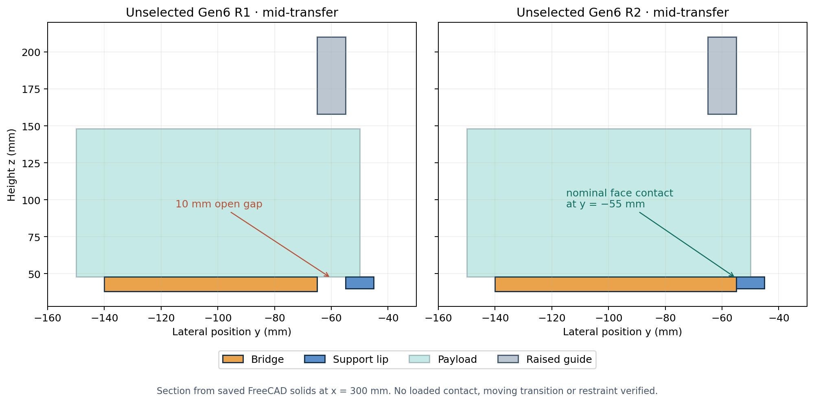

# Gen6 one-cell track/feed integration R2

**Status: unselected nominal geometry study.** R2 retains the evaluated Gen5 model and the earlier Gen6 feeder, first-article and [R1 integration](../gen6_integration_r1/README.md) models unchanged. It addresses the 10 mm unsupported lateral handoff gap in R1; no feeder architecture, sourceable bridge actuator, launch restraint or hardware release is selected.

## Geometry correction

The original separate feeder and first-article models collide when combined: the feeder bridge intersects the launch guide by 34,050 mm³, a mid-transfer 3U proxy intersects it by 74,910 mm³, and a cassette stop enters the carrier pusher by 1,800 mm³. [R1's source audit](../gen6_integration_r1/release/Original_Cross_Assembly_Interference.json) records all pairs, including duplicate study proxies. R1 raised a 340.5 mm guide window and ended its bridge before the guide, leaving 10 mm of unsupported lateral distance.

R2 adds an **extending support-bridge proxy**. During transfer, with the guide window raised, it extends from the cassette to the launch-side support lip at y = −55 mm. It retracts to the outside of the guide corridor before that guide is shown closed. The bridge and lip meet nominally at one face and at the same top height, z = 48 mm. This removes the previously identified *nominal geometric gap*; it does not establish safe spacecraft contact, bridge bending, a captive actuator, sequencing interlock or fault behavior.

The [builder](build.py) saves four editable FreeCAD 1.0 FCStd states and four STEP compounds, each with 27 valid leaf solids. It checks pairwise exact-solid intersections in each state and 81 sampled 2.5 mm transfer stations for the spacecraft and pusher, with guide raised and bridge extended. All nominal intersections are zero. The separate [STEP readback](release/Gen6_Integrated_R2_STEP_Verification.json) checks 27 solids and zero intersecting pairs in each export. [Machine-readable source hashes and results](release/Gen6_Integrated_R2_Report.json) accompany the models.

```bash
PYTHONPATH=/usr/lib/freecad-python3/lib /usr/bin/python3 cad/gen6_integration_r2/build.py
PYTHONPATH=/usr/lib/freecad-python3/lib /usr/bin/python3 cad/gen6_integration_r2/verify_step.py
```



The [section plot source](plot_handoff_section.py) reads the saved native FreeCAD solids at x = 300 mm. The image is a computed section, not a software screenshot or physical test.

## Remaining design gates

There is no swept proof of the bridge-extension and guide-lift *transition sequence*. Both motions need hard stops, containment, sensor agreement and power-off behavior. Payload rail/contact geometry, bridge stiffness and load, jam force, thermal/tolerance growth, launch lock, 1U inserts, three further cells, host mounting, harness and mass/CG/inertia remain open. A contact face without penetration is only a kinematic hypothesis; no payload or provider ICD accepts it. Selection remains governed by the [weighted trade and evidence gates](../gen6_feeder/WEIGHTED_TRADE_SCREEN_2026_10_12.md).
