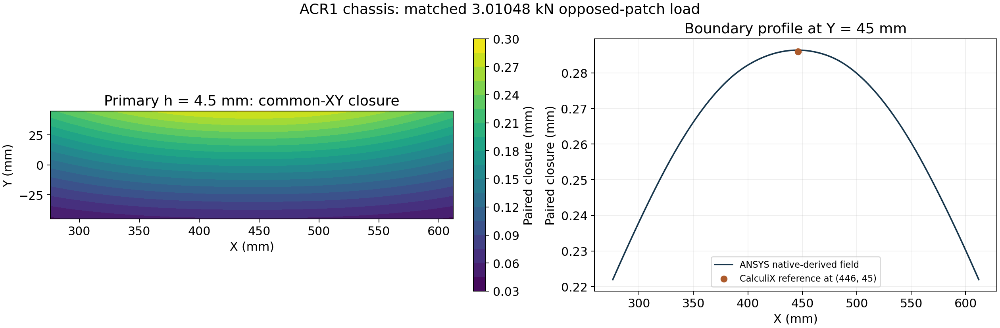

# ACR1 chassis: independent static solver comparison

The ANSYS static model and the established CalculiX reference evaluate the same bare chassis, opposed load patches and six scalar 3-2-1 constraints. The primary ANSYS result gives **0.286392 mm paired closure**, compared with **0.285983 mm** from CalculiX: a **0.143% difference**.



*Scientific postprocessing of native-result-derived numerical data; the profile is at the patch boundary Y = 45 mm. This is a numerical plot, not a Mechanical GUI screenshot.*

## Common model

- Reference chassis BREP: one valid solid, matching the accepted chassis volume and bounds, with zero two-way Boolean volume difference.
- Material allocation: E = 70 GPa, Poisson ratio 0.33, density 2,700 kg/m³.
- Each patch: X = 276–612 mm, Y = −45–45 mm, Z = ±14 mm; area 30,240 mm².
- Opposed resultant loads: **±3,010.480631 N**, centred at (444, 0, ±14) mm. Native nodal forces, resultants and moments were independently reconstructed.
- Numerical restraint: UX/UY/UZ at (200, −100, 0); UY/UZ at (688, −100, 0); UZ at (200, −80, 0), in millimetres.

## Mesh sensitivity

| Nominal mesh size | Nodes | Elements | Peak paired closure | Difference from CalculiX |
|---:|---:|---:|---:|---:|
| 5.5 mm | 59,677 | 31,470 | 0.285241 mm | −0.260% |
| 4.5 mm, primary | 81,355 | 43,563 | **0.286392 mm** | **+0.143%** |
| 4.0 mm | 98,542 | 53,210 | 0.287589 mm | +0.562% |

Successive closure changes are 0.404% and 0.418%. The three-mesh span is 0.821% of the CalculiX reference. These values describe mesh sensitivity; they do not establish a formal convergence order or certified error bound.

All **11,448 primary closure samples** were independently evaluated from the native RST and match the delivered numerical table within 5 × 10⁻¹¹ mm. Primary force and moment residuals are approximately 1.78 × 10⁻⁶ N and 0.00125 N·mm. Secondary peaks were checked against their sample tables and native input/solve evidence.

## Effect on the existing conditional clearance budget

The selected upstream budget retains its stated CalculiX basis. Applying the same centred allocation and tolerance formula to the finest ANSYS paired closure changes the conditional margin from **0.264111 mm to 0.263067 mm**, a reduction of **1.044 µm**. The primary ANSYS substitution gives 0.263845 mm. These are sensitivity calculations under the existing assumptions, not measured installed clearance.

## Inspect and reproduce

[Selected input/output package](../validation/acr1_ansys_crosscheck/README.md) · [Scientific summary](../validation/acr1_ansys_crosscheck/ACR1_STATIC_CROSSCHECK.json) · [Original selected-file identities and transformations](../validation/acr1_ansys_crosscheck/PUBLIC_MANIFEST.json) · [Clearance sensitivity](../validation/acr1_ansys_crosscheck/CLEARANCE_SENSITIVITY.json)

```bash
python3 validation/acr1_ansys_crosscheck/check_capture.py
python3 validation/acr1_ansys_crosscheck/plot_crosscheck.py --output /tmp/volley-static-figures
```

The public supplement contains sanitized native input decks and logs, compatible geometry, mesh/load exports and numerical sample fields. The original native RST is hash-pinned and retained privately because its header contains workstation/user metadata. No modified binary is presented as the original native result. A licensed compatible MAPDL installation is needed for a new solve.

This comparison supports the specified linear-elastic bare-chassis model. Contact, assembled mounts and physical correlation have separate acceptance criteria. Ordered modal frequencies do not establish mode-shape identity or MAC correlation.
