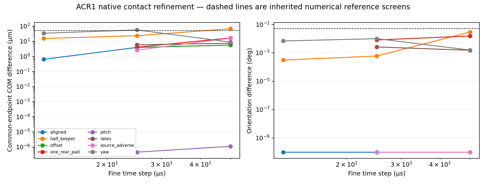
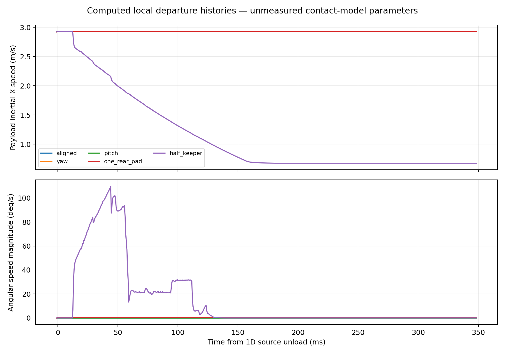
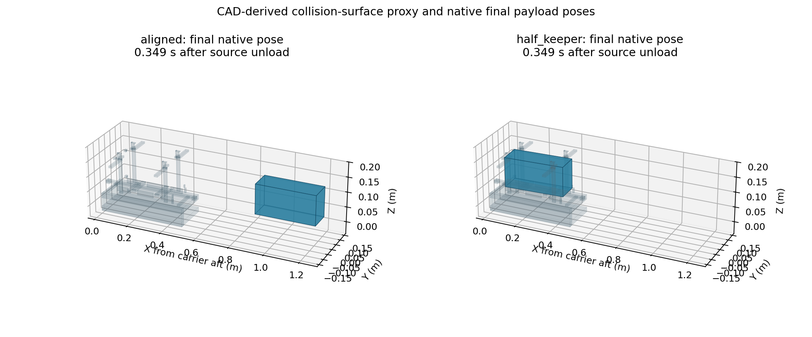

# ACR1 release and arrest dynamics

**25 October 2026 — bounded computational supplement.** Forty-two native MuJoCo 3.3.7 runs evaluate local departure/contact sensitivity for the unchanged VOLLEY-G5-ACR1 reference. The aligned case is consistent with the accepted one-dimensional release state, and the computed payload clears the represented carrier surfaces. A partial keeper-opening fault catches it. The study resolves local nominal egress and tests contact sensitivities; a physical release-accuracy specification additionally requires measured contact properties, the complete loading history, host attitude and source/contact feedback.

[Source, logs and raw traces](../validation/acr1_release_dynamics/README.md) · [machine-readable summary](../validation/acr1_release_dynamics/SUMMARY.json) · [protocol](../validation/acr1_release_dynamics/PROTOCOL.md) · [discriminating physical tests](../validation/acr1_release_dynamics/PHYSICAL_TEST_SPECIFICATION.md)

## Model tied to the current reference

The native dynamics model uses a six-degree-of-freedom, 4 kg uniform-box payload with dimensions 340.5 × 100 × 100 mm. Its principal inertias are 0.00666667, 0.04198008 and 0.04198008 kg·m², matching the surrogate used by the accepted energy calculation. The carrier and finite host have the source masses, 13.127805767 and 687.428913933 kg, and translate along X. Their transverse motion and rotations are ideal constraints. This is a payload departure model, not a complete six-DOF host or flexible spacecraft model.

Sixty-six rectangular collision surfaces are derived from the controlling CAD builder's actual box arguments: rear pads/supports, seats, pallet members and end grips, closed caps, guides/pillars and open forekeeper tabs. The pallet end upper faces, 0.5 mm below the nominal payload, are retained to expose possible recontact. The [geometry map](../validation/acr1_release_dynamics/GEOMETRY_AND_INPUTS.json) states omissions and input hashes. This is a documented surface subset; it is not complete CAD tessellation or a manufactured clearance guarantee.

The unchanged averaged source function is instrumented only to record every 5 µs force step. Nominal and adverse 3 m/s, 20 µH histories retain source hash `560088cb2a05…`. The native model applies that net force to the carrier/host relative joint, retaining equal and opposite X reaction. It does not recompute the electrical/controller response when contact changes the motion.

Each run starts 1 ms before the one-dimensional rear-unload event, after the nominal cam opening is complete, and runs for a common 0.35 s through arrest and subsequent coast. Source unload times are approximately 0.866965 s nominal and 0.910340 s adverse. Powered return, earlier launch/loading, pre-existing elastic deformation and fixed-host collision corridor are not resolved. Perturbed initial poses are placed without accidental penetration; the required small gap adjustments are recorded. Some tilted cases consequently miss the short remaining rear-load interval. They are initial-state sensitivities, not whole-cycle tip-off predictions.

## Numerical result and refinement

| Check | Result | Interpretation |
|---|---:|---|
| Completed native runs | 42 of 42; no native warnings | Includes a no-contact control, nine primary case families, refinement and sensitivity variants. |
| Aligned inertial release speed, 25 µs | 2.926912832 m/s | About −6.32 µm/s from the corresponding 5 µs source result, 2.926919151 m/s. Numerical agreement is not measured accuracy. |
| Aligned common-endpoint change, 25 → 12.5 µs | 0.000637 mm; 0° | Small local model refinement difference. |
| 0.1° yaw case, 25 → 12.5 µs | 0.034034 mm; 0.006877° | Its 50 → 25 µs COM difference was 0.056430 mm; the finer witness is retained. |
| Half-open keeper, 25 → 12.5 µs | 0.015210 mm; 0.000311° | Refines the tested Newton contact model, not the physical fault. |
| Largest total X momentum residual | 2.49 × 10⁻¹³ N·s | Closed X momentum balance under the declared guide constraints. |
| Largest payload linear/angular contact-impulse residual | 3.02 × 10⁻¹⁴ N·s / 3.50 × 10⁻⁸ N·m·s | Internal numerical balance, without physical force validation. |
| Contact-force/generalized-force discrepancy | 4.70 × 10⁻¹³ N | Checks contact-frame/sign bookkeeping. |

The no-contact control follows analytic straight-line translation with about 1.24 × 10⁻¹² m final position residual at 25 µs. Its rotational angular momentum is separately checked. Energy change is compared with applied motor work. Contact damping/friction and regularization can store or dissipate energy, so their difference is not automatically numerical error. The aligned difference is about −0.60 µJ; the half-keeper case dissipates much more within its assumed contact model.

All primary cases use 100, 50 and 25 µs steps; aligned, yaw and half-keeper cases also use 12.5 µs. The earlier 0.05 mm/0.05° FCE pose screens are shown as numerical reference lines, not spacecraft acceptance limits. Newton 100 → 200 iterations leaves the checked aligned and half-keeper endpoints unchanged. An exact-union partition of contact boxes changes their manifolds: the half-keeper endpoint changes 0.044512 mm and 0.040227°.

The CG algorithm check is a remaining warning against a universal fault rating. Its half-keeper run reaches the 200-iteration budget once and differs from Newton by 0.048947 mm and 0.059283°, with a different final angular rate. Its fault attitude/rate is therefore not accepted as solver-independent. This is stated alongside the favorable Newton refinement result.

## Contact, tip-off and recontact

The aligned 25 µs case has no positive modeled contact impulse after the source unload event. At the common endpoint its payload aft lies about 0.887 m ahead of the carrier aft, beyond the represented 0.5145 m maximum carrier/pallet extent. This establishes egress for that initial state, surface set and time window. It does not establish every off-axis departure or later powered-return clearance.

The single-rear-pad active-set case has a small later contact impulse, about 1.46 × 10⁻⁴ N·s, involving a lower surface. Thus even this local sensitivity set does not support a blanket no-recontact statement. Off-axis initial pose/rate cases remain explicit deterministic scenarios, without probability or manufactured-tolerance claims.

Moving one forekeeper only 6 mm instead of the nominal 12 mm produces a clear catch: the 25 µs payload speed ends near 0.674484 m/s, with about 13.04 N·s total absolute post-source-unload contact impulse across keeper, floor, cap and other surfaces. It remains near the carrier rather than departing at the nominal state. Friction and solver variants change the final fault attitude/rate. The useful conclusion is the need to verify full opening and inhibit a release when it is absent, not a precise fault tip-off rating.

Contact acceleration stiffness, damping and friction are unmeasured sensitivity inputs. The direct stiffness sweep spans 10⁵–10⁷ s⁻²; zero, underdamped and critical reference damping and friction 0/0.1/0.3 are identified. These quantities are not the accepted axial rail stiffness in N/m or measured vacuum tribology. Aligned final speed shifts over the tested contact regularizations are tens of µm/s, while fault angular rates are more sensitive. Native contact peaks remain unrated.

This pose capture is plotted from native final states and the corresponding XML collision surfaces. It is a collision-model illustration, not a full CAD or hardware image.

## Relationship to accepted evidence and completion

The earlier [Chrono diagnosis](../validation/feeder_contact_diagnosis/REPORT.md) concerns FM06-R1 and failed pose convergence across solver/representation variants. It is preserved and supplies no ACR1 validation. The present MuJoCo result is a separate native study using the current carrier/pallet geometry.

The accepted ACR1 elastic-energy values remain analytical bounds for the declared rail/pad surrogate. They are not replaced by these dynamics runs and do not become measured tip-off distributions. Conversely, numerical symmetry producing nearly zero aligned angular motion is not proof of real zero tip-off.

This supplement completes a reproducible local release/arrest, egress and initial-state/contact sensitivity study, including adverse behavior and a discriminating test specification. A subsequent physical release-accuracy and repeatability assessment requires measured contact/preload/interface data, a validated full loading-to-return history, source/contact feedback, actual payload/host inertia and control authority, whole-corridor clearance and repeated physical release measurements. No core ACR1 or ED1 file was changed.
