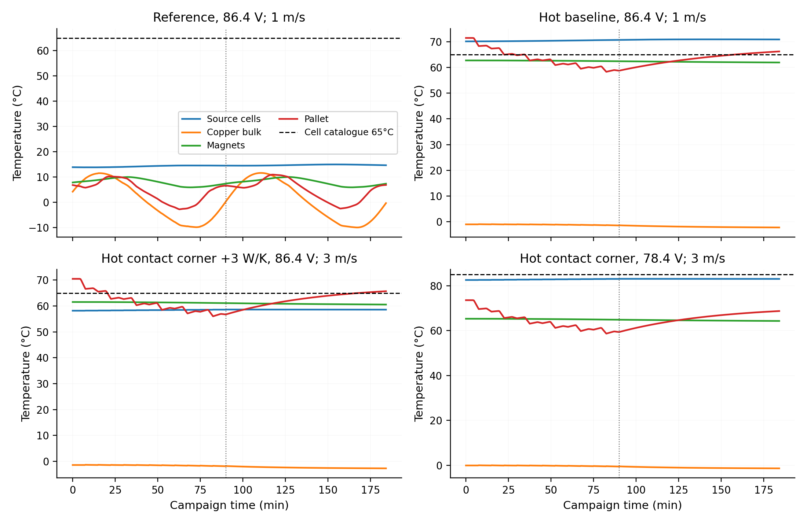
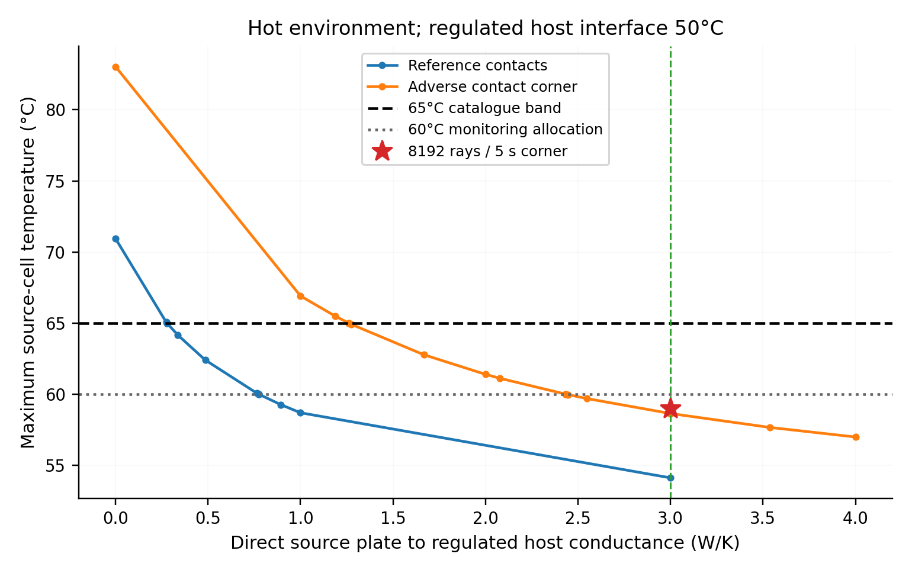
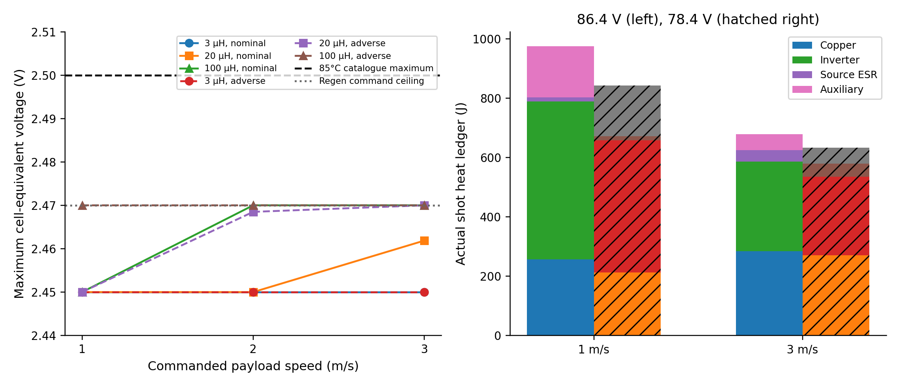
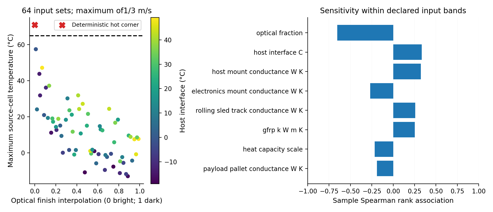

# ACR1 thermal environment and material sensitivity

**Study:** ACR1-THERM-ENV-01, with separately identified ACR1-THERM-CORRECTIONS-01 and ACR1-SOURCE-DERATED-78P4-01. **Configuration:** frozen Gen5 ACR1, twelve passive 4 kg 3U payloads, generic 500 kg host in a 500 km orbit, twelve releases 450 s apart. This supplement does not revise the frozen source, CAD, ED1 or accepted electrical captures.

## Computational operating envelope

The thermal model establishes a concrete interface requirement: **at least 3 W/K from the source/electronics plate to a regulated host interface held at or below 50°C**, including the pads and end joints. In the refined adverse contact case, hottest-cell temperatures are **59.00°C at 86.4 V** and **59.06°C at 78.4 V**. Both satisfy the selected 60°C monitoring allocation. That allocation reserves 1 K for sensor under-read, 2 K for hottest-cell gradient and 2 K for remaining operating/model margin below the 65°C catalogue limit. The conductance, host regulation and monitoring allowances are physical acceptance requirements, rather than measured properties.

The separately identified **78.4 V source variant passes all eighteen supported production shot cases**, with 2.45 V initial, 2.47 V regenerative command and 2.50 V absolute catalogue maximum per series group. The combined heat-path and voltage variant satisfies the studied electrical and thermal checks.

| Configuration in the refined hot case | Hottest source cell | Interpretation |
|:--|--:|:--|
| 86.4 V, original indirect heat path | 71.78°C | Outside the standard 65°C catalogue band; establishes the need for a designed host heat path |
| 78.4 V, no additional direct path | 84.42°C | Within the derated 85°C catalogue point, outside the selected 80°C monitoring allocation |
| 86.4 V with specified 3 W/K path | 59.00°C | Within the selected 60°C monitoring allocation |
| 78.4 V with specified 3 W/K path | 59.06°C | Within the selected 60°C monitoring allocation |

This completes the declared computational heat-path, repeated-duty and representative-property sensitivity study. A physical implementation must substantiate the actual source placement, materials, vacuum joints, contamination controls and monitoring response. The accepted ACR1 core and ED1 document bytes remain unchanged; neither asserted hot-environment qualification.

## Model and retained inputs

The self-contained [study package](../validation/acr1_thermal_environment/README.md) pins exact accepted shot, finite-motor, arrest, CAD/BOM, feeder, lift, copper conduction and mission inputs in [INPUT_SOURCE_MANIFEST.json](../validation/acr1_thermal_environment/INPUT_SOURCE_MANIFEST.json). The frozen STEP hash is `77c949d42eeda86a9470405dded81ae05ff57074a20ea303383140dd08936922`.

There are 24 thermal nodes: mounting ladder, copper, GFRP, sled, magnets, captive pallet, source cells, electronics, twelve individual payloads, track frame, two banks and lift frame. The 387 actual CAD solids supply 204.55672 kg loaded mass, material heat capacities, contact dimensions and radiation surfaces. The unlocated 7 kg source/control allowance has no invented external area. The source cells account for 1.28 kg of that allowance; the remaining 5.72 kg is represented separately.

For each node the solver integrates

\[
 C_i\dot T_i=\sum_jG_{ij}(T_j-T_i)+Q_{i,\mathrm{solar}}+Q_{i,\mathrm{IR}}+Q_{i,\mathrm{electrical/mechanical}}.
\]

Vacuum cooling uses conduction and diffuse grey radiation, including internal reflections, finite Earth-disc IR/albedo, deep space, self-shadowing and uncertain host view. Native BRep tests exclude contact faces; cosine-weighted CAD rays determine exchange areas. Reciprocity is imposed by symmetric balancing. Thirteen actual radiation stages remove each released payload. No air convection is credited.

Actual copper-to-GFRP dimensions, narrow GFRP support wings, fourteen track supports, bank/lift columns, pallet feet and magnet seats define the conduction topology. Unknown preload, rolling contact and electrical mounting conductances remain declared parameters. During the 40 s feed, payload thermal custody ramps from its bank to the pallet; it is fully on the pallet for the final 152 s. Departed payload enthalpy remains in the energy accounting, but no postdeparture temperature rating is predicted.

The initial condition is a numerically periodic passive-storage orbit, verified to within 0.02 K per orbit. It is not an asserted launch temperature or an approved waiting period. The campaign lasts 90 min and is followed for one additional orbit. Home-state radiation with sequential removal represents storage geometry; changing shadows during actual lift/feed/launch motion remain unresolved.

### Environment and property basis

| Case | Solar W/m² | Albedo | Earth IR W/m² | Beta | Allocated host interface | Finish interpolation |
|---|---:|---:|---:|---:|---:|---:|
| Cold | 1322 | 0.26 | 193 | 0° | −20°C | Dark endpoint |
| Reference | 1367 | 0.23 | 234 | 45° | 20°C | Midpoint |
| Hot | 1414 | 0.26 | 259 | 90° | 50°C | Bright endpoint |

Solar bands come from NASA Ames ARC-STD-8070.1 (2018). Albedo/IR pairs use NASA/TM-2001-211221 high-inclination 90 min guidance; the hot case adds the stated 15 W/m² daylight-SSO allowance to 244 W/m². Earth emission uses a 30 km atmosphere shell, while occultation uses the physical Earth radius. These are investigation inputs, not mission probabilities, a provider ICD or a claim of NASA compliance. The generic SSO has no selected LTAN, attitude or beta history. Reference beta 45° is interpolated between sampled 30°/60° geometry.

NASA-RP-1121 measured surface examples supply bright/dark optical endpoints: buffed aluminium α/ε = 0.16/0.03, buffed copper 0.30/0.03, black anodize 0.88/0.88 and black copper 0.98/0.63. GFRP, payload and magnet optical properties are explicit assumptions. No actual finish is selected. NIST G10-CR at 300 K supplies representative GFRP conductivity 0.60798 W/(m K) and heat capacity 998.74 J/(kg K); hot extrapolation and the actual GFRP grade remain uncertain. Arnold N48M supplies representative NdFeB heat capacity/conductivity and a reversible Br coefficient; N48M is not selected for ACR1.

[PRIMARY_SOURCE_REGISTER.json](../validation/acr1_thermal_environment/PRIMARY_SOURCE_REGISTER.json) records URLs, versions, hashes and access outcomes. [PRIMARY_FACTS.json](../validation/acr1_thermal_environment/PRIMARY_FACTS.json) retains short numeric facts. The NIST direct download returned HTTP 403; its primary page was independently read, and the structured transcription is clearly identified without an invented upstream byte hash. Manufacturer PDFs are referenced by hash rather than redistributed.

### Explicit representative property allocations

The geometry builder retains the following heat capacities in J/(kg K): aluminium 900, copper 385, generic insulator/GFRP 1000, steel 470, polymer 1200, generic catalogue hardware/electronics 800, passive payload 900, NdFeB 460 and source cells 1000. Except the cited room-temperature G10/NdFeB references, these are declared engineering approximations, not selected-grade certificates. The sensitivity sweep scales the resulting capacities by 0.8–1.2. Aluminium conductivity 167 W/(m K) is also an allocation. The small local gap screen uses CTE allocations aluminium 23, magnet 7, copper 17 and GFRP 50 µm/(m K); it is not a complete thermal-structural model.

### Repeated duty and losses

The actual accepted adverse 3 µH shot ledgers at 1 and 3 m/s are used separately. The 2 m/s heat ledger is componentwise below the endpoint envelope; no simultaneous sum of maxima from different shots is invented. This is a bounded endpoint thermal study, not an assertion that two temperature histories prove every intermediate operating condition.

Copper loss heats the copper node; source ESR heats the cells; inverter and auxiliary losses heat electronics; friction splits between sled and track. The actual mesh-local copper excess over bulk is added as a decaying local screen, using the accepted 90 mm diffusion time. That mesh corner is not a converged physical hotspot. The separately recomputed 78.4 V current-ripple integral scales this screen.

Feeder/lift electrical peak power is held over its actual duty windows as a conservative heat allocation. The charger has an explicitly assumed 80% efficiency. The frozen 1.1664 W balancing load is retained conservatively in both voltage configurations (the 78.4 V resistor value would be 0.9604 W). Unallocated controller standby and payload internal dissipation are zero because actual values are unavailable; this is not a completed installed power budget. The result files provide a linear additional-electronics-heat sensitivity to allocate measured loads.

## Baseline thermal and material results

The table gives main-resolution maxima for each endpoint campaign. Payload entries are temperatures at release, not universal payload acceptance limits.

| Environment / speed | Source cells max °C | Copper local FE screen °C | Magnets max °C | Pallet min…max °C | Payload releases min…max °C | Source 65°C screen |
|---|---:|---:|---:|---:|---:|---|
| Cold / 1 m/s | −9.98 | 12.46 | 7.32 | −12.95…22.24 | −28.60…−17.52 | Pass |
| Cold / 3 m/s | −10.19 | 12.68 | 7.32 | −12.95…22.24 | −28.60…−17.52 | Pass |
| Reference / 1 m/s | 14.92 | 13.68 | 9.95 | −2.85…10.90 | −14.70…9.32 | Pass |
| Reference / 3 m/s | 14.71 | 13.89 | 9.96 | −2.85…10.90 | −14.70…9.32 | Pass |
| Hot / 1 m/s | 70.94 | 1.27 | 62.75 | 58.33…71.49 | −46.91…37.37 | **Fail** |
| Hot / 3 m/s | 70.74 | 1.48 | 62.75 | 58.33…71.49 | −46.91…37.37 | **Fail** |

The hot case need not be hottest for every surface: the narrow exposed copper/GFRP geometry has a different view and shadow history from the sunlit frame and unlocated source. Individual surfaces are not assigned the frame temperature.

The copper screens remain below the accepted 100°C adverse-resistance regime. The representative magnet coefficient applies over 20–100°C and cannot be used to accept the colder cases or prove irreversible-demagnetization margin. Actual magnet grade, BH(T), adhesive and coating are missing. A local material-expansion screen predicts gap-thickness changes from about −5.4 to +14.7 µm in the deterministic cases; it omits frame warpage, through-thickness gradients and tolerances, so it does not replace the mechanical air-gap check. Its CTE values are explicit representative allocations.

The IRFP4668 catalogue absolute junction maximum is 175°C and maximum RθJC is 0.29 K/W. A conservative package-energy/peak-power screen is retained, not a time-resolved junction prediction or device mounting acceptance. The quoted typical 0.24 K/W greased case-to-sink value is not credited as a measured ACR1 contact; its sampled metadata parameter does not alter the lumped network. Actual devices, thermal contacts and transient junction response require circuit testing.

## Resolving the source hot case

At a 50°C regulated host interface, root solving gives the following **main-resolution model boundaries**, taking the maximum of the two endpoint campaigns:

| Contact context | Baseline max °C | Minimum added direct G for 65°C | Minimum added direct G for 60°C | Maximum host temperature without added path for 65°C |
|---|---:|---:|---:|---|
| Reference contacts | 70.94 | 0.27795 W/K | 0.77382 W/K | 38.51°C |
| Adverse contact corner | 83.04 | 1.26061 W/K | 2.43360 W/K | No solution in the investigated −20…65°C band |

The corner changes host mounting to 0.1 W/K, electronics-to-frame to 5 W/K, cells-to-electronics to 0.02 W/K and thermal capacity to 80% of reference. It exposes a warm frame feeding a poorly cooled source; no infinitely cold host is assumed. A direct path goes to the regulated host, rather than merely to that warm ladder.

The original 1 W/K diagnostic fails 65°C in this corner. An initial 2.5 W/K allocation passes 65°C but reaches 60.29°C in combined ray/time refinement, missing the selected 5 K monitoring allowance. Both diagnostics and their original scripts/results are retained. One corrective allocation increment gives the final **3 W/K** candidate.

| Final 3 W/K path | 86.4 V | 78.4 V |
|---|---:|---:|
| Reference contacts, max of endpoints, main resolution | 54.11°C | 54.14°C |
| Adverse contact corner, max of endpoints, main resolution | 58.64°C | 58.70°C |
| Adverse corner / 3 m/s, 8192 rays and 5 s | **59.00°C** | **59.06°C** |

The refined 86.4 V corner leaves 1.00 K below the 60°C trip allocation. That additional kelvin is not a confidence interval. At the main resolution the host ceiling for 65°C with the final path is 61.95°C for reference contacts and 58.00°C for the corner; the operating allocation stays at **50°C or colder** to preserve margin. The modeled direct path exports up to 26.1 W in the sampled histories, in addition to the ordinary mounting path. The host must actually accept the resulting heat while holding its specified temperature.

### Practical path allocation to measure

A short copper foil stack or compliant laminated link, two end blocks and two interface pads give this reviewable allocation:

| Element | Provisional allocation |
|---|---|
| Copper | k ≥350 W/(m K), free length 44.05 mm, section 1510 mm²; indicative width 100 mm / total foil thickness 15.10 mm |
| Each end joint | Measured conductance ≥12 W/K, including actual contact/clamp behavior |
| Each pad | 100 ×40 mm area, 0.25 mm thickness, allocated k ≥3 W/(m K), calculated bulk G 48 W/K |
| Series path | 12 W/K copper + two 12 W/K joints + two 48 W/K pads → 3.4286 W/K calculated; **installed acceptance ≥3 W/K** |
| Mass | Copper 0.59616 kg; end blocks 0.108 kg; pads 0.006 kg; fasteners 0.05 kg → **0.76016 kg** |
| Existing allowance | Fits the unlocated 0.9 kg thermal-plate budget arithmetically; 0.13984 kg remains |

This is a dimensional and mass allocation, **not an installed CAD design, selected supplier capability or vacuum-qualified interface**. A free length above about 48.95 mm exhausts the mass allocation at the chosen bulk conductance. Actual placement must therefore put the source plate close enough to the host interface, avoid the travel envelope and verify compliance, preload, pad compression, outgassing and contact conductance. The series estimate counts pad bulk and joint contact separately. NASA's illustrative bolt and pad examples support a useful investigation scale, not the stated joint acceptance values.

## Separate 78.4 V source candidate

The exact Eaton TV catalogue source confirms the extended 85°C point at 2.5 V/cell. The candidate starts at **78.4 V = 2.45 V per series group**, commands regeneration no higher than **79.04 V = 2.47 V/group**, and retains **80 V = 2.5 V/group** as the absolute hot catalogue ceiling. There is no 80 V initial condition promoted as a margin-bearing design.

The unchanged production Python file is copied byte for byte. An audited AST adapter replaces only two initial-voltage literals and one regeneration-limit literal with named inputs. Restoring those three literals reproduces the complete original AST. No force, current, stroke, timing or energy equation/gate is relaxed. The eighteen cases are 1/2/3 m/s × nominal/adverse × 3/20/100 µH; all pass the original gates plus strict 2.47/2.5 V checks.

| Production result | Value |
|---|---:|
| Maximum cell-equivalent terminal/internal voltage | 2.469999972 V |
| Maximum mean phase current | 411.9245 A, original limit 600 A |
| Maximum per-device current including sharing/ripple | 57.9471 A, original limit unchanged |
| Maximum stopping coordinate | 1.507336 m, original stroke gate unchanged |
| Maximum absolute production energy residual | 0.01094 J |
| Initial-to-80 V energy headroom | 792.0 J nominal; 498.96 J adverse capacitance |
| Adverse initial-to-79.04 V control headroom | 198.3744 J |
| Conservative 600 A / 100 µH three-phase magnetic energy | 27.0 J |
| Retained sled 3 m/s kinetic arrest energy | 59.0751 J |

The energy comparison is a scalar bound, not proof of instantaneous voltage protection. The actual production trajectories enforce the regenerative ceiling; physical lead inductance, controller latency, switch overshoot and cell imbalance still require verification. The remaining 30 mV/group between the regenerative command and catalogue ceiling is allocated as 10 mV imbalance, 5 mV sensing error, 5 mV control overshoot/latency and 10 mV unresolved fast interconnect transient. These are maximum allocations to demonstrate on all 32 groups, not measured performance and not permission to rely on bank-average voltage.

The derated thermal calculations use their own recomputed source ESR, inverter, copper, auxiliary and charger losses. At the refined hot corner without the new path, the cells reach 84.42°C, passing the catalogue point but failing the selected 80°C trip allocation. With the final path they reach 59.06°C. Charge/regeneration inhibit must use the selected configuration, individual group voltage and the hottest-cell temperature with verified error/gradient allowances. Original 86.4 V captures remain unchanged.

## Sensitivity and numerical checks

A seeded 64-point Latin hypercube samples declared conductance, heat capacity, host temperature/view and optical bands; both endpoint campaigns give 128 actual runs. The maximum sampled source temperature is 57.49°C. All sampled points pass 65°C, while the separate deterministic hot corner fails. **This sampling result is not an envelope, reliability probability or qualification statement.** Sample rank associations identify the strongest effects within these particular bands.

| Verification | Result |
|---|---:|
| 10 s →5 s integration refinement, six baseline campaigns | Maximum node-peak change 0.02632 K |
| 4096 →8192 radiation samples, cold/reference/hot selected campaigns | Maximum node-peak change 2.41205 K |
| Refined unmodified hot source shift | +0.83429 K |
| Refined corrected adverse corner, 86.4 V / 78.4 V | 59.00016 / 59.06084°C |
| Maximum global energy residual over baseline, sensitivity and refined runs | 3.14×10⁻⁷ J |
| Independent incoming-minus-escaping radiosity balance residual | 6.55×10⁻¹⁰ W |
| Worst verified periodic-storage orbit change | 0.01861 K, at most six orbits |
| Isolated portable replay | All 18 production outputs bit-identical; refined corrected thermal peak difference 0 K |

The ray discrepancy is retained as a numerical limitation; this is not a converged physical temperature guarantee. The selected path clears its 60°C numerical monitoring gate at both tested resolutions. Internal energy/radiosity checks verify bookkeeping independently of time-step agreement, but do not validate the material/contact assumptions.

## Physical and interface gates

A subsequent flight implementation requires:

1. Named aluminium/GFRP/magnet/adhesive/coating/TIM materials, temperature-dependent properties, BH(T), creep, electrical insulation and applicable contamination/outgassing limits. No universal magnet, payload or cleanliness limit is invented here.
2. Located source, inverter, charger, harness and controller CAD; routed short thermal path; actual mounting, stiffness, preload and collision checks; measured installed G ≥3 W/K and regulated host ≤50°C under all allocated heat loads.
3. Actual standby/payload dissipation and host heat rejection capacity. The remaining linear heat headroom must be allocated to measured loads; zero unallocated standby is not acceptance of an unknown controller.
4. Vacuum repeated-duty thermal correlation, hottest-cell gradients, representative cell C/ESR versus temperature/age, source group imbalance, sensor error, balancing, charge/regeneration inhibit and fault handling. Verify the 5 K temperature budget and 30 mV/group voltage budget independently.
5. Contact conductance through copper/GFRP, magnet seats, pallet, rolling bearings and payload interfaces; motion-dependent shadows, local gradients, thermal warpage, vacuum wear, lubricants and payload contamination/release cleanliness.
6. Actual inverter transient junction measurement/model correlation and source/actuator operation at the accepted environmental corners. Catalogue absolute ratings and this lumped screen do not replace circuit or environmental acceptance.

The [criterion recommendation](../validation/acr1_thermal_environment/CRITERION_RECOMMENDATIONS.json), [numerical receipt](../validation/acr1_thermal_environment/NUMERICAL_VERIFICATION.json), [portable replay receipt](../validation/acr1_thermal_environment/PORTABLE_REPLAY.json), [figure inventory](../validation/acr1_thermal_environment/FIGURE_SOURCE_INVENTORY.json) and final source manifest provide the exact evidence boundaries.
