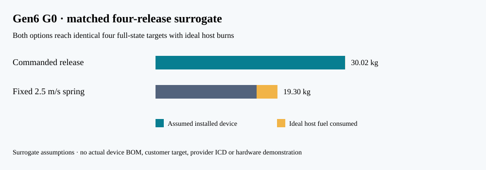

# Gen6 G0 mission and first-article requirements, revision 2

**Status:** user-selected service case with surrogate engineering inputs, 12 October 2026. **Gate G0 remains open.** This document directs the next calculations and first laboratory article. It is not a customer specification, selected architecture, provider interface, hardware performance claim, or authorization to build or launch. [P130](../validation/P130_gen6_matched_campaign.md) is the current matched four-release construction; [P129](../validation/P129_gen6_mixed_mission.md) preserves the earlier unoptimized policies. [Public reference audit](GEN6_GO1_PUBLIC_REFERENCE_AUDIT.md). [P128](../validation/P128_gen6_g0_reference.md) remains a different four-identical-3U one-event screen.

## Intended service and reference case

The service hypothesis is **commanded, measured delivery of each CubeSat to an agreed state at an agreed epoch** from a shared host. The customer value to test is delivered-state accuracy, schedule flexibility, and reduced payload-side maneuvering or integration burden. Release speed alone is not the saleable result. Gen5 remains the evaluated academic design with negative mass and fit findings; it is not silently modified by this Gen6 study.

The selected service case is **two 1U and two 3U ordinary passive CubeSats**, released by a rideshare or orbital-transfer host within one orbit. Delivery means distinct **position and velocity targets at one common epoch, 24 hours after the fourth release**, with different orbit energy and along-track position in one plane. A host maneuver is allowed and counted for every alternative. The provisional starting state is a circular **500 km sun-synchronous orbit**. The likely buyer and interface decision-maker is the host operator, but none is named or committed. No build is funded; the first article is to be designed and sourced before any physical programme decision.

P129 assigns surrogate payload masses of **1.33/4/1.33/4 kg**, host dry mass 300 kg, 10 kg starting fuel, 220 s host specific impulse and releases at 0/20/40/60 minutes. Its **3/5/7/9 m/s inertial impulse-derived target states** are constructed challenges, not customer requested delivery slots or rated VOLLEY speeds. The first instrumented laboratory article remains a **single restrained 4 kg dummy on a reusable carrier** with a proposed 3–6 m/s measurement range. It would not demonstrate the full four-release mission or the 9 m/s surrogate endpoint. A later multi-size feed is a separate G1–G3 decision.

P130 applies the same target states and ideal host-burn schedule to a commanded release and a fixed 2.5 m/s spring class. Both hit all four full-state targets mathematically. Under **assumed** device masses of 30 and 16 kg, commanded release saves 3.2823 kg of modeled host fuel but carries 14 kg more device mass. This is a negative installed-resource indication, pending an actual BOM, finite-burn and customer case. A +0.1 m/s release-speed perturbation causes roughly 25–27 km of common-epoch position change in this one-day coast; a perfect nominal solution gives no practical accuracy bound.

| ID | Proposed requirement or decision criterion | Verification and present status |
|:--|:--|:--|
| G6-M01 | Record a named spacecraft, owner, host, deployment authority, applicable interface document, target state and common epoch before calling G0 a mission need. | **Partial public context.** SwissCube and MinXSS give named 1U/3U precedents; CDS Rev. 14.1 and NRCSD supply class and ISS interface context. Neither spacecraft nor NRCSD is the selected 500 km host/payload; authority and applicable ICD remain open. |
| G6-M02 | For each release, give position/velocity or agreed orbital elements, full tolerance and covariance, delivery time, collision volume and disposal constraint. | **Partial.** P129 propagates four explicit surrogate position/velocity target vectors to a common epoch. Acceptance tolerances, covariance, collision and disposal remain open. |
| G6-M03 | Screen a 500 km sun-synchronous 2 × 1U + 2 × 3U manifest, four releases within one orbit and target epoch 24 hours after the last release; count host recoil and maneuvers for both options. | **Surrogate feasible, not accepted.** P130 constructs a matched fixed-time J2 campaign with ideal pre-release and transfer burns for both options, counting recoil and host fuel. It is neither optimized nor provider-approved. P129's simple-policy misses are superseded for this comparison. |
| G6-M04 | Derive full-state position/velocity and collision tolerances and a navigation covariance budget from a named service; preregister success bands before comparing architectures. | **Partial sensitivity, acceptance open.** P130 gives one-at-a-time +0.1 m/s speed and +1° pitch perturbations; these are illustrative, not distributions. No customer tolerance, navigation covariance or measured accuracy exists. |
| G6-M05 | Compare the same targets, host, epoch and resource accounting against spring plus optimized host control, payload propulsion/drag and an orbital transport service. Report installed device mass, fuel, power, attitude, integration, reliability and cost with provenance. | **Partial.** P130 gives a feasible spring-plus-host solution under the same ideal burn schedule and a spring-speed sweep. Global optimization, payload propulsion/drag, actual OTV service terms and a sourced installed BOM are open. The 16 and 30 kg devices remain study inputs. |
| G6-I01 | Preserve ordinary passive 1U and 3U CubeSat accommodation without spacecraft-side electronics or modifications; declare envelope, rail/canister, retention, umbilical, shock, acceleration, magnetic exposure, cleanliness and provider deployment limits. | **Open.** Public SwissCube, MinXSS, CDS and NRCSD data bound form factors and illustrate interface clauses, but no payload or provider ICD is selected for VOLLEY. ISS/NRCSD speed and mass limits cannot be assigned to the SSO surrogate host. 6U is a later expansion. |
| G6-A01 | First article shall capture a 4 kg inert dummy and carrier within a controlled test volume. A power-off safe state, abort and contained failed release must be defined before powered testing. | **Proposed; unbuilt.** G1 must release containment, restraint, return and brake drawings and hazard controls. |
| G6-A02 | Model and measure commanded 3–6 m/s speed *and three-dimensional vector* across repeated shots, reporting distribution, calibration, timing and outliers. | **Proposed measurement range, not achieved speed or accuracy.** At 6 m/s and a fully useful 1.3 m stroke, ideal mean acceleration is 1.41 g and payload kinetic energy is 72 J before losses. Real peak acceleration and arrest loads remain unknown. |
| G6-A03 | Record synchronized current, voltage, force/position, release vector, contact, restraint status, carrier/brake temperature and host reaction impulse; reconcile energy and momentum with uncertainty. | **Open.** Specify sensors, sample rates, calibration and preregistered model bands at G2 before a G3 test. |
| G6-A04 | Demonstrate repeatable single-payload release and safe reset before advancing to a 1U/3U mixed-size four-slot feed, tip-off, jams, partial actuation and abort sequences. | **Open.** No Gen6 mechanism has been selected or tested. |
| G6-D01 | Compare at least two complete, sourceable Gen6 architectures on the same mission and installed budget; include editable CAD, STEP, clearance/tolerance, mass/CG/inertia, circuit, source, thermal and faults. | **G1 open.** [Go 2](GEN6_GO2_ARCHITECTURE_SCREEN.md) supplies two single-dummy FreeCAD/STEP envelopes and partial material/load bounds, but neither has a selected drive, source, contact, restraint, brake or complete installed mass. Gen5 H1 is a separate unselected hypothesis. The 30 kg P130 device value is only a recoil study mass. |
| G6-H01 | Keep 1 km/s in a separate high-speed payload/stroke investigation until a compatible payload, host, load limit and service case are selected. | **Boundary set.** For 4 kg over 1.3 m, the ideal mean load is about 39,220 g and kinetic energy 2 MJ; neither is a Gen6 first-article target. |

## Gate order and decision rules

1. **G0 — service fit:** obtain a named or openly surrogate full-state delivery job, comparable alternatives and a payer/authority. Keep a negative result if benefit disappears after installed costs. The present G0 is **partial, not passed**.
2. **G1 — architecture:** select only after at least two complete candidate configurations, actual interfaces, sourced parts or explicitly marked custom parts, editable CAD/STEP, moving clearance, mass properties and safe abort are reviewed. A candidate is rejected if its envelope clashes or its resource/load budget cannot close.
3. **G2 — predictive design:** use independent field/force methods, coupled electrical and thermal dynamics, contact/recoil/brake and uncertainty/convergence studies. Register acceptance bands *before* testing. An ideal-force speed cannot substitute for this gate.
4. **G3 — first instrumented article:** build only with containment and calibrated instrumentation; compare measured distributions and adverse cases to G2 bands. Failed or missing data do not pass. Four-slot feeding follows a credible single-payload result.

The [prototype-to-flight roadmap](GEN6_PROTOTYPE_TO_FLIGHT_ROADMAP.md) controls later Gen7 engineering, Gen8 qualification and Gen9 flight decisions. Provider approval, physical qualification, launch authorization and customer demand require outside evidence.

