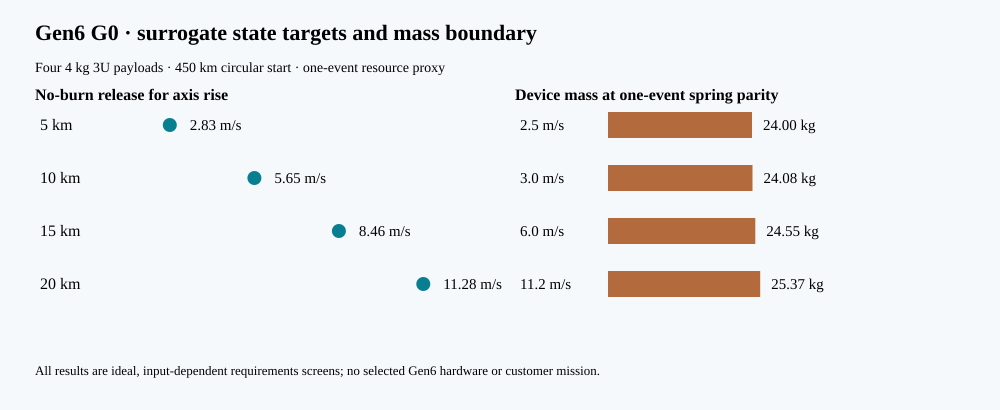

# Gen6 G0 mission and first-article requirements, revision 0

**Status:** proposed surrogate, 12 October 2026. **Gate G0 remains open.** This document directs the next calculations and first laboratory article. It is not a customer specification, selected architecture, provider interface, hardware performance claim, or authorization to build or launch. [P128](../validation/P128_gen6_g0_reference.md) and its [reproducible source](../analysis/gen6_g0_reference.py) supply the numerical screen; [P124](../validation/P124_precision_delivery_design_space.md) supplies the prior orbit/stroke check.

## Intended service and reference case

The service hypothesis is **commanded, measured delivery of each CubeSat to an agreed state at an agreed epoch** from a shared host. The customer value to test is delivered-state accuracy, schedule flexibility, and reduced payload-side maneuvering or integration burden. Release speed alone is not the saleable result. Gen5 remains the evaluated academic design with negative mass and fit findings; it is not silently modified by this Gen6 study.

The G0 reference uses four identical **4 kg 3U surrogates**, one 450 km circular starting orbit, an assumed 300 kg host base dry mass, 10 kg starting fuel, 2 kg one-event reserve and 220 s host specific impulse. At one common reference epoch, the four trial immediate semimajor-axis-rise targets are **5, 10, 15 and 20 km**, each with a provisional ±1 km axis band. P128 calculates ideal prograde increments of **2.795, 5.585, 8.369 and 11.149 m/s**. These are four *individual state targets*, not a completed sequential mission. The first instrumented laboratory article is a **single restrained 4 kg dummy on a reusable carrier** at proposed 3–6 m/s commands. The subsequent multi-slot mechanism is a separate G1–G3 decision.

| ID | Proposed requirement or decision criterion | Verification and present status |
|:--|:--|:--|
| G6-M01 | Record a named spacecraft, owner, host, deployment authority, applicable interface document, target state and common epoch before calling G0 a mission need. | **Open.** All are surrogate or unselected. Interface applicability must be confirmed by its authority. |
| G6-M02 | For each release, give position/velocity or agreed orbital elements, full tolerance and covariance, delivery time, collision volume and disposal constraint. | **Open.** P128 calculates only immediate semimajor axis in a two-body, tangential screen. |
| G6-M03 | Screen 5/10/15/20 km rises at ±1 km as trial design targets; derive required release vector and host maneuvers with recoil and changing host mass. | **Partially computed.** P128 gives single-event ideal speeds and recoil. It does not propagate four events. The targets are challenge cases, not accepted requirements. |
| G6-M04 | Challenge a 0.55 m/s worst-case *tangential* allocation at the 20 km endpoint, then replace it with a state/covariance budget tied to a real navigation service. | **Provisional.** P128's ±1 km endpoint margin is 0.555 m/s and leaves about 0.005 m/s in the one-dimensional sum. No accuracy has been measured. |
| G6-M05 | Compare the same state, host, epoch and resource accounting against a spring plus host burn, payload propulsion/drag and an orbital transport service. Report installed device mass, fuel, power, attitude, integration, reliability and cost with provenance. | **Open.** P128's one-event spring proxy allows only about 24.08 kg device mass at 3 m/s or 24.55 kg at 6 m/s for device-plus-fuel parity; this is neither four-shot parity nor a customer value threshold. |
| G6-I01 | Use ordinary 3U/4 kg payload as the *surrogate class*; declare rail/canister, retention, umbilical, shock, acceleration, magnetic exposure, cleanliness and deployment-rule limits from the selected payload and provider. | **Open.** No provider-specific ICD or payload allowable has been selected. Do not infer compatibility from a generic 3U label. |
| G6-A01 | First article shall capture a 4 kg inert dummy and carrier within a controlled test volume. A power-off safe state, abort and contained failed release must be defined before powered testing. | **Proposed; unbuilt.** G1 must release containment, restraint, return and brake drawings and hazard controls. |
| G6-A02 | Model and measure commanded 3–6 m/s speed *and three-dimensional vector* across repeated shots, reporting distribution, calibration, timing and outliers. | **Proposed measurement range, not achieved speed or accuracy.** At 6 m/s and a fully useful 1.3 m stroke, ideal mean acceleration is 1.41 g and payload kinetic energy is 72 J before losses. Real peak acceleration and arrest loads remain unknown. |
| G6-A03 | Record synchronized current, voltage, force/position, release vector, contact, restraint status, carrier/brake temperature and host reaction impulse; reconcile energy and momentum with uncertainty. | **Open.** Specify sensors, sample rates, calibration and preregistered model bands at G2 before a G3 test. |
| G6-A04 | Demonstrate repeatable single-payload release and safe reset before advancing to four-slot feed, tip-off, jams, partial actuation and abort sequences. | **Open.** No Gen6 mechanism has been selected or tested. |
| G6-D01 | Compare at least two complete, sourceable Gen6 architectures on the same mission and installed budget; include editable CAD, STEP, clearance/tolerance, mass/CG/inertia, circuit, source, thermal and faults. | **G1 open.** Gen5 H1 is an unselected hypothesis, not a Gen6 design. A 30 kg P128 device value is solely a recoil study mass. |
| G6-H01 | Keep 1 km/s in a separate high-speed payload/stroke investigation until a compatible payload, host, load limit and service case are selected. | **Boundary set.** For 4 kg over 1.3 m, the ideal mean load is about 39,220 g and kinetic energy 2 MJ; neither is a Gen6 first-article target. |

## Gate order and decision rules

1. **G0 — service fit:** obtain a named or openly surrogate full-state delivery job, comparable alternatives and a payer/authority. Keep a negative result if benefit disappears after installed costs. The present G0 is **partial, not passed**.
2. **G1 — architecture:** select only after at least two complete candidate configurations, actual interfaces, sourced parts or explicitly marked custom parts, editable CAD/STEP, moving clearance, mass properties and safe abort are reviewed. A candidate is rejected if its envelope clashes or its resource/load budget cannot close.
3. **G2 — predictive design:** use independent field/force methods, coupled electrical and thermal dynamics, contact/recoil/brake and uncertainty/convergence studies. Register acceptance bands *before* testing. An ideal-force speed cannot substitute for this gate.
4. **G3 — first instrumented article:** build only with containment and calibrated instrumentation; compare measured distributions and adverse cases to G2 bands. Failed or missing data do not pass. Four-slot feeding follows a credible single-payload result.

The [prototype-to-flight roadmap](GEN6_PROTOTYPE_TO_FLIGHT_ROADMAP.md) controls later Gen7 engineering, Gen8 qualification and Gen9 flight decisions. Provider approval, physical qualification, launch authorization and customer demand require outside evidence.

