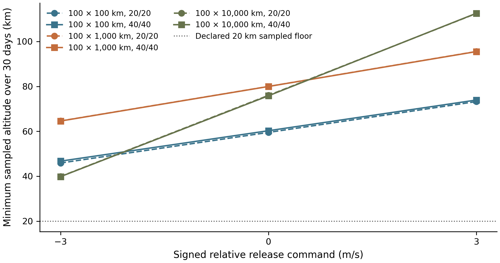
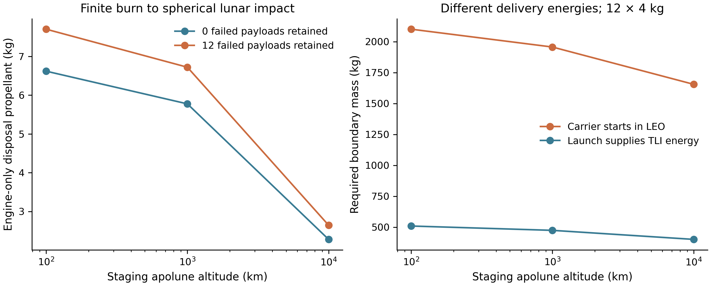

# Source-linked programme studies, ACR1

25 October 2026. These computations extend the existing research programme. The near-term machine remains VOLLEY-G5-ACR1: twelve 3U payloads, two six-level banks, supported modeled command range 1–3 m/s, a 13.127806 kg captive sled/pallet, and 64 source cells. Gen6 mixed 1U/3U studies retain their separate identity.

The lunar investigation is **LUNAR-PCS-01**, a separate surrogate with 280 kg retained dry mass, 20 kg independent disposal reserve and 4 kg payloads. Its 300 kg retained wet single-release reference is distinct from the 500 kg wet LEO bus. A real carrier, customer, engine and interface have not been selected.

## Existing results reused

The [accepted native lunar coast study](../validation/lunar_native_coast/README.md) already contains 18 native attempts at 7/30/90/180 days, gravity-degree/step/field sensitivity, SPICE frame settings and raw histories. Its capture checker passes. At its 23 October TAI epoch and specified MJ2000Eq initial states, the circular inclined case stops at the reference sphere after about 116–118 days; the high ellipse stops after about 40.1 days. These results are retained with their original initial conditions. The new release study uses a different declared epoch, apolune starting state and signed release vector; a completed 30-day case cannot replace those longer-horizon findings.

The [accepted navigation sensitivity](../validation/system_feasibility_closure/LUNAR_NAVIGATION_SENSITIVITY.json), [ideal lunar bounds](../validation/extended_feasibility_bounds/README.md), [current mission comparisons](../validation/acr1/mission/MISSION_REPORT.md), resource ledger and eight final native solid-signature captures are also reused. No historical speed dispersion or high-speed result is transferred into the current 1–3 m/s rating.

## Numerical ACR1 host demand and matched mass boundary

The eight native geometry states have a common bounding box **2.250 × 1.240 × 1.3489 m**, or 3.7634 m³ as a rectangular enclosure. This is geometry occupancy; the unlocated 7 kg power/control allocation, harness routing, service access and provider keep-outs require further accommodation. Installed device mass including that allocation is 156.556720 kg dry and 204.556720 kg loaded.

Across the 18 accepted nominal/adverse, 3/20/100 µH cases at 1/2/3 m/s, the maximum source draw is **992.126 J**. Replenishment over the 450 s release spacing requires 2.756 W with the declared 80% charger efficiency, plus 1.1664 W balancing and additional feed/lift/standby services. Maximum modeled local pulse loss divided by 450 s is 2.167 W; this is an average thermal burden, not a radiator or component-temperature solution. The declared 355 s cycle occupies a 400 s zero-force loading coast.

At 3 m/s, the post-arrest payload momentum is about 11.708 N·s. A 0.1 m offset therefore deposits about 1.171 N·m·s, requiring at least 0.05854 N·m average counter-torque over 20 s. The transient sled recoil and final post-arrest host recoil are kept separate in [STUDY_RESULTS.json](../validation/programme_closure_acr1/STUDY_RESULTS.json). Assumed inertia/offset sensitivities are requirements for comparison, not demonstrated host authority.

The current campaign uses a 72 kg conventional-deployer class proxy, so ACR1 adds **84.556720 kg** device mass. Even the impossible best case of saving the entire common 20 kg host fuel reserve leaves **64.556720 kg** added mass. In matched alternating targets at 5 N, the best tested conventional pretrim consumes 0.053645 kg and ACR1 0.289874 kg. At 1 N, a tested pretrim policy succeeds where no tested ACR1 candidate meets the force ceiling. These are candidate results, not global infeasibility proofs. Full installed power/thermal/volume/reliability/vendor costing remains unavailable; no product or supplier winner is claimed.

## Lunar release vectors and perturbed coast

The new native run set has **18 actual GMAT R2026a propagations**: three staging orbits, signed −3/0/+3 m/s apolune releases, and GRGM900C 20/20 versus 40/40. It uses Earth/Sun DE421 ephemerides, explicit SPICE/MOON_PA lunar coefficient rotation, MJ2000Eq initial planes, and a 25 October 2026 12:00 UTC epoch. The declared criterion is 30 days and a 20 km minimum sampled reference-sphere altitude. All nine geometries pass at both degrees. The smallest 40/40 sampled margin is **39.830 km**. The maximum change in sampled minimum altitude between 20/20 and 40/40 is 0.835 km; this is observed model sensitivity, not physical convergence.

The finite-host release map records payload kick and retained-host recoil for each command. These are last-payload 300 kg retained-wet snapshots; they do not form a full twelve-release campaign. Native histories and source scripts are in the package. Terrain, SRP, perturbed covariance, long-term useful service, communications, conjunction assessment and exact mission targeting remain outside this bounded coast result.

## Inverse navigation accuracy

For a declared 100 × 1,000 km apolune release at +3 m/s, the assumed position and velocity standard deviations are 10 m and 0.01 m/s. A **±1 km three-sigma osculating-perilune study band** requires approximately **0.192240 m/s three-sigma release-speed accuracy** with 0.1° pointing standard deviation. The fixed-seed 16,384-sample Monte Carlo, 4,096-sample comparison and independently refined finite-difference sensitivity are captured.

A separately saturated plane-error budget of 1 mrad at the 99.73% quantile yields 24.155° three-sigma pointing under this weak plane-only study criterion. Speed and pointing limits cannot both be saturated and treated as a joint pass: pointing also changes orbital energy. The joint periapsis Monte Carlo uses the stated 0.1° pointing band. These are investigation requirements, not customer inputs, measured capability, the historical 0.0274 m/s dispersion or a 30-day perturbed error distribution.

## Engine-only disposal, including all failed releases

The carrier's disposal solution uses its engine with **zero payload-release recoil credit**. A declared 20 N / 220 s chemical-thruster surrogate burns continuously retrograde from apolune to a two-body cutoff targeting −100 km osculating perilune, then coasts. Cutoffs are fixed before independent GMAT replay. Native replays use GRGM900C, Earth/Sun DE421, mass depletion, and the same coefficient frame. All **24 native cases** reach the 1737.4 km reference sphere within 24 hours: no failures or all twelve payloads captive at both gravity degrees, plus ±1% burn-duration and ±1° pointing perturbations for the twelve-failure case. The worst propellant use is **7.7779 kg**, below the independently allocated 20 kg reserve.

| Staging orbit (km) | Nominal all-failure burn (s) | Propellant, 40/40 (kg) | Sphere time from ignition (h) |
|---|---:|---:|---:|
| 100 × 100 | 830.72 | 7.7009 | 0.579 |
| 100 × 1,000 | 724.93 | 6.7202 | 1.108 |
| 100 × 10,000 | 285.41 | 2.6458 | 6.725 |

Earth return, high-lunar disposal and escape are explicitly compared in the result file. Earth return has no valid targeted solution and is rejected as an unsupported claim. Escape energy alone cannot establish an Earth-return path or long-term safe disposal. High-lunar circularization is only an impulsive energy bound. A native sphere impact is a dynamical solution; a selected impact site, terrain model, actual engine, environmental/policy review and applicable approval are external.

## Launch delivery energy remains separate

The same twelve-payload manifest, 280 kg dry carrier, 20 kg disposal reserve and 220 s Isp produce the following ideal patched-conic boundaries. One case starts in 500 km circular LEO and must supply TLI; the other arrives on the same ideal lunar encounter after launch/transport supplied TLI energy. LOI is still charged to the carrier. Neither is evidence that a named provider can deliver that mass/state.

| Starting boundary | Staging orbit (km) | Carrier TLI (m/s) | LOI (m/s) | Required boundary wet mass (kg) |
|---|---|---:|---:|---:|
| 500km_LEO | 100 × 100 | 3058.2 | 820.3 | 2100.5 |
| TLI_apogee_384400km | 100 × 100 | 0.0 | 820.3 | 509.0 |
| 500km_LEO | 100 × 1,000 | 3058.2 | 666.8 | 1956.3 |
| TLI_apogee_384400km | 100 × 1,000 | 0.0 | 666.8 | 474.0 |
| 500km_LEO | 100 × 10,000 | 3058.2 | 305.7 | 1654.7 |
| TLI_apogee_384400km | 100 × 10,000 | 0.0 | 305.7 | 401.0 |

Finite TLI/LOI, launch-provider mass/cost availability and integrated thermal accommodation retain separate requirements. The standalone maps and disposal tests above are complemented by the coupled campaign below.

## Twelve-release campaign and hardware flowdown

The [coupled lunar campaign](../validation/programme_closure_acr1/CAMPAIGN_REPORT.md) evaluates **20 finite-host cases** with changing payload inventory, CAD-slot-based mass properties, linear and angular recoil, finite slew and propulsion authority, and the actual loading/recovery timeline. A **7,152-candidate search** selects release order, direction and roll rather than assuming cost-free host pointing.

The searched twelve-release reference completes the declared slots at **5 N·m / 20°/s** authority, retaining **18.23363 kg** propellant. The lower-rate and doubled-inertia cases preserve their missed-slot outcomes. Nominal and fault cases account for retained payloads and distinguish an independently isolated failed cell from an unresolved shared-path obstruction.

Three native host replays check the declared force models; **24 native payload histories** clear the 30-day sampled altitude criterion. Three subsequent native disposal replays reach the reference sphere within 24 hours using at most **6.51096 kg** additional propellant, within the independently reserved 8 kg allocation. The point-gravity native host replay agrees with the separate Python implementation to about 11 mm. The environmental model change is assessed separately: the harmonic host endpoint differs by about 1.63 km and 1.49 m/s, so precise full-state delivery requires navigation/planning feedback beyond the standalone covariance assumptions.

The [C7 requirements](../validation/programme_closure_acr1/C7_HARDWARE_REQUIREMENTS.md) translate those results into separation command, accuracy, host authority, mass properties, retention, pulse/bus, thermal and safe-state demands. The [H0 demand sheet](../validation/programme_closure_acr1/H0_DEMAND_SHEET.md), [H5 provider questions](../validation/programme_closure_acr1/H5_PROVIDER_QUESTIONS.md) and [interface sketches](../validation/programme_closure_acr1/H5_INTERFACE_SKETCH.md) provide the corresponding integration record. These are explicit surrogate requirements; they do not assign unverified capabilities to a provider.

## Evidence and reproduction

The [package README](../validation/programme_closure_acr1/README.md) provides commands; [MANIFEST.json](../validation/programme_closure_acr1/MANIFEST.json) pins every supplied file. Inputs include exact copied ACR1 results, the accepted native signature captures and their SHA-256 source identities. No third-party binaries, ephemerides or gravity data are redistributed. Native model/runtime hashes identify the required installation. The [criterion recommendations](../validation/programme_closure_acr1/CRITERION_RECOMMENDATIONS.json) map all 40 original computational programme rows; they do not change tracker states or convert external evidence into a numerical pass.
