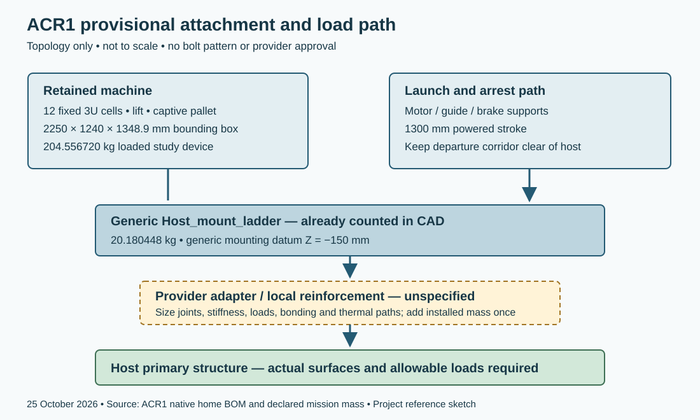

# ACR1 reference hosts and provisional interfaces

**25 October 2026 — VOLLEY-G5-ACR1.** These are dated public-data reference architectures and calculated interface questions. No provider has approved the device, supplied a mission allocation or accepted its payloads. [Source cards](../validation/reference_interfaces_acr1/SOURCE_CARDS.json), [demand sheet](../validation/reference_interfaces_acr1/HOST_DEMAND.json) and [comparison tables](../validation/reference_interfaces_acr1/COMPETITIVE_POSITION.md) identify the boundaries.

## Reference architecture screen

| Reference and primary source | Evidence maturity and useful capability | ACR1 fit and mission disposition |
|---|---|---|
| [ISRO POEM](https://new1.isro.gov.in/Atomospheric_Re_entry_of_POEM4.html), account 4 April 2025; checked 25 October 2026 | Flown hosted experiments. [POEM-3 account](https://www.isro.gov.in/POEM-3_Mission_achieves_Payload_objectives.html), 27 January 2024, identifies attitude control, generation, telecommand and telemetry. | POEM-4 was lowered to about 350 km/55.2° and passivated. That is not the 500 km SSO surrogate. Main-engine restarts before passivation do not establish repeated burns afterward. Volume, mass and recoil allocation unknown; physical fit unresolved. |
| [D-Orbit ION](https://dorbit.space/launch-deployment/), live primary service description checked 25 October 2026 | Commercial orbital transport service; propulsion and proprietary/third-party dispensers deliver customized slots. Flight service category corroborated by NASA's deployment review. | Relevant buyer/alternative, without public ACR1 installation or propulsion budget. Neither fit nor inability to fit is established. |
| [Electron Kick Stage guide V7.0](https://rocketlabcorp.com/assets/Electron-Payload-User-Guide-7.0-v6.pdf), cover 1 November 2022; checked 25 October 2026 | Flight stage; guide pp.16–20 identifies maneuvering, restarts and RCS. [26 January 2021 flight account](https://rocketlabcorp.com/updates/rocket-lab-demonstrates-new-orbital-maneuvering-capability-with-most-complex-kick-stage-mission-yet/) reports raise and disposal burns. | Standard nominal screen fails: loaded device 204.556720 kg exceeds 200 kg nominal to 500 km SSO before a new adapter; protected bounding dimensions exceed the standard 1.2 m diameter. Expanded fairings are a nonstandard service, requiring new fit/performance/load screening. This is not a rejection of every Electron configuration. |
| [Generic ACR1 host](../validation/acr1/mission/MISSION_REPORT.md), 24 October 2026 | Computational concept: 500 kg wet bus, 20 kg fuel included, 220 s Isp, 1/5 N resultant-force bounds and 500 km SSO. | Matches the declared model by construction. A generic CAD mounting datum does not establish a real host or flight attachment. |

The three external references and the generic basis serve different decisions. A flown platform does not automatically provide a maneuvering delivery service, while a maneuvering stage does not automatically have room or electrical authority for this device. The guide's 40 kg dry Kick Stage and 120 N thrust are source facts, not replacements for the common 500 kg/220 s/1–5 N surrogate.

For any later cislunar comparison, freeze each provider's delivered separation state and epoch before computing carrier-only TLI, LOI, reshaping and disposal. The POEM LEO state, a tailored Electron injection, and direct lunar injection are different starting services. These reference cards do not close lunar propulsion or common-staging results.

## Host-independent demand sheet

| Demand | ACR1 quantity or relation | Interface consequence |
|---|---|---|
| Accommodation | 2250 × 1240 × 1348.9 mm represented bounding box; 1300 mm powered stroke; 210 mm declared arrest allocation | Preserve the full machine, keeper/lift motions, release corridor, access and harness/service keep-outs. Bounding box excludes any unrepresented provider adapter and installation margins. |
| Carried mass | 149.5567197 kg CAD + 7 kg allocation + 48 kg payload = 204.5567197 kg | Obtain host support limits and loaded/depleted CG/inertia throughout the campaign; the 7 kg has no assigned spatial CAD inertia. |
| Launch load scale | Loaded mass × g0 = about 2.006 kN per imposed g | Apply the actual mission limit-load vector, dynamic response, joint stiffness and safety factors; this scalar is not a qualified launch load. |
| Power and storage | Internal 32S2P source: 86.4 V, 6.25 F nominal, 0.176 Ω; adverse sensitivity 3.9375 F/0.352 Ω | Host bus must feed a qualified charger and isolated controls. Internal capacitor voltage is not a selected host supply voltage. |
| Shot energy | Existing eighteen supported production-model cases draw about 229.49–992.13 J net from the modeled bank | At 450 s spacing, worst net shot replenishment alone is about 2.205 W before charger loss, balancing, handling and standby. This is a lower boundary, not total host power. |
| Operations | 450 s release slots; 400 s loading coast, including 355 s declared mechanism cycle and 45 s reserve; 5 s pre/20 s post release guards | Reserve coast and inhibit host burns until custody, corridor and navigation conditions are met. |
| Recoil | First 3 m/s command maps to about 2.92694 m/s inertial payload kick, about 11.70775 N·s payload momentum | Net retained-host recoil after arrest differs from transient carrier motion. Torque impulse is r × J; real inertia, mounting offset and control authority are required. |
| Pointing and navigation | Release-vector error scales approximately as speed × angular error | A 1 mrad error at 3 m/s contributes about 0.003 m/s transverse error; this illustrative sensitivity is not an accepted pointing requirement. |
| Thermal and faults | Modeled copper pulse/campaign budget, source degradation cases and interlock checks exist | Need actual conductive/radiative paths, source temperature/radiation acceptance and common-path fault policy. |
| Disposal | Retained device and any failed payload stay with the host | Protect an engine-only disposal reserve independently of successful deployments; no POEM/ION disposal authority is imported. |

The initial 3 m/s carrier case has about 0.07293 m/s peak pre-arrest host recoil in the supported production set; after arrest the conserved retained-host state follows the payload momentum, about 0.01671 m/s for the initial loaded case. These different phases must not be combined into one host-control number. Neither linear recoil nor a tip-off energy bound proves host attitude recovery.

## Provisional mechanical attachment and load path

The native home BOM contains a **20.180448 kg Host_mount_ladder**, already counted in CAD mass, with a generic Z = −150 mm mounting datum. Track, cassette and lift reactions enter that retained structure. Launch and arrest reactions follow the motor/guide supports into it. An application-specific adapter must then transfer loads to verified host primary structure. The sketch defines that topology; it adds no bolt pattern, material thickness, preload, stiffness or structural approval.

Required interface work is the actual contact plane and datums; bolt group and bearing/shear/tension load sharing; local host reinforcement; loaded/depleted CG and inertia; launch vibration/shock and first modes; dimensional/thermal alignment; electrical bonding; plume/vent/field keep-outs; assembly access; and separation of release corridor from host appendages. Provider adapter, reinforcement and harness additions must be added once to mass/volume and included in coupled analysis. The current internal chassis result does not qualify the host adapter.

## Components and service maturity

The [component cards](../validation/reference_interfaces_acr1/SOURCE_CARDS.json) distinguish catalog data, project screens and flight services. ACR1 uses FAULHABER 3242 BX4/32GPT references for feed/lift sizing, Eaton TV cells and IRFP4668/UCC21520 circuit references. These are catalog-supported design inputs; no space qualification, supplier acceptance or completed procurement is implied. A repeated engine-ignition demonstration or an igniter test cannot establish a complete stage's restart/endurance capability.

The EXOpod Nova product card adds a real equivalent-capacity reference: three 12U S4 units give twelve independent 3U slots and 39.96 kg bare mass ±5%, with exclusions identified. Frozen mission calculations still use 72 kg. A real comparison must assign each architecture's actual release-energy policy, sequencer, adapter, harness, thermal provisions, retained hardware and failure exposure before recalculating resources.

## Questions prepared for a future authorized interface exchange

1. Which retained host/configuration and separation state are offered, and what operations remain authorized after primary delivery or passivation?
2. What stowed/operating envelope, mounting surfaces, load limits, CG/inertia allocation and departure corridor are available for the 204.556720 kg loaded device?
3. What regulated supply, average/peak power, thermal paths, grounding and command/inhibit/telemetry interfaces can be allocated?
4. What navigation, pointing/rate, force/torque, impulse-bit, slew/settling and reserve limits apply over twelve release slots?
5. Which payload field, contact, sustained-load, shock/tip-off and switch requirements govern acceptance?
6. What fault-safe retention, ambiguous-departure, blocked-path, collision/plume and independent disposal rules apply?

These questions and the load-path sketch complete preparation of a bounded interface discussion. They are not provider answers. D/H/L completion recommendations are recorded [individually](../validation/reference_interfaces_acr1/SOURCE_REVIEW_AND_CRITERIA.json); unsupported missions and external approvals remain open.
