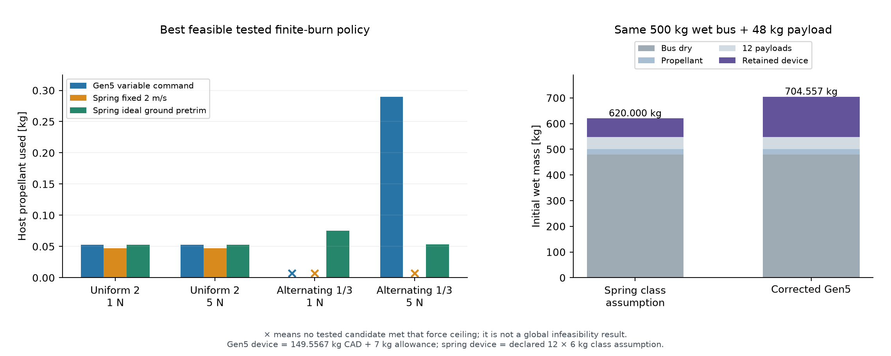
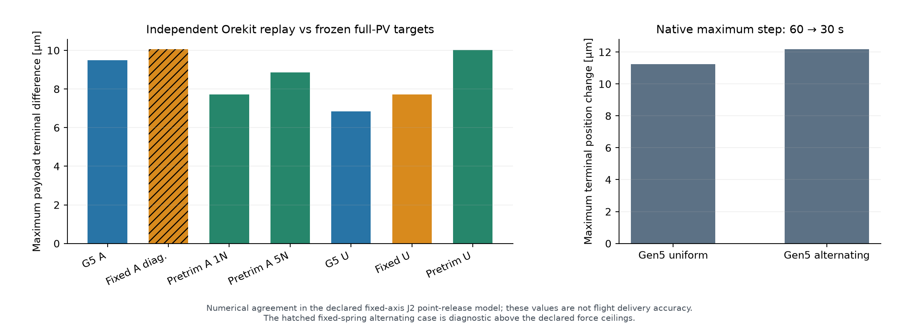

# Corrected Gen5: synthetic same-input mission comparison

The tested Gen5 policy closes the uniform 2 m/s target family with 1 N and 5 N host authority, and the alternating 1/3 m/s family with 5 N. The ideal ground-pretrimmed spring comparator closes both families with either authority. These preplanned cases show no Gen5 propellant or initial wet-mass advantage over that comparator.

## Common inputs

Each architecture starts from the same six-state nominal 500 km SSO orbit and carries twelve 4 kg 3U payloads. The first-order J2 SSO inclination is 97.401808° and the Kepler period is 5676.978029 s. Releases occur at 450, 900, …, 5400 s; the final release is inside one orbit. All twelve payload targets and the retained host target are evaluated at the same epoch, 91800 s, exactly 24 h after final release.

The initial wet bus is **500 kg = 480 kg dry + 20 kg propellant**. The 20 kg is included once. Gen5 retains 149.5567197004 kg of computed CAD device mass plus an explicit 7 kg power/control allowance; the spring reference retains a declared 12 × 6 kg = 72 kg class-study mass. The spring number is an assumption, not a vendor quote. Initial wet masses including the 48 kg payload manifest are **704.556720 kg Gen5** and **620.000000 kg spring**, a **84.556720 kg** device penalty for Gen5.

Both use the same constant-inertial-force host model, Isp 220 s, 20 kg fuel budget, fixed-axis J2 gravity, and 1 N/5 N thrust-authority gates. The host is recovered to the common chief trajectory at one orbital period and coasts to the common evaluation epoch. No later host-state reset is applied.

## Targets and control policies

Targets are constructed independently of architecture: coast an unforced chief to each release epoch, add a synthetic +along-track inertial velocity increment to its PV, then propagate that full six-state child PV under J2 to the common evaluation epoch. The two families use 2 m/s for every payload, or alternate 1 and 3 m/s. All target PV values are frozen in `TARGETS.json` before targeting. They are synthetic study cases, not customer requirements.

The targeter uses two constant-force windows per leg and continuous propellant mass flow. Both architectures retain 5 s zero-force pre-release and 20 s post-release guards. Gen5 additionally reserves a 400 s zero-force loading coast per payload; the declared 355 s mechanism cycle leaves 45 s reserve. Spring has no imposed loading-coast requirement: it may use the same optional short-window policy or wider 35% and 45% windows. Selection reports the lowest-fuel feasible member of this bounded policy set.

The fixed spring baseline uses a declared 2 m/s relative separation speed. The stronger ideal spring comparator uses a per-payload ground energy table that compensates predictable finite-host recoil. Those speed/energy values are frozen after mission planning and before native replay. Preplanned variable release energy is therefore represented explicitly; no late target change or inflight retasking is simulated.

Gen5 commands interpolate measured nominal 1/2/3 m/s coupled-shot release data and remain within the supported command range. Its reusable sled is retained. With pre-release total mass `M`, payload `m=4 kg`, sled `s=13.127805767 kg` and measured sled–host release speed `V`, the post-return payload–retained-host separation speed is

`u_sep = V × (M − m − s) / (M − m)`

and the payload inertial kick is `V × (M − m − s) / M`. Thus a 3 m/s sled command is not treated as a direct 3 m/s payload kick. Mass and this mapping are recomputed after each host burn and release; host burns supply the remaining velocity needed by the full-PV target. The ideal spring energy is `0.5 × m × (M−m)/M × u_sep²`.

## Bounded mission results

| Target family | Authority | Gen5 propellant | Fixed 2 m/s spring | Ideal ground-pretrimmed spring |
|---|---:|---:|---:|---:|
| Uniform 2 | 1 N | 0.052443 kg | 0.046957 kg | 0.052443 kg |
| Uniform 2 | 5 N | 0.052443 kg | 0.046957 kg | 0.052443 kg |
| Alternating 1/3 | 1 N | No tested pass | No tested pass | 0.075002 kg |
| Alternating 1/3 | 5 N | 0.289874 kg | No tested pass | 0.053645 kg |

All fourteen constructed targeter candidates close the requested full PV states mathematically. Some require force above the declared ceiling: the tested Gen5 alternating policy peaks at 4.204212 N, and the lowest-peak fixed-spring alternating policy requires 7.537264 N. Their failures at lower ceilings are bounded candidate failures, not global infeasibility proofs. The ideal pretrimmed spring can use a wider policy at 1 N and the shared short-window policy at 5 N.

The 84.556720 kg retained-device penalty is separate from propellant consumption. In this fixed 20 kg fuel-budget comparison, the measured fuel differences do not offset it. The study does not establish a unique inflight-retasking benefit, because all targets were known before the ground energy tables were set.

## Native replay and numerical checks

Nine accepted native Orekit replay cases include both Gen5 60→30 s step refinements and one clearly labeled fixed-spring diagnostic above the force ceiling. Maximum payload target difference is **1.12472029e-05 m / 1.23467973e-08 m/s**. Independent mass-flow residual is at most **1.25e-12 kg** and momentum residual at release is **1.04e-09 kg·m/s**. All fourteen candidate continuity, mass, recoil and guard checks pass. Native coast energy and axial angular momentum invariants are checked as well.

Native replay uses the verified installed Orekit 13.1.6 and Hipparchus 4.0.3 jars and propagates every host arc from its previous state. Gen5 recoil is recomputed independently in Java from the replayed mass. The ideal pretrimmed spring uses its frozen speed table. The largest Gen5 native terminal-position change under 60→30 s refinement is 1.21774647e-05 m. Numerical agreement is not a physical delivery-accuracy claim.

## Scope and reproduction

The comparison uses fixed-axis J2 point masses, point-center release, constant inertial resultant force and Isp 220 s. Drag, higher gravity, third bodies, attitude/plume allocation, actual navigation and finite exit geometry are outside this model. These are constructed two-window policies and sampled schedules, not global fuel optima or real-customer delivery cases.

The old captured mission work is unchanged. Exact copies of its tested target/export/replay sources and software lock are in `provenance/`; this study creates new inputs and outputs. Run `mission_model.py`, then `native_checks.py`, then `report_and_plot.py` using the recorded runtime. `MISSION_INPUTS.json`, `CALIBRATION.json`, `TARGETS.json`, each `release/*.json/.csv`, `SELECTED_CASES.json` and `NATIVE_REPLAY_CHECKS.json` preserve assumptions, commands, full PV states, forces, fuel, guards and numerical checks. The source/runtime hashes and final integrity capture accompany them.
