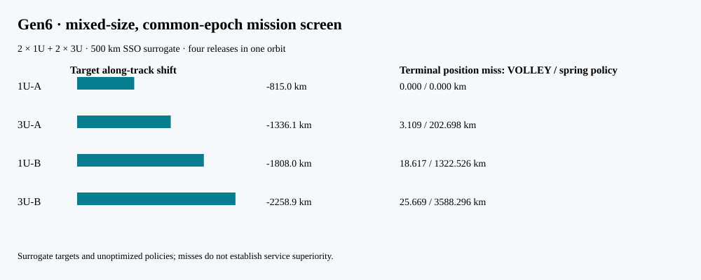

# P129 — Gen6 mixed-size full-state mission screen

**Status:** user-selected service architecture with surrogate numeric inputs; ballistic requirements screen, not a solved customer mission or achieved VOLLEY release capability.

The selected service is two ordinary passive 1U and two ordinary passive 3U spacecraft from a rideshare/OTV host, released within one orbit. Each should reach a distinct **position and velocity at one common epoch**, 24 hours after the last release. The target pattern varies both initial orbit energy and resulting along-track position while remaining in one plane. The buyer is hypothesized to be the host operator; no customer or provider has approved the case.

This numerical reference starts from a circular 500 km orbit at the first-order J2 sun-synchronous inclination (97.402°). Four releases occur at 0/20/40/60 minutes; the epoch is 25 hours after the first release. Payload masses of 1.33/4/1.33/4 kg, a 300 kg base host, 10 kg fuel, 220 s Isp, a 30 kg VOLLEY *recoil study mass* and a 16 kg spring-class installed proxy are **assumptions, not selected hardware or supplier limits**.

## Independent target construction

For a reproducible full-state challenge, each target is generated by an inertial prograde 3/5/7/9 m/s impulse from an **unperturbed reference host** at the assigned time, followed by Cartesian J2 propagation to the common epoch. This construction is transparent but favors a prograde release topology; real service targets must come from a customer. It also does not prove that the specified 1U or 3U can tolerate a particular deployment system.

| Payload | Mass | Trial inertial increment | Initial semimajor-axis rise | Along-track at common epoch vs reference host |
|:--|--:|--:|--:|--:|
| 1U-A | 1.33 kg | 3.0 m/s | 5.43 km | -815.0 km |
| 3U-A | 4.00 kg | 5.0 m/s | 9.00 km | -1336.1 km |
| 1U-B | 1.33 kg | 7.0 m/s | 12.67 km | -1808.0 km |
| 3U-B | 4.00 kg | 9.0 m/s | 16.27 km | -2258.9 km |

## Two deliberately limited policies

The VOLLEY policy commands the recoil-corrected relative speed for each trial impulse but makes **no host correction** after recoil. The spring policy uses a fixed 2.5 m/s relative release and an optimistic instantaneous host burn at each actual release position to match the target *departure velocity*. It cannot reset a displaced host to the reference position. These are policy screens, **not optimized equal-capability mission plans**; neither terminal residual proves a winner.

| Payload | VOLLEY relative command | VOLLEY terminal position / velocity miss | Spring host burn | Spring terminal position / velocity miss |
|:--|--:|--:|--:|--:|
| 1U-A | 3.011 m/s | 0.000 km / 0.0000 m/s | 0.510 m/s | 0.000 km / 0.0000 m/s |
| 3U-A | 5.058 m/s | 3.109 km / 3.4124 m/s | 2.971 m/s | 202.698 km / 223.1091 m/s |
| 1U-B | 7.027 m/s | 18.617 km / 20.4128 m/s | 9.714 m/s | 1322.526 km / 1459.9878 m/s |
| 3U-B | 9.106 m/s | 25.669 km / 28.2649 m/s | 25.678 m/s | 3588.296 km / 3959.9744 m/s |

The spring policy spends 5.907 kg of its assumed initial 10 kg fuel in ideal local impulses; VOLLEY spends no host propellant in this policy but carries an assumed 30.0 kg device versus 16.0 kg for the spring class. Power, integration, reliability and payload-side costs are absent. A stronger optimizer may change either side and must be tried before claiming a service benefit.

Numerical check: halving the fixed RK4 step from 10 to 5 s changes the largest target terminal position by at most **0.45 m** and velocity by **0.00050 m/s**. This measures time-step error only; it does not cover force-model error, drag or operational uncertainty.

**G0 disposition remains partial.** Full target vectors are now explicit, but they are generated surrogates, and neither policy closes a provider-approved four-shot campaign. Next: name a public 1U/3U reference spacecraft and OTV interface, set meaningful state/collision/disposal tolerances, optimize both host-control policies on the same resource budget, and price installed burden. Keep the original four-identical-3U P128 as a separate historical screen.

Reproduce with `python3 analysis/gen6_mixed_mission.py`; `--check` verifies the captured data, report and figure within strict cross-runtime floating tolerance. No physical or customer validation is implied.
