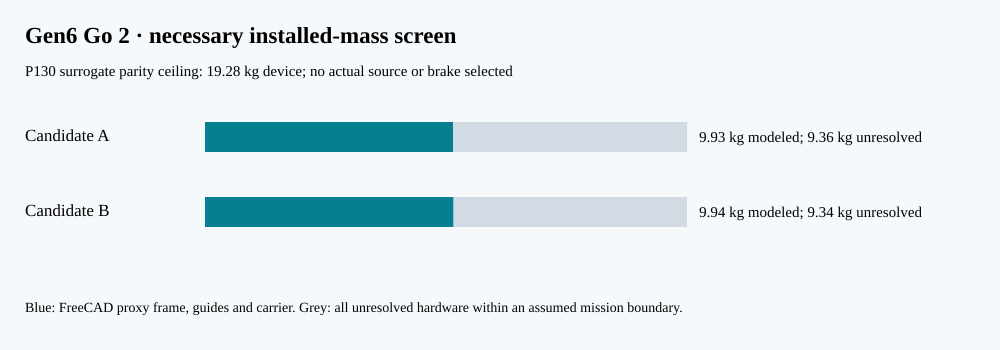

# P131 — Gen6 Go 2 first-article necessary bounds

**Status:** FreeCAD envelope-derived mass and analytic mechanics screen. Candidate A is a captured permanent-magnet carrier; B is a captured conductive-plate carrier. Both use a passive 4 kg 3U dummy, a shared guide and ideal 1.3 m drive stroke. Neither drive is selected or electrically rated.

The [native FreeCAD and STEP review set](../cad/gen6_first_article/README.md) contains two editable primitive assemblies and STEP exports. Five sampled carrier/payload stroke positions have zero solid interference in the nominal envelope; this does not prove contact, swept-path, tolerance, launch-load or brake clearance under deflection.

## Mission-derived installed-mass screen

The P130 spring-plus-host surrogate assumes a 16 kg spring device and consumes 3.2977 kg of host fuel. Re-solving the same ideal campaign over VOLLEY device mass gives a device-plus-consumed-fuel parity ceiling of **19.282 kg**. It is a narrow study proxy, not a purchase target or accepted host mass limit.

| Candidate | FreeCAD partial frame, guide and carrier material | Captured carrier material | Remaining under P130 proxy ceiling |
|:--|--:|--:|--:|
| A: PM carrier | 9.926 kg | 0.543 kg | 9.356 kg |
| B: conductive plate carrier | 9.945 kg | 0.562 kg | 9.337 kg |

That remainder must cover the actual drive, energy source, inverter, cabling, bearings, launch restraint, payload interface, carrier capture/brake, controls, thermal hardware, mounting and margins. No such installed BOM exists, so **neither candidate passes G1 mass closure**. The CAD proxy itself is not structurally justified or optimized.

The native-CAD partial dry center for A is x=0.864 m. With an assigned uniform 4 kg dummy, the combined proxy center moves from x=0.713 m at start to x=1.138 m after the powered stroke. [FreeCAD mass/CG/inertia ledger](../cad/gen6_first_article/release/Gen6_G1_Partial_Mass_CG_Inertia.json). These are not complete host inertia properties.

## Ideal mechanical lower bounds

| Candidate | Speed | Total moving kinetic energy | Ideal mean drive force | Payload mean acceleration | Captured-carrier brake energy | Ideal mean brake force over 200 mm |
|:--|--:|--:|--:|--:|--:|
| A | 3 m/s | 20.44 J | 15.73 N | 0.353 g | 2.44 J | 12.22 N |
| A | 6 m/s | 81.78 J | 62.90 N | 1.412 g | 9.78 J | 48.88 N |
| B | 3 m/s | 20.53 J | 15.79 N | 0.353 g | 2.53 J | 12.64 N |
| B | 6 m/s | 82.11 J | 63.16 N | 1.412 g | 10.11 J | 50.56 N |

The 6 m/s brake mean deceleration is 9.18 g for the captured carrier. Energy recovery, drive efficiency, peak motor force, pusher contact, friction and repeated-stop heat are unmodeled. The four-release P130 study includes 7 and 9 m/s hypothetical commands, outside this first article's proposed 3–6 m/s measurement band.

## Lateral tolerance screen

The nominal guide width is 110 mm around a 100 mm dummy, giving 5 mm gap per side. With an **assumed** 1.5 mm linear stack, the full 340.5 mm 3U length consumes `L tan(yaw)` of lateral corridor. These are arbitrary screening bands, not provider tolerances or verified payload contact geometry.

| Yaw | Swept width consumed | Residual side corridor | Conditional screen |
|--:|--:|--:|:--:|
| 0.2° | 1.19 mm | +2.31 mm | clear |
| 0.5° | 2.97 mm | +0.53 mm | clear |
| 0.7° | 4.16 mm | -0.66 mm | clash |

The computed yaw limit at that stack is 0.589°. A 0.7° case fails. The 5 mm gap may itself permit excessive attitude error without a defined contact/retention scheme; geometry clearance alone is not release-vector accuracy.

## Disposition

A is the *analysis lead* because it is closer to the evaluated Gen5 force-model lineage, while B remains a live challenger that avoids permanent magnets on the moving carrier. This is a sequencing choice, **not** an architecture selection: A inherits magnetic-exposure and capture concerns; B inherits induction efficiency, heating and historical handover-ripple concerns. Both need full drive and source ratings, contacts, safe abort, structural/thermal models and actual component data before G1 can pass.

Reproduce analytic bounds with `python3 analysis/gen6_go2_article_bounds.py`; generate and read back CAD with `PYTHONPATH=/usr/lib/freecad-python3/lib /usr/bin/python3 cad/gen6_first_article/build.py` on FreeCAD 1.0. The report and STEP hash ledger are inside the CAD folder.
