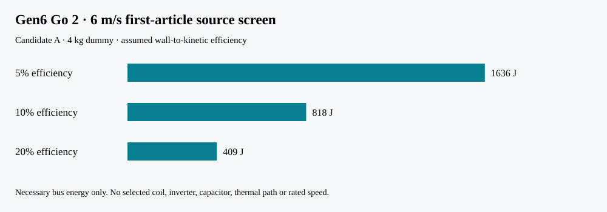

# P132 — Gen6 Go 2 source and instrument bounds

**Status:** necessary algebraic source and metrology screen for the P131 inert 4 kg first article. No coil, inverter, capacitor, controller, brake or sensor is selected or rated; no shot has been fired.

The FreeCAD candidates differ only slightly in moving material mass. For a constant-acceleration 1.3 m stroke, 3 and 6 m/s require about 0.867 and 0.433 s respectively. The table divides P131's total moving kinetic energy by **illustrative** 5/10/20% wall-to-kinetic efficiencies, then applies an ideal 96-to-72 V capacitor swing. Those voltages are a screening choice, **not** a selected Gen6 bus. Current is only the hypothetical DC bus power divided by 72 V; winding and switch currents can differ sharply.

| Candidate | Exit m/s | Assumed efficiency | Minimum bus energy J | Ideal capacitor F | Ideal end-stroke bus W | Lower-bound 72 V bus A | Four identical shots' aggregate loss J |
|:--|--:|--:|--:|--:|--:|--:|--:|
| A | 3 | 5% | 409 | 0.203 | 944 | 13.1 | 1554 |
| A | 3 | 10% | 204 | 0.101 | 472 | 6.6 | 736 |
| A | 3 | 20% | 102 | 0.051 | 236 | 3.3 | 327 |
| A | 6 | 5% | 1636 | 0.811 | 7549 | 104.8 | 6215 |
| A | 6 | 10% | 818 | 0.406 | 3774 | 52.4 | 2944 |
| A | 6 | 20% | 409 | 0.203 | 1887 | 26.2 | 1308 |
| B | 3 | 5% | 411 | 0.204 | 947 | 13.2 | 1560 |
| B | 3 | 10% | 205 | 0.102 | 474 | 6.6 | 739 |
| B | 3 | 20% | 103 | 0.051 | 237 | 3.3 | 328 |
| B | 6 | 5% | 1642 | 0.815 | 7580 | 105.3 | 6241 |
| B | 6 | 10% | 821 | 0.407 | 3790 | 52.6 | 2956 |
| B | 6 | 20% | 411 | 0.204 | 1895 | 26.3 | 1314 |

At 6 m/s and 10% assumed efficiency, A's source would need at least **818 J**, an ideal **0.406 F** across this voltage swing and about **3.77 kW** at the stroke end under constant acceleration. Four identical shots would deposit roughly **2.94 kJ of loss somewhere in the drive chain**. No particular capacitor, winding or thermal path has been shown to survive these numbers. Actual peak power can exceed them with position-varying force, friction, handover, source sag or control action. The 200 mm carrier stop's roughly 10 J per shot is a separate local brake-heat concern.

## Measurement floor for a future contained test

With two ideal optical gates 200 mm apart, an **illustrative** 0.01 m/s scalar speed resolution has the following *single-source* timing and baseline-error ceilings. Real uncertainty must combine both gates, their positions, synchronization, alignment, event detection and calibration. No 3-D vector or tip-off accuracy is derived here.

| Speed | Ideal shot duration | Gate interval | Timing error if sole source | Baseline error if sole source |
|--:|--:|--:|--:|--:|
| 3 m/s | 0.867 s | 66.67 ms | 222.2 µs | 0.667 mm |
| 6 m/s | 0.433 s | 33.33 ms | 55.6 µs | 0.333 mm |

A future test plan must capture synchronized voltage/current, carrier and payload position, exit speed/vector, rail contact, brake displacement/temperature and retained carrier status; choose sensor bandwidth from the fastest expected current/force and contact transients, which this screen does **not** resolve. The power-off safe state, containment and aborted-shot procedure need a separate reviewed design before any energized test.

The [FreeCAD/STEP candidate record](../cad/gen6_first_article/README.md), [P131 mechanics](P131_gen6_go2_article_bounds.md) and [G1 issue](https://github.com/aaaaaaaaaaaavm/VOLLEY/issues/46) define the next model and hardware-selection evidence. A vendor component table must include part number, revision, mass, temperature and voltage/current/pulse ratings, ESR/inductance, material data and data-sheet link. No line should be marked selected from this calculation alone.

Reproduce with `python3 analysis/gen6_go2_power_instrument_screen.py --check`.
