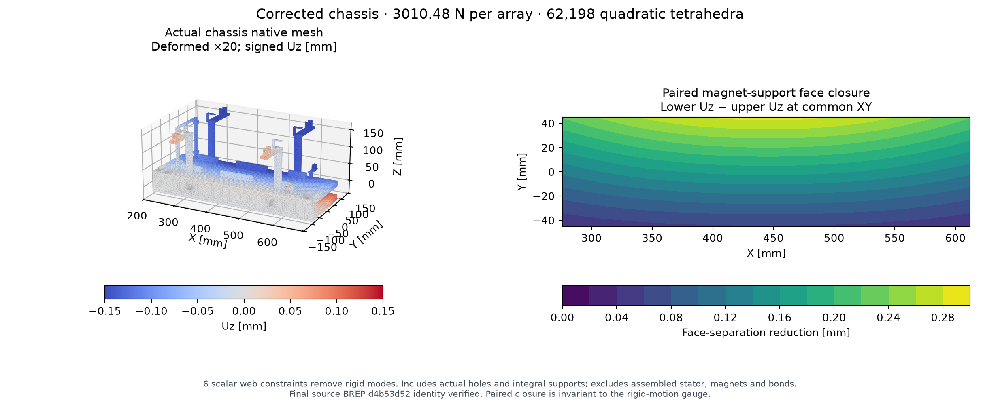

# Actual corrected chassis elasticity

The final source-generated chassis BREP is byte-identical to the analyzed solid: `d4b53d520c1bc0d33c1c36c29dddeb775d0b4147ec24dbb342a4fc43e97460a1`. The identity receipt ties it to final builder `e1179e88`. This model includes the actual 6.2 mm pallet-lock shaft bores, axle bores, home lug and integral supports. The earlier uniform quarter C-frame is retained as a comparison.

Gmsh fragments the actual solid with two internal plate boxes to imprint the 336×90 mm loading patches. Retained volume changes from 3,117,425.815727472 to 3,117,425.8157274765 mm³; the operation adds no material. Each patch receives 3010.480631 N, inward, using seven-point quadratic surface integration. The paired loads have zero resultant and moment. Three noncollinear web nodes receive exactly six scalar constraints to remove the six rigid modes.

The accepted mesh has 112,519 nodes and 62,198 C3D10 elements. Native high-order optimization removes the inverted curved elements detected in the initial rejected mesh; the accepted minimum scaled Jacobian is +0.075419 and the mesh is connected. CalculiX 2.23 finishes with force and moment equilibrium residuals of 1.42e−12 and 1.47e−12 relative to the applied load scales. E = 70 GPa and ν = 0.33 are assumed.

| Quantity | Nominal load | Declared 1.3× load sensitivity |
|---|---:|---:|
| Force on each array | 3010.481 N | 3913.625 N |
| Maximum paired face-separation reduction | 0.285983 mm | 0.371778 mm |
| Remaining sum of two nominal 1 mm gaps | 1.714017 mm | 1.628222 mm |
| Upper inward Uz in declared web gauge | 0.140538 mm | 0.182699 mm |
| Lower inward Uz in declared web gauge | 0.145458 mm | 0.189096 mm |

The 1.3× column scales the same linear solution; it is not another solve or a probability bound. The paired closure uses quadratic displacement interpolation at common XY locations, combining the patch nodes with a 2 mm grid. Its 9,969 sample points remove the arbitrary rigid translation and rotation from the comparison. Absolute per-face displacements use the declared web gauge. A positive summed gap does not establish both individual assembled stator gaps.

The figure shows the actual native mesh boundary, with displacements enlarged 20 times, and the computed paired closure. PDF and SVG versions accompany the PNG. It is a scientific result graphic, not a software-interface screenshot.

One actual-geometry mesh provides the bounded geometry-delta check. The loaded deflection is close to the earlier h8 uniform-quarter value of 0.144103 mm per face and remains far from consuming the nominal gap in the declared gauge, including the 1.3× sensitivity. No second actual-geometry mesh was needed to decide this clearance comparison. This does not establish a continuum error bound.

The actual chassis model excludes separate magnets, adhesive, rollers, joints, stator supports and complete assembly constraints. It makes no whole-product or hardware qualification claim.

Native mesh, INP/DAT/FRD outputs, logs, source hashes, load integration, identity receipt and full result JSON are preserved in `chassis_fea/d4b53d520c1bc0d3_h8/`.
