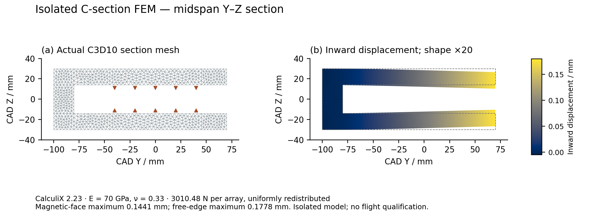

# ACR1 magnetic attraction and isolated C-section verification

## Evidence boundary

This package combines a same-geometry analytic cuboid field integral, a declared linear C-frame sensitivity, and a native three-dimensional elasticity model of an isolated C-section. It is a component investigation. It does not establish the complete sled, magnetic bonds, joints, supports, flight environment or measured performance.

## Same-geometry magnetic attraction

The model contains two arrays of 42 cuboids, 8 mm pitch, 8 mm magnetic thickness and 90 mm depth, with 60° block-to-block polarization rotation and 1.32 T polarization. The field axes are X travel, Y gap, Z depth; CAD uses X travel, Z gap, Y depth. The total force on one array is integrated over the separating mid-gap plane as `(By² − Bx² − Bz²)/(2 μ0)` using SI units. The normal force is not divided by two between the opposed plates.

| Numerical check | Result |
|---|---:|
| Nominal force, 600×220 mm plane, 0.5 mm grid | 3010.480631 N |
| Relative 1→0.5 mm grid change | 7.361e-11 |
| Relative 600×220→800×300 mm extent change at 1 mm | 3.964e-07 |

The cuboid field law is shared with the motor force study. The stress-plane integral is not independent FEM or a field measurement. It excludes current-reaction fields and magnetic support perturbations. The complete plane, field vectors and stress values are preserved in `NORMAL_MIDPLANE.npz`; run records are in `NORMAL_ATTRACTION.json` and the native log.

## Isolated C-section finite elements

The native model uses CalculiX 2.23 and Gmsh runtime 4.13.1. It represents the 16 mm upper/lower plates and 20 mm negative-side web of a uniform 488 mm-long C-section, with E = 70 GPa and ν = 0.33 assumed. X midspan and Z midplane symmetry reduce the specimen to a quarter model; one Uy constraint removes the remaining rigid translation. The 3010.48 N total force is redistributed uniformly over the 336×90 mm magnetic footprint. A planar six-node face integration applies the quarter load of 1505.24 N. Mesh connectivity and positive scaled Jacobians are checked.

| Maximum mesh size | Nodes | C3D10elements | Maximum magnetic-face closure | Relative force-balance residual |
|---:|---:|---:|---:|---:|
| 12 mm | 7186 | 3703 | 0.142424 mm | 3.208e-07 |
| 8 mm | 17206 | 9603 | 0.144103 mm | 6.645e-08 |

The 12→8 mm refinement changes the magnetic-face maximum by 1.165%. The fine specimen gives 0.144103 mm closure and 0.855897 mm remaining from a nominal 1 mm face-envelope gap. This two-mesh comparison is not a certified continuum error bound.

**Figure:** Actual C3D10 cross-section and CalculiX nodal displacements at longitudinal midspan. The lower half is reconstructed from the stated Z symmetry. The deformed shape is enlarged 20 times; color values retain actual millimetres. Dashed lines show the undeformed section. The view is an isolated C-section FEM result, not a full-sled simulation or a software-interface screenshot. Editable SVG and PDF versions accompany the PNG.

## Gap-feedback sensitivity

Decreasing the gap increases the analytic magnet attraction. An approximate scalar feedback uses the sampled force-versus-gap curve and the component/strip compliance. It does not solve an assembled nonlinear magnetomechanical contact problem.

- Strip/C-frame feedback: approximately 0.186314 mm per-face closure after a direct field check, leaving approximately 0.813686 mm.
- Isolated FEM-compliance interpolation: approximately 0.150087 mm closure, leaving approximately 0.849913 mm.

The scalar treatment assumes a uniform gap corresponding to a maximum deformation; actual gap and load distributions vary. These values are sensitivities, not a declared operating clearance or qualification margin.

## Other checks

`FEEDER_SIZING_CROSSCHECK.json` independently substitutes the quintic profile and drive quantities. The 250 mm / 40 s feed command has 11.71875 mm/s peak speed and 3164.0625 rpm motor speed. The 100 N transverse guide screen changes from −0.05918 mm residual with 8 mm shafts to +0.74733 mm with 10 mm shafts under its declared stack. Actual guide/bush geometry was checked for the 10 mm design; this is not a fitted-assembly tolerance proof.

`LIFT_SIZING_CROSSCHECK.json` checks the 784 mm / 120 s lift command, 3638.25 rpm motor peak, common-drive torque and equal-share screw buckling equations. Six coast cases pass the source sizing screens; three of six ground-gravity cases pass. The ground failures remain explicit. Actual moving mass, synchronization, nut life and power-loss dynamics remain source dependencies.

## Native records and reproduction

- `cframe_fea/h12/` and `h8/`: actual INP, DAT, FRD, mesh, solver log and metadata files.
- `cframe_fea/mesh_solve.py`: isolated-specimen mesh and native solver driver.
- `cframe_fea/postprocess.py`: displacement/reaction extraction. Reactions are summed only in constrained degrees of freedom.
- `cframe_fea/plot_section.py`: actual mesh/result visualization.
- `cframe_screen.py`: declared strip/C-frame comparison and historical-load sensitivity.
- `normal_attraction.py` and `FIELD_FUNCTION_CAPTURE.txt`: actual cuboid field and Maxwell-plane study.

The scripts read the controlled ACR1 parameter files and installed open-source tools. Recorded hashes identify the snapshots actually consumed; final integration must reconcile them with the final CAD revision. No unchanged historical Gen5 or FM08 artifact is overwritten by this investigation.
