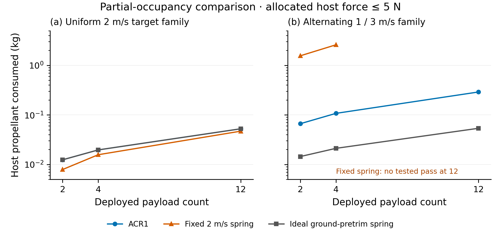

# ACR1 partial-occupancy mission comparison

**ACR1-PARTIAL-OCCUPANCY-01 · 26 October 2026.** Two- and four-payload finite-force campaigns extend the accepted twelve-payload reference. All cases retain the complete launcher hardware and use passive 4 kg 3U surrogates.

[Methods and results](REPORT.md) · [Common 2/4/12 comparison](technical/README.md) · [Independent replay checks](INDEPENDENT_CHECKS.json) · [Source identities](SOURCE_IDENTITIES.json)

Computed comparison at 5 N allocated authority. Missing points denote no tested pass. The alternating ACR1 target family has no tested 1 N pass. Full hardware mass and the common evaluation epoch are retained; numerical consistency is distinct from physical delivery accuracy.

The capture contains 28 new finite-force candidate trajectories, 17 native Orekit replays and four step refinements. The comparison tables combine these with the separately preserved twelve-payload study. Mixed-size Gen6 performance and provider compatibility require their own configurations and evidence.

## Reproduce

Run `python3 check_capture.py` for the standard-library source/output identity and result checks. Install the pinned scientific dependencies in `requirements.txt` to run `python3 run_cases.py`. Native replay uses `python3 verify_and_replay.py --jars-dir /path/to/orekit-jars`; the original Java source and command/output captures are included. See [the report](REPORT.md#source-and-reproduction) for model, units and runtime details.
