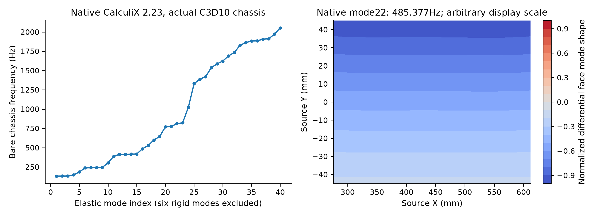
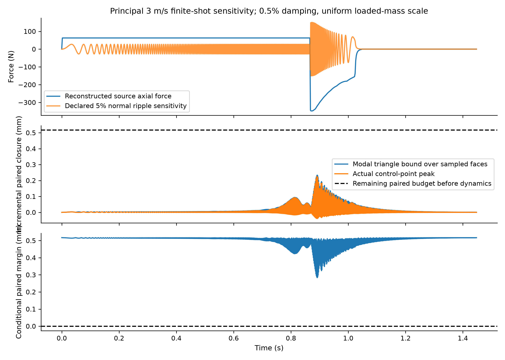
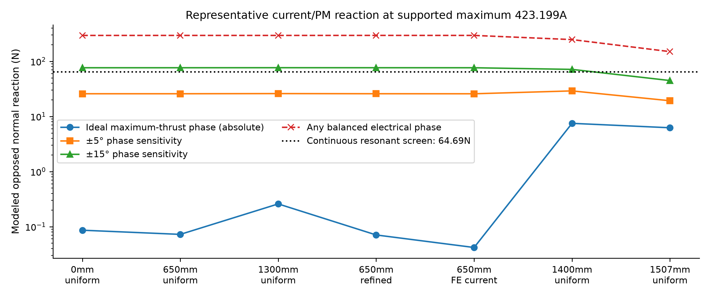
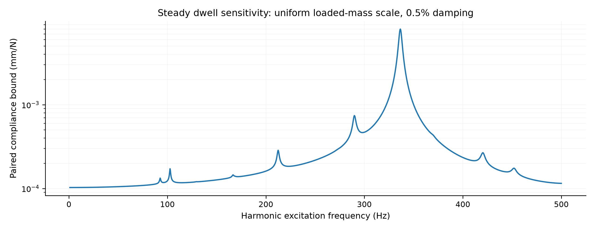

# ACR1 structural dynamics and conditional airgap screen

**Study SD01; 25 October 2026. Separate follow-on evidence.** Frozen ACR1 geometry, original static/ED1 captures and report operating-point identities remain unchanged. This study supplies genuine native modal extraction and bounded numerical forcing/airgap decisions; it does not qualify the complete installed assembly.

## Result and design decision

The actual connected chassis mesh yields six numerical rigid modes and **40 elastic modes from 131.4105 to 2052.744 Hz**. All **54 finite principal-3 m/s sensitivity cases** retain positive conditional paired clearance. The adverse 50 µs refinement has **0.234425 mm** incremental paired closure bound and **0.282788 mm** paired budget remaining. This relies on the original guide/flatness/assembly/thermal allocations and stationary-stator/centring boundary.

A continuous resonant load is an adverse case: with assumed 0.5% damping the conservative modeled normal-force limit is **64.687 N** (about **2.149%** of DC pinch). A sustained 5% harmonic exceeds this conditional budget. It must not be confused with a brief swept passage in the finite shot.

The representative current/PM calculation gives ideal maximum-thrust-phase opposed normal reaction at most **7.500 N**, including sampled arrest positions. At the supported current maximum, the representative ±5° and ±15° phase sensitivities reach **29.091 N** and **76.687 N**. The arbitrary balanced-phase envelope reaches **295.711 N**. The corresponding station-based continuous-resonance phase-error screen is approximately **±12.60 degrees**. This is a conditional design requirement, not demonstrated controller accuracy or a global force-map bound.

## Actual native model and scope

The input reuses all **112,519 nodes and 62,198 C3D10 elements** from accepted chassis deck SHA256 `e62f404781d0ad7e43897daa2e98c3af21eabb639ecfd435ac51b0db1b8d9255`, itself tied to the final connected-chassis BRep. E = 70,000 MPa and Poisson ratio 0.33 remain source assumptions. Added density is 2700 kg/m³ (2.7e-9 tonne/mm³) from the frozen material class. The bare represented chassis mass is **8.417050 kg**.

The original six scalar static gauge constraints are removed for true free-free modes. The six near-zero rigid modes have squared angular frequencies below 0.001 rad²/s² in magnitude; small negative numerical rigid values are not elastic buckling modes. Elastic participation factors in rigid translation/rotation are near zero. Native output is mass normalized. The final native run also prints stresses at **148 integration points**, including the element incident to the actual accepted static stress hotspot. Original source deck/mesh/geometry are not edited.

Separate magnets, bonds, pallet, payload, rollers, joints, stator and host mounts are not meshed here. Uniform-density sensitivities scale the bare mass to the retained-sled and retained-sled-plus 4 kg totals; they are not real discrete attachment modes or a bound over arbitrary mass distributions. No provider mount approval is implied.

## Forcing, DC preload and finite response

The source **3010.480631N per array** is permanent-magnet mutual attraction. The two PM arrays move together, so this is treated as DC preload, never a full 3 kN oscillatory excitation. The accepted 130% static closure and existing material/thermal/tolerance allocations remain in the budget.

The axial history is reconstructed from the captured principal 3 m/s phase-current trace and finite-force/arrest coefficients. The original saved trace is sampled every 2 ms; reconstructed transitions do not resolve switching or uncaptured current transients. Longitudinal force is distributed uniformly over the two existing magnet patches for this elasticity screen. Free-body rigid acceleration is excluded from paired elastic closure.

Normal sensitivity fractions are 0.1%, 1% and 5% of DC, multiplied by the normalized source force envelope and sin(2pi*x/pitch), with actual source x(t), 8 mm stator pitch and48 mm magnetic wavelength. These are deliberately declared sensitivities, not calibrated ripple. Damping ratios are 0.5%, 2% and 5%. The nominal body, uniformly mass-scaled retained sled and uniformly mass-scaled loaded sled give54 finite cases.

A 500 N/mm rank-one opposing-gap stiffness sensitivity uses the energy-conjugate normal modal force. It is rounded above the largest recorded field-gap secant (about 485 N/mm over the source 0–0.8 mm per-face samples), rather than asserted as a certified derivative bound. Native mechanical geometric-prestress stiffness is not included. The reduced stiffness remains positive for the declared cases.

The modal response uses an exact state transition for each linearly interpolated force increment. A triangle bound covers the union of accepted face nodes and2mm grid; actual control-point histories are retained separately. Static FEM residual is reserved explicitly rather than silently replacing the accepted static solution with a truncated modal approximation.

## Current-induced normal reaction from source physics

Each PM array is handled separately. Magnetostatic reciprocity gives reaction on that array as minus the volume integral of JcrossB from its field on the winding. This avoids hiding opposed pinch through cancellation of the total winding normal force. Field coordinates are right-handed Xtravel,Ygap,Zdepth, with CADX=Xfield,CADZ=Yfield,CADY=-Zfield. Common-mode normal force is reported separately in the JSON.

Actual connected DC FE-current distributions for phaseA(h2mm),B(h3mm),C(h3mm) are integrated at650mm. Other representatives use the exact source active-bar and end-return quadrature, including two arrest-region stations; one interior station is refined. The supported18-case maximum phase current is **423.198740A**. Maximum-thrust electrical phase matches the ideal phase convention of the frozen averaged motor model.

| Stroke mm | Numerical method | Ideal phase abs N | ±5deg N | ±15deg N | Any balanced phase N |
|:--|:--|--:|--:|--:|--:|
| 0 | uniform actual active bars + source return-path transverse quadrature | 0.0863 | 25.824 | 76.516 | 295.314 |
| 650 | uniform actual active bars + source return-path transverse quadrature | 0.0725 | 25.823 | 76.539 | 295.455 |
| 1300 | uniform actual active bars + source return-path transverse quadrature | 0.2589 | 25.998 | 76.687 | 295.330 |
| 650 | refined uniform-bar/return quadrature | 0.0708 | 25.843 | 76.604 | 295.711 |
| 650 | actual connected phase DC FE-current centroid integration | 0.0419 | 25.797 | 76.525 | 295.514 |
| 1400 | uniform arrest-region source bars + return quadrature | 7.4996 | 29.091 | 71.448 | 248.179 |
| 1507 | uniform arrest-region source bars + return quadrature | 6.2379 | 19.285 | 44.842 | 150.105 |

The actual FE-current interior normal envelope differs from refined uniform quadrature by about 0.067%. That checks this representative implementation; it does not independently validate the shared cuboid field or a full commutation/stroke/brake map. AC skin/proximity, induced fields, steel perturbations, detailed cables and actual controller errors remain outside the model.

## Stress, convergence and required limits

The actual accepted native **nodal extrapolated DC vonMises maximum is 24.662187MPa**, at the declared web hotspot. Recovered static and modal C3D10 integration-point stresses share the same consistent strain tensor; modal recovery matches native printed stresses within **0.213%** relative component error. The adverse finite monitor bound is **59.411MPa**, including130% monitored DC stress. This bounds the declared monitored integration points, not a global dynamic peak. No alloy/temper, yield, fatigue or measured strength limit is invented.

Static paired closure with 10/20/40 elastic modes is0.00553/0.24771/0.29100mm versus accepted0.28598mm. The40-mode maximum spatial residual is0.008468 mm; a 1.3-scaled0.011008 mm reserve is included. The adverse30-to40-mode finite closure-bound change is about 0.0065%;100-to50 µs refinement changes the adverse bound by about 0.266%. Source-trace2ms sampling remains a separate input limitation.

This is one actual accepted mesh with positive element Jacobians, not modal/stress mesh qualification. Full assembly/stator/mount modes, joint/contact damping, manufactured tolerances, a denser current-normal force map and calibrated phase/ripple histories remain required before a physical operating rating. The conditional individual-face residual assumes the original centring allocation; positive paired clearance alone does not prove both actual installed gaps.

**Required design controls:** retain a verified normal-force spectrum/phase-error bound below the applicable resonant limit or introduce demonstrated damping/stiffness/operating exclusions; validate the actual attachment/stator spectrum and individual gaps; keep stress/yield acceptance separate until real material specifications and loads are assigned. The present results support the declared computational reference and identify explicit adverse limits. They do not broaden the original averaged1–3 m/s evidence into hardware qualification.

## Source and reproduction record

`MODAL_INPUT.json`, `runs/free_free/modal.inp`, native `modal.dat` and `SOLVER_STDOUT.txt` identify the genuine run. `MODAL_BASIS.npz` retains patch modes and148 monitored stress fields. `RESPONSE_RESULTS.json`, `FINITE_CASES.csv`, `RESPONSE_CURVES.npz`, `SOURCE_SHOT_FORCE.csv` and `CURRENT_NORMAL_FORCE.json` provide inputs, limits and raw reduced-model results. No vendor PDF is redistributed.

CalculiX2.23 manual sections6.9,7.52,7.63,7.87 and7.88 document mass normalization, frequency extraction, printed stress and modal response conventions (publisher: https://www.dhondt.de/ccx_2.23.pdf). Actual numerical outputs remain the run evidence; a prepared input or manual citation alone is not execution proof.
