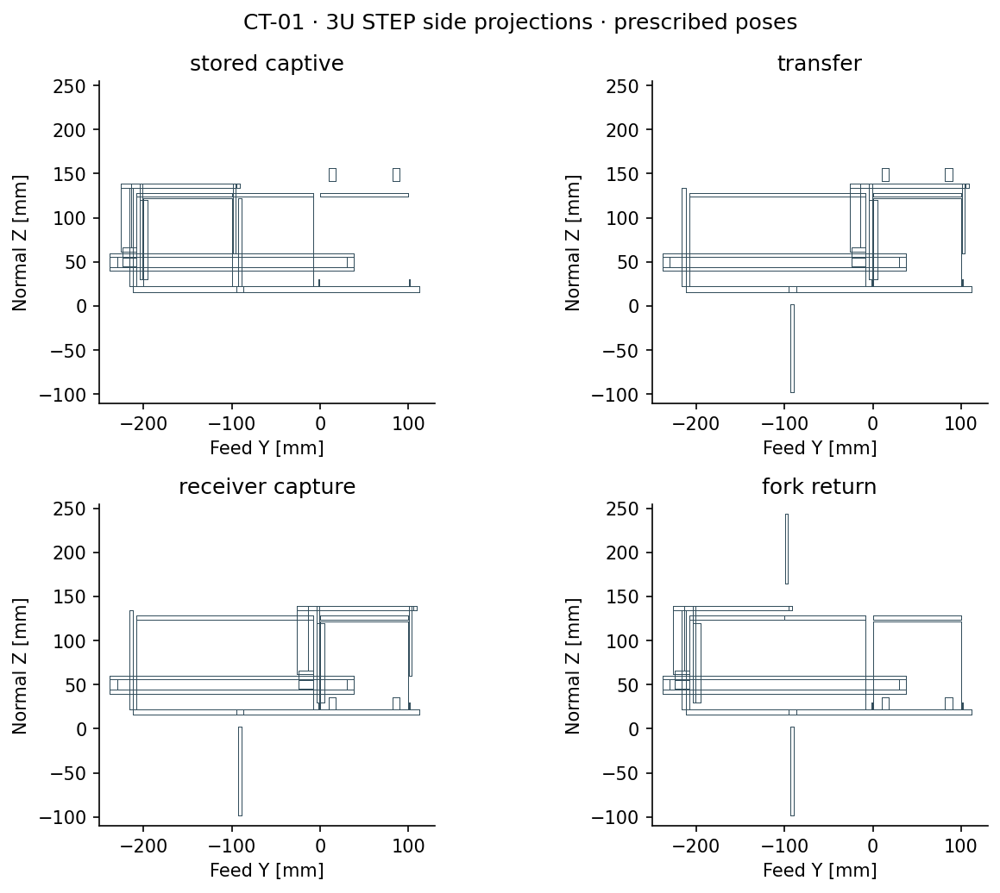
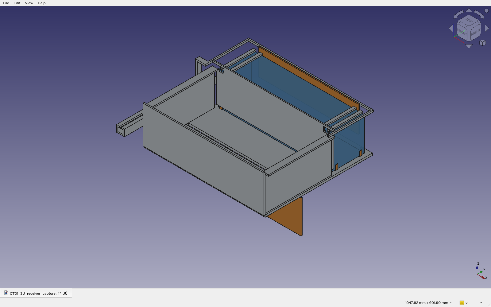
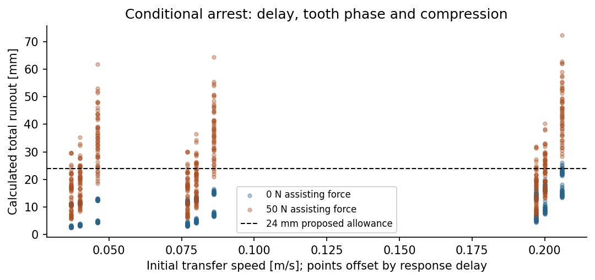
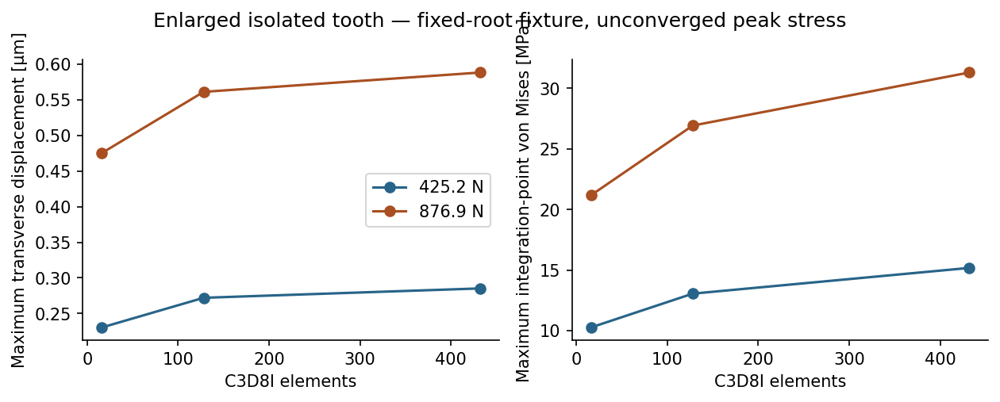

# Scope and disposition

CT-01 is a separately versioned nominal transfer-coupon investigation. It does not select a feeder, replace the frozen evaluated Gen5, or repair every FDR-08 candidate. The seven feeder alternatives remain in the earlier equal-boundary trade. This study addresses the common custody geometry and a separate compliant-arrest sizing hypothesis.

The prescribed rectilinear cycle now has continuous interference evidence. Positive retention after a real actuator/sensor fault, loaded clearances, actual joint ratings and integration with a moving launcher sled remain unresolved. The external-departure phase is imposed motion; it is not an electromagnetic launch simulation.

# Controlled configuration

Public-envelope surrogates: 1U length 113.5 mm and 3U length 340.5 mm, each 100 × 100 mm cross-section; 200 mm lateral transfer. Feed is Y, nominal departure is X and normal is Z. A captive C guide supports a connected overhead fork, front/rear barriers, rear corner lugs and top retainers. Receiver locks and its top retainers occupy separate bands from the fork. No supplier-approved passive-spacecraft contact interface is claimed.

The storage gate retracts **downward by 120 mm through an actual floor slot**. This removes the crossing with the overhead fork but creates an explicit under-deck accommodation requirement: the open gate extends to Z = −98 mm while the floor underside is Z = 16 mm. Receiver Y dogs retract laterally by 20 mm; their X stop counterparts retract upward by 120 mm. These motions require actuator, guide, latch and mechanical interlock design. Native solids do not substitute for those joints.

Modeled material is 2.349 kg for the 1U coupon and 4.389 kg for 3U, excluding payload, source-rated drives, actuators, purchased bearings, sensors, wiring, fasteners and host interface. Native volume-derived CG and inertia are recorded for all 22 states; these are not installed system properties or a fair seven-feeder mass ranking.

# Continuous geometry and custody

The sequence is stored/captive → storage gate retracted → transfer → receiver capture → front barrier raised → fork return → storage gate closed → fork reset. Receiver release requires independently verified external sled custody. The subsequent X translation and empty-receiver reset are explicit boundary surrogates.

For each represented axis-aligned constituent, both bounds vary linearly over phase time. Positive-volume intersection requires overlap in all axes at the same instant. Intersecting those strict time intervals provides a continuous prescribed-translation test, rather than endpoint or time-grid clearance. Same-part constituents are fused, and deliberate shared contact faces are not treated as positive penetration. This is exact for the stated primitive geometry; it excludes rotations, compliance and actual actuator linkages.

20 continuous 1U/3U phase cases report 0 positive penetrations. FreeCAD/OpenCascade independently checked 60 endpoint/midpoint poses. Twenty-two native FCStd and 22 STEP states plus a separate contact coupon were created; STEP readback verifies valid solids and total material volume. Small-gap contact, tolerance and loaded motion remain separate questions.

The native application capture below shows the stored FreeCAD document in a Python-hosted Qt/Coin viewer. Colour distinguishes the payload and moving gates; no application interface or geometry is composited. The native document is not saved by the capture process.

# Fault logic and retained counterexamples

The executable guard model checks 432 combinations around opening the fork, returning it and unlocking the receiver. Other cells cannot advance while shared-path proof is invalid. This verifies requirements under truthful physical indications; it is not a real electrical implementation.

Three counterexamples remain: a false receiver-locked indication permits unsafe fork opening; a power-failed storage gate can close onto a straddling payload unless physically inhibited; and unlocking without actual sled custody loses the defined retention chain. They require independent retention verification, mechanical hold-open/holding design and a real receiver-to-sled interface. Logical guards alone do not resolve them.

# Local tolerance sensitivity

243 gap screens apply 0.30 mm combined manufacturing allowance, angular error over 200 mm, differential CTE over −40/20/80°C, and 0/0.5/1.3 mm assumed deflections. 148 cases have nonpositive residual clearance. This is a conservative local sensitivity, not a GD&T assembly solution. The smallest nominal guide/receiver gaps are 1 mm. Neither nominal nonpenetration nor a selected favorable angular case establishes loaded fit.

# Conditional compliant arrest

The proposed square rack root grows from the earlier 8 × 1 mm section to 16 × 6 mm, at 3 mm contact height. A separate STEP/FreeCAD coupon has one square bolt in actual face contact with a tooth; insertion, preload and the attachment load path are not implemented. This geometry is not yet connected to the moving fork.

After an assumed catch, the model solves m q̈ + c q̇ + k q = F. Free travel includes response latency and tooth phase. The 972 cases span 2.83/5.5/7.5 kg moving mass, 0.04/0.08/0.20 m/s, 5/20/50 ms assumed delay, 2/10 mm tooth phase, 8/16/32 kN/m stiffness, 0/80/160 Ns/m damping and 0/50 N assisting force. The 7.5 kg bound is provisional; installed moving hardware must be rechecked.

Maximum calculated runout is 72.40 mm; 180 cases exceed 12 mm compression and 226 exceed 24 mm total allowance. Maximum compression force is 425.22 N under this linear model. Unmodeled pawl impact can produce different peaks. Energy balance and an independent undamped compression bound are checked; halving the selected worst-case time step changes compression by 7.25e-10 mm.

The restricted, **unvalidated operating hypothesis** of speed ≤0.08 m/s, response ≤20 ms and removal of assisting force has 216 cases, with maximum runout 14.05 mm. This is a candidate requirement for a 5 s or slower transfer, not a rated operating envelope. The persistent-force cases show why passive spring-driven and powered drives cannot share an assumed safe-stop result.

# Native tooth fixture analysis

CalculiX 2.23 ran six C3D8I cases for the 16 × 6 × 3 mm isolated tooth at 425.225 N and 876.9 N. Steel E = 200 GPa and ν = 0.3 are assumptions. The lower face is fully fixed and transverse load is distributed over the top face. Reaction force balances are checked. The last mesh has 432 elements; at 876.9 N, maximum displacement is 0.588 µm and maximum integration-point von Mises stress is 31.30 MPa.

Last-mesh displacement changes by 4.61% and peak stress by 13.98%. Peak stress is **not converged**; no selected alloy allowable, strength margin or qualified tooth follows. Sharp roots, contact, fillets, pins, attached rack support, rebound, fatigue and impact remain absent. The short block also limits the slender-beam approximation. Raw INP/DAT/FRD/logs are included.

# Verification status and next design actions

| Finding | Current disposition |
|:--|:--|
| Overhead storage gate crosses fork in motion | Corrected in CT-01 prescribed geometry by downward gate and floor slot; under-deck fit unapproved. |
| Receiver locks cross fork overhead member | Corrected in CT-01 prescribed geometry by separate lateral/vertical lock motions. Actual guides and latches remain open. |
| Fork custody and withdrawal only shown as snapshots | Continuous nominal rectilinear cycle checked; actual contact and actuator mechanism remain open. |
| Earlier thin tooth and unengaged pawl | Larger isolated root/face-contact coupon analyzed; no integrated, rated retention mechanism. |
| Stop travel after power loss | Broad candidate envelope fails; a restricted drive-removed hypothesis is identified for validation. |
| False latch indication / gate falling onto payload | Physical counterexamples retained; controller model is insufficient. |
| Loaded clearance | Adverse local sensitivities fail; actual datum stack and assembly FEA required. |
| Four/twelve-cell integration | Not supplied by this single-cell coupon. |

# Reproduction

Use FreeCAD 1.0/OpenCascade 7.8.1 system Python for build_native.py and extract_views.py. Run audit.py, stop_dynamics.py, interlocks.py, tolerance.py and report.py in Python with NumPy, SciPy and Matplotlib. Set CCX to CalculiX 2.23 for tooth_fea.py. Captured evidence can be checked without native solvers using check_capture.py. Exact source/output hashes accompany the release. This report is generated; edit its generator and rebuild.
