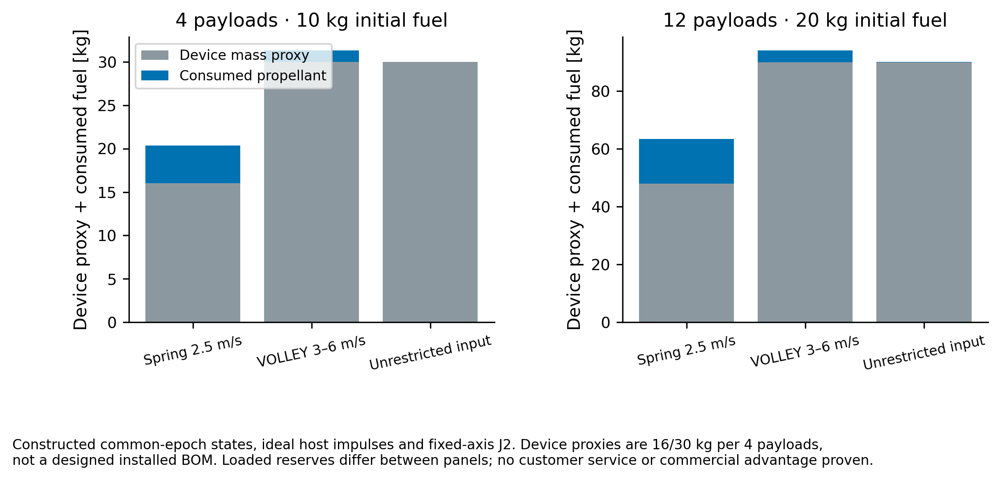

# Study boundary

This is a constructed numerical comparison, not a validated customer mission or working launcher. Four and twelve alternating 1.33/4 kg passive payloads start at a 500 km, 97.4° surrogate. Releases occur from 0 to 3600 s. Each target is defined by a 3–9 m/s prograde increment at its release epoch, then propagated to the common 90000 s epoch, 24 h after the final release. These selected targets favor variable release commands and are not evidence of customer demand or an optimum deployment strategy.

Host dry mass is 300 kg, assumed Isp 220 s. Device proxies are 16 kg for springs and 30 kg for VOLLEY per four payloads. They are explicit assumptions, not installed mass estimates. Spring departure is 2.5 m/s; VOLLEY commands are limited to 3–6 m/s in the first-article case. The unrestricted case reaches about 9.1 m/s relative and is an imposed future-capability diagnostic, not an achievable motor rating.

# Coupled host construction

Each shot solves a finite-mass momentum split. Host pre-burn and propellant are coupled through a fixed-point rocket equation. The host coasts 20 s after release, then an ideal-impulse shooting transfer restores the next nominal release position. After the final shot it restores reference host position and velocity at 4200 s before coasting to the common epoch. All pre-burn, transfer and final-restore delta-v is counted. Finite burns, thruster direction/geometry, slew, plume exclusion, navigation, control limits, power, thermal duty and disposal are absent. No host compatibility or resource feasibility follows.

Full Cartesian payload targets are met by construction; their small residuals check the solver and shooting equations. They are not a release-accuracy prediction. The force model is fixed-axis J2, distinct from the GMAT/Orekit prescribed-pole benchmark.

# Results

| N | Strategy | Initial fuel [kg] | Consumed [kg] | Device proxy [kg] | Status |
|--:|:--|--:|--:|--:|:--|
| 4 | Spring 2.5 m/s | 10 | 4.355163 | 16 | Computed ideal-impulse case |
| 4 | VOLLEY 3–6 m/s | 10 | 1.328501 | 30 | Computed ideal-impulse case |
| 4 | Unrestricted input | 10 | 0.033661 | 30 | Computed ideal-impulse case |
| 12 | Spring 2.5 m/s |10|—|—| Fuel reserve exhausted |
| 12 | VOLLEY 3–6 m/s | 10 | 3.954434 | 90 | Computed ideal-impulse case |
| 12 | Unrestricted input | 10 | 0.101619 | 90 | Computed ideal-impulse case |
| 12 | Spring 2.5 m/s | 20 | 15.352517 | 48 | Computed ideal-impulse case |
| 12 | VOLLEY 3–6 m/s | 20 | 4.049854 | 90 | Computed ideal-impulse case |
| 12 | Unrestricted input | 20 | 0.101619 | 90 | Computed ideal-impulse case |

The twelve-release spring case exceeds the 10 kg reserve at the tenth transfer. Increasing all twelve-payload alternatives to 20 kg initial fuel gives a completing spring countercase; reserve exhaustion therefore does not establish that spring delivery is impossible. Under these proxies, the VOLLEY device mass increase exceeds the propellant saving. This study does not establish a favorable installed-system mass case. A competent alternative may also choose different release times, host paths or target tolerances; no global optimization has been performed.

# Conditional nominal clearance

The interval screen starts host/payload assessment20 s after each release, excluding the actual launch-interface/near-field phase. It splits host arcs at each ideal impulse. Pairwise payload assessment begins at the later birth. Over an interval half-width h, the lower bound uses midpoint distance minus relative speed times h minus10h² minus0.02 m. The acceleration term assumes a20 m/s² relative acceleration bound while both bodies remain outside the Earth radius; the domain is checked conservatively from center states. Adaptive bisection retains unresolved or violating intervals.

The 0.02 m subtraction stipulates at most 1 cm numerical position error per object; it is not an independently rigorous error enclosure. The 20 m threshold applies to nominal point centers. Payload size, swept launch geometry, covariance, navigation, contact, tip-off, plume and finite burns are not included. A passing conditional screen is not collision-free flight, a collision probability or launch-interface clearance proof.

# Numerical refinement

Reducing the DOP853 maximum step 60→30 s preserves the retained fuel-exhaustion failure. Completed-case fuel and host-delta-v changes are recorded in REFINEMENT.json. Same-solver refinement is not independent mission validation. Momentum identities are algebraic checks; atmospheric drag, Earth orientation and real propulsion errors remain outside this model.

# Reproduction

`python run.py` reproduces the 10 kg cases, `python refine.py` the 30 s refinement, `python reserve.py` the 20 kg twelve-payload countercases, and `python report.py` this report and figure. Raw state CSV filenames identify manifest count, strategy, initial fuel and maximum step. RESULTS.json and RESERVE_CASES.json retain shot and burn histories; source and exact result hashes are recorded in MANIFEST.json. The frozen Gen5 evaluated record is unchanged.
