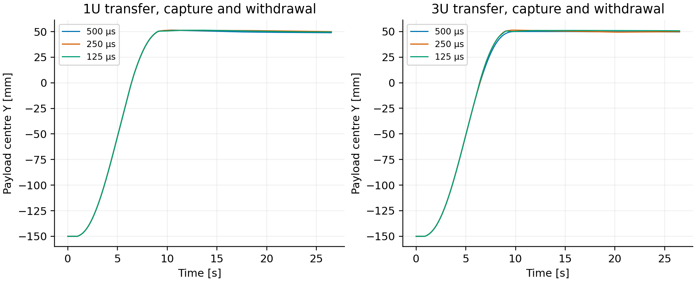
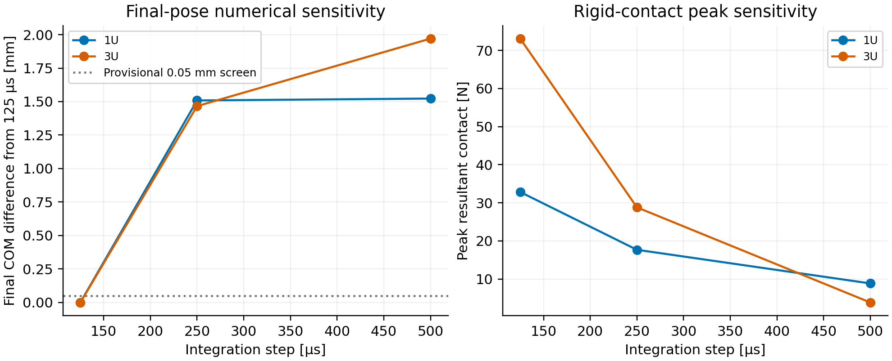

# Feeder contact verification — FCE12

This study evaluates the numerical collision representation for the unchanged FM06-R1 transfer geometry. The native Project Chrono 10.0.0 model uses kilograms, millimetres and seconds internally and converts recorded outputs to SI. The software, geometry and output identities are included.

## Results

- Fourteen analytical planar-gap controls cover both payload sizes. The millimetre-coordinate representation detects the 10 µm–1 mm imposed overlaps; the largest checked reported-gap error is 4.28 nm. These simple controls do not establish general curved-surface accuracy.
- A no-contact controller replay agrees with the metre-coordinate calculation to below 1e-6 in the checked SI outputs.
- Twelve native cases cover both sizes, three integration steps, an iteration refinement, friction, a rigid 6 kg gravity case and two injected faults. Ten sequences reach the 26.5 s transfer/capture/withdraw endpoint; deliberate jam and stuck-pin cases abort at 11 s.
- Independent full native-solid checks cover 84 selected poses. Two residual intersections have maximum volume 0.000124 mm³; a 1 µm Y translation removes all checked intersections in both residual poses. The original poses and residuals remain in the audit. This is a discrete geometric-resolution check, not continuous loaded clearance.
- Final pose and impulsive contact peaks remain sensitive to integration step. The 250-to-125 µs final COM changes are 1.509 mm for 1U and 1.466 mm for 3U, exceeding the provisional 0.05 mm numerical screen. No delivered-accuracy or contact-force rating follows.






## Geometry and model boundary

The native payload is partitioned into nine convex cells with disjoint interiors and exact B-rep union equivalence. Mechanism contact geometry uses 64 rectilinear CAD cells per size within a guarded X/Z domain. Full original body mass, CG and inertia are retained. The independent pose audit uses the complete original B-reps, including excluded collision-domain material.

The model starts with the storage gate open. Ideal prismatic guides, full-state 1 ms feedback, assumed 40 rad/s critically damped PD control, force limits and friction remain explicit assumptions. The model does not supply selected hardware, elastic joint/contact correlation, a complete launch/reset cycle, mixed-size installed integration, measured reliability or flight qualification. All seven feeder concepts remain unselected.

## Files and replay

| Record | Content |
|:--|:--|
| `FEEDER_CONTACT_VERIFICATION.pdf` | Engineering method and results |
| `RESULTS.json` | Quantitative summary and acceptance boundaries |
| `campaign_mm/` | Frozen native commands, CSV, logs, metrics and hashes |
| `geometry_guarded/` | Captured collision cells and CAD partition records |
| `mechanism.py`, `reference/` | Original full native geometry |
| `NATIVE_POSE_AUDIT.json`, `POSE_RESOLUTION.json` | Full-B-rep checks and residual resolution |
| `captured/` | Exact executed C++ source; current root copies are token-equivalent formatted editions |

Build with a configured Project Chrono 10 SDK:

```sh
cmake -S . -B build -DChrono_DIR=/path/to/chrono/build/cmake
cmake --build build --parallel 2
python run_campaign.py
python check_capture.py
```

`run_campaign.py` writes a separate `reproduced_runs` directory. The frozen native capture is preserved. Native CAD checks require FreeCAD and use `audit_native_poses.py`; NumPy and Matplotlib generate the numerical figures. The exact source and output identities are recorded in `MANIFEST.json`.
