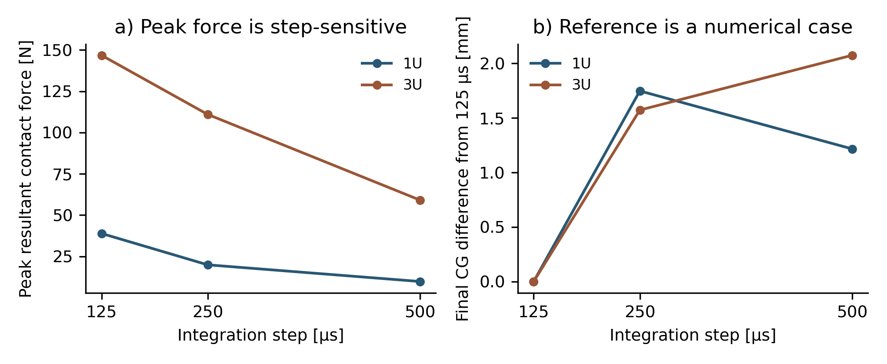

# Native contact assessment: FCE08

The twelve captured cases are numerical studies, not hardware release tests. **Engineering acceptance is not established.** Nominal sequence completion is separated from contact, clearance and accuracy acceptance.

## Captured results

| Case | Payload / variation | Step [µs] | Exit | Last CSV sample [s] | Peak resultant contact [N] | Positive mechanical work [J] |
|:--|:--|--:|--:|--:|--:|--:|
| FCE08-01 | 1U / time refinement | 500 | 0 | 26.500 | 9.827 | 1.92008 |
| FCE08-02 | 1U / time refinement | 250 | 0 | 26.500 | 19.917 | 1.92024 |
| FCE08-03 | 1U / time refinement | 125 | 0 | 26.500 | 38.904 | 1.92009 |
| FCE08-04 | 3U / time refinement | 500 | 0 | 26.500 | 59.149 | 1.92264 |
| FCE08-05 | 3U / time refinement | 250 | 0 | 26.500 | 111.013 | 1.92265 |
| FCE08-06 | 3U / time refinement | 125 | 0 | 26.500 | 146.807 | 1.92357 |
| FCE08-07 | 3U / iteration refinement | 250 | 0 | 26.500 | 85.327 | 1.92306 |
| FCE08-08 | 3U / rigid ground adverse mass | 500 | 11 | 10.990 | 966.436 | 1.04853 |
| FCE08-09 | 3U / friction sensitivity | 500 | 0 | 26.500 | 30.925 | 1.92235 |
| FCE08-10 | 3U / friction sensitivity | 500 | 0 | 26.500 | 51.214 | 1.92377 |
| FCE08-11 | 3U / deliberate jam | 500 | 11 | 10.990 | 164.207 | 0.23265 |
| FCE08-12 | 3U / deliberate stuck pin | 500 | 11 | 10.990 | 59.149 | 0.96160 |

Exit 0 denotes the programmed sequence endpoint; 11 denotes a commanded abort and 10 a numerical/domain rejection. These codes do not measure reliability. Mechanical work omits electrical losses, static holding power and actual actuator ratings.

## Numerical review

The nominal 1U and 3U cases complete transfer, capture and fork withdrawal. Peak contact forces increase substantially as the integration step is reduced. Doubling the iteration cap also changes the final 3U pose. The study therefore does not establish a converged force history or delivery-accuracy range. The 125 µs trace is a comparison reference, not an exact solution.

Independent exact-solid spot checks retain 8 positive payload/fork intersections; the largest checked intersection volume is 385.777 mm³. This is a volume, not a penetration depth. These actual solver-transformed B-reps contradict a zero-dynamic-interference claim even where reported triangle-contact distances are small. The discrete spot checks do not cover all components or continuous time.

For cases whose final CSV sample coincides with the final physics step, momentum balance recomputed from CSV velocity and native contact impulse agrees within the stated numerical tolerance. A truncated abort CSV does not support that independent endpoint check; its native every-step residual is retained separately. Balance validates bookkeeping under the rigid model; it does not validate collision geometry, contact law, constraints or force predictions.

The gravity case is a rigid-body sensitivity and does not include the elastic tine deflection calculated separately in FLR02. The jam and stuck-pin cases are deliberately injected faults; their results do not demonstrate safe power-loss containment, redundant sensing or recovery. Ideal state measurements and force cutoffs have no selected physical implementation.

## Disposition

Use the campaign to diagnose contact representation, numerical sensitivity and missing interfaces. Do not use it to accept loaded clearance, contact loads, tip-off, repeatability, a source-rated actuator or flight reliability. Further work requires controlled surface/contact refinement, time/iteration studies with specified convergence criteria, actual joint compliance/friction, complete restraint/release geometry and physical correlation.
