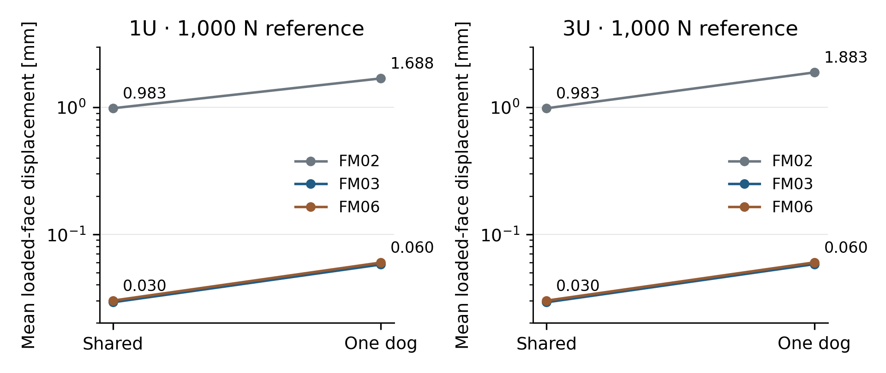
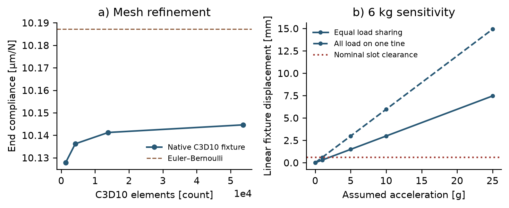
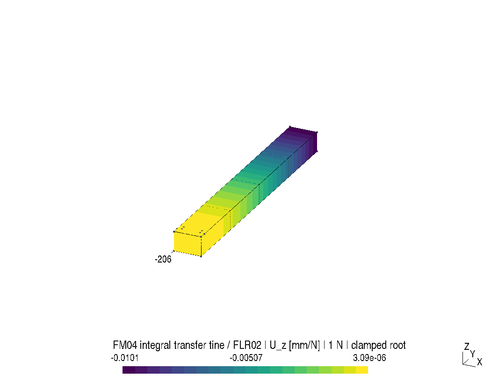
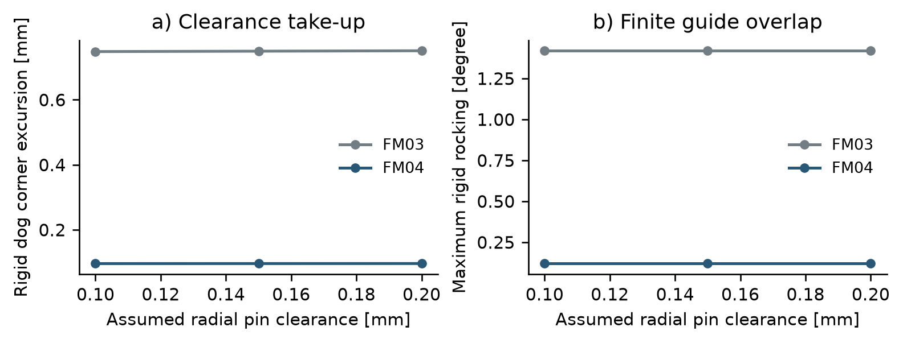

# Feeder geometry, stiffness and contact study

**FM06-R1 · FLR01 · FLR02 · FLR03 · FCE08 | 21 October 2026**

This study investigates the cassette-to-sled handoff for separate 1U and 3U reference payloads. It introduces transfer-support tines, a shorter front-barrier stroke and longer receiver guides, corrects a nonmanifold backstop junction, and examines component stiffness, guide play, tolerance sensitivity and rigid contact. It is a separate Gen6 research revision. The evaluated Gen5 configuration and its adverse findings remain unchanged.

**The study does not establish a completed feeder.** Installed actuation, actual joints, payload-interface approval, launch and complete reset remain unresolved. All seven feeder architectures remain unselected.

## Geometry and exchange evidence

The payload surrogates measure 113.5 × 100 × 100 mm and 340.5 × 100 × 100 mm. Their reference masses are 1.33 and 4 kg; adverse sensitivities also examine 2 and 6 kg. The rail dimensions are informed by the public CubeSat Design Specification, revision 14.1. Actual spacecraft protrusions, rail-end contacts and a provider-approved interface are absent. No compatibility certificate follows.

The fork travels 201 mm: 1 mm takes up the initial rear gap and 200 mm transfers the payload laterally. Two integral 12 × 109 × 8.5 mm support tines pass through represented storage/sled slots. The front restraint lifts 12 mm before withdrawal. The receiver uses 8 × 12 mm stems and 48 mm guides with 0.05 mm nominal clearance on each side. Two 3 mm endpoint pins are represented. The guide fit is a research hypothesis, not an approved tolerance.

Thirty native FreeCAD documents and assembly STEP exchanges represent fifteen poses for each payload size. Eighty-four additional poses and 28 continuous prescribed rigid-translation phases have no represented positive-volume interference at the stated geometric threshold. The independent exchange checker reads all thirty assemblies. Seventy individual STEP files (35 per reference assembly, including repeated component variants) retain the assembly datum; they are reference exchanges rather than unique manufacturing part numbers or production drawings. All seventy independently read back as valid.

[3U assembly STEP](cad/FM06_3U_transfer.step) · [Native FreeCAD assembly](cad/FM06_3U_transfer.FCStd) · [Individual-part index](parts/INDEX.json) · [Independent part checks](parts/INDEPENDENT_STEP.json)

The earlier backstop/near-rail junction met along an edge. B-rep validity and a single-solid count did not detect the four incident surface triangles at that junction. Extending the backstop to Y = 7…95 mm gives 3 and 5 mm attachment lengths at the two rail faces. The first, wider attempt produced a 10 mm³ fork intersection and was rejected. The accepted nominal correction adds 216 mm³ of aluminium proxy material, or 0.5832 g. Its attachment strength remains unverified.

Each current component is tessellated to a 5 µm deflection target. Coincident vertices are merged within 10 nm; every surface edge must have exactly two oppositely directed incident faces and the signed mesh volume must be positive. All seventy surfaces satisfy this topology test. Mesh-volume agreement is recorded per component. This checks the represented surface, not physical surface finish or manufacturing tolerance.

Twenty-two deliberate geometric obstruction checks and two unsafe receiver-command counterexamples are retained in `PHYSICAL_INTERLOCKS.json`. Obstruction does not prove pin retention, load capacity or fault tolerance. The receiver/cassette gap check samples six sled stations per payload: the smallest checked gap is 4 mm. It is not a toleranced full-motion clearance certificate.

## Receiver component stiffness: FLR01 and FLR03

Forty historical FLR01 Gmsh/CalculiX linear-elastic analyses compare earlier receiver solids. A revision audit found that their upper-crossbar geometry differs from the current underfloor-crossbar receiver. Twelve additional FLR03 analyses therefore use the actual FM06-R1 receiver STEP, with independent material-geometry correspondence checked. The historical result is not carried over as current stiffness. The actual receiver solid is loaded by 1,000 N toward negative Y, either shared between both dogs or placed on one dog. Both pin bores are fully clamped. Assumed steel stiffness is E = 200 GPa, ν = 0.3. No material strength allowable is selected.

| 3U one-dog fixture, 1,000 N | FM02 historical | FM03 historical | FM06 current |
|:--|--:|--:|--:|
| Maximum absolute Y displacement [mm] | 2.2023 | 0.07062 | 0.07363 |
| Mean loaded-face Y displacement [mm] | 1.8829 | 0.05811 | 0.05998 |

The FM06 reduction in mean displacement relative to FM02 is 96.8% **within this fixture model**. Its current value is approximately 3.2% higher than the historical FM03 result. The largest final mesh-to-mesh change in FLR03 loaded-face compliance is 0.200%; the historical FLR01 series retains a maximum 0.577% change. Applied/reaction force and moment balance are checked. Clamped bores do not establish an upper or lower bound on assembled stiffness: real pin contact, guide bearing and support flexibility can change the load path. Negative-Y dog deflection moves away from the payload; its magnitude is a retention excursion rather than a demonstrated payload collision. Local peak stresses near supports are not strength acceptance results.

All fifty-two receiver case summaries and captured raw-file identities are included. Six complete native input/DAT/log captures contain both load patterns for the finest 3U models in FM02, FM03 and FM06. Other raw receiver outputs are not included in this public package; generation programs and case parameters are retained.

## Transfer-support tine: FLR02

Four C3D10 meshes solve a unit transverse end traction on the actual isolated tine STEP. The root is fully clamped; E = 69 GPa and ν = 0.33 are assumed aluminium properties. The finest model has 53,650 elements and a mean end compliance of 0.0101446 mm/N. The final change is 0.0334%; the Euler–Bernoulli reference is 0.0101871 mm/N. Reaction force and moment are independently summed from native output.

Forty linear-scaled sensitivities combine four payload masses, five acceleration levels and equal/one-tine loading. These are not forty additional native solves. For a 6 kg payload at 1 g, equal loading gives approximately 0.298 mm, and the one-tine case approximately 0.597 mm, against a nominal 0.6 mm slot gap. Self-weight, root/frame compliance, contact pressure and tolerances are absent. Higher-load cases can violate the small-deflection/elastic assumptions. No strength or launch-load acceptance follows; launch restraints require a separate load path.

## Rigid guide play and tolerances

A 2-D strip/disk optimization evaluates rigid guide rocking, with an independent polygon-feasibility check and selected actual 3-D B-rep transforms. At the actual 0.15 mm radial pin clearance, extending the guide from 16 to 48 mm reduces the calculated angular extreme from approximately 1.419° to 0.1193°. The corresponding outward dog-corner excursion reduces from approximately 0.7495 to 0.0961 mm. These are geometric limits, not predicted random motion or loaded repeatability. A 3-D check detects a sled intersection in one earlier-geometry extreme; the analytical 2-D optimum alone was insufficient.

The tighter guide also creates a demanding tolerance problem. Of 1,215 deterministic width/alignment/differential-temperature/extra-deflection combinations, 1,117 leave a nonpositive width residual. These counts are not a hardware failure probability. The inputs span independent ±100 K component temperature changes, assumed aluminium/steel expansion coefficients and imposed angular errors. A viable bore/guide process, thermal design and assembled load/contact model remain necessary.

## Rigid contact: FCE08

The captured campaign and numerical assessment are in [CONTACT_REVIEW.md](CONTACT_REVIEW.md). Project Chrono 10.0.0 uses CAD-derived closed triangle surfaces, rigid bodies, ideal prismatic guide constraints, 1 ms assumed full-state feedback and force-limited control. Only payload-to-mechanism contacts are enabled. Internal mechanism contacts remain a separate nominal CAD check. The 5 N guide resistance is a smooth assumed law, not measured friction.

The simulated subcycle begins with the storage gate already open and its crossbolt inserted. It transfers the payload, withdraws/reinserts receiver pins, raises the receiver and front restraint, and retracts the fork. It does not simulate storage-gate actuation, free separation, empty-sled return or complete reset. Nominal completion does not establish converged contact forces, delivery accuracy or physical reliability. Numerical skin, time step, solver iteration and actual B-rep overlap are reviewed separately.

## Campaign accommodation

FSR02 retains the unchanged finite-burn reference coasts. The reduced front stroke changes the assumed full handling allowances to 92.4 s and 69.2 s for two auxiliary-speed hypotheses. Later twelve-release coasts offer 92.182 s, so the slower hypothesis still fails eleven releases. Constant-speed auxiliary motion and six seconds of verification are assumptions. This schedule is distinct from the 26.5 s native contact subcycle and does not supply installed actuator, indexing, host-attitude or reset performance.

## Engineering disposition

The work resolves the represented nominal surface-topology defect and supplies reproducible component-fixture evidence. It does not close the feeder architecture decision. The principal unresolved interfaces are:

- Source-rated installed drives, brake, independent drive cutoff and thermal limits.
- Axial pin capture, launch locks, release actuators and a physically justified safe state.
- Approved payload rail-end contact geometry, actual protrusions and forward-stop release.
- Loaded joint/contact/tolerance behavior and manufactured alignment.
- Complete launch/free separation, empty return and reset.
- A shared mixed-size receiver and installed four/twelve-cell system.
- Comparable mass, motion, fault and source-rated hardware evidence for all seven feeder alternatives.

These findings support a ground-article design investigation. They do not establish a manufacturing release, reliability level, flight rating or service advantage.

## Reproduction

`python check_capture.py` verifies the captured identities and checks selected independent mechanical identities without native solvers. Native CAD uses FreeCAD 1.0/OpenCascade 7.8; independent exchange readback uses CadQuery 2.8/OpenCascade 7.9. Mesh/linear-static calculations use Gmsh 4.14.1 and CalculiX 2.23. Contact uses Project Chrono 10.0.0, Eigen 3.4.0 and GCC 14.2.

See [BUILD.md](BUILD.md) for dependencies, native build instructions, captured-input boundaries and provenance. Software methods and the public CubeSat specification are credited there. No experimental measurement or external review is represented.
