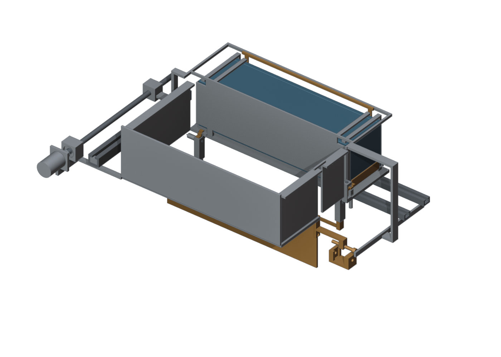
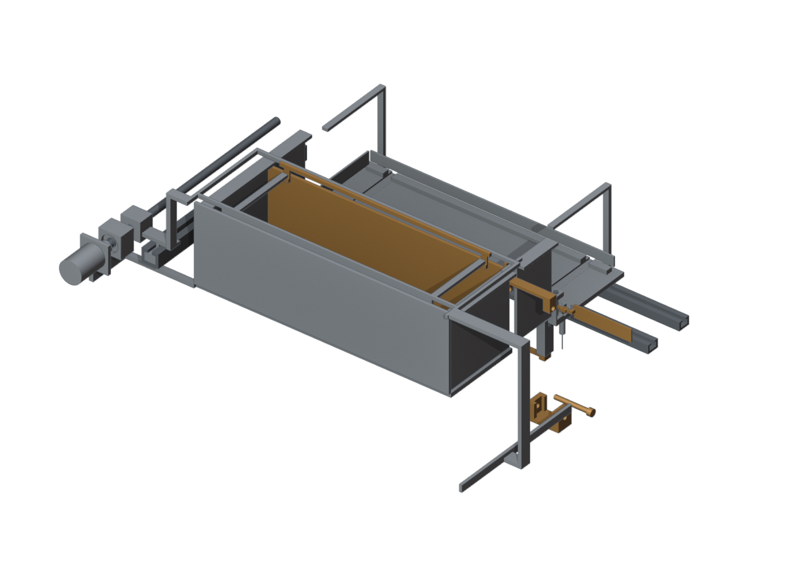
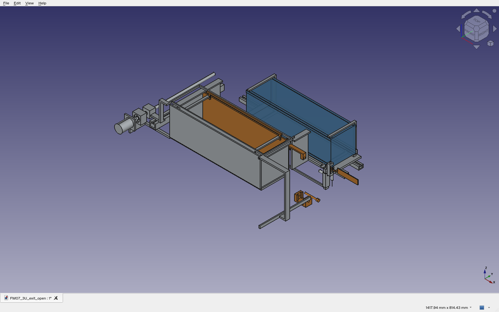

# Study configuration

FM07-R5 extends the fixed-cell, lead-screw transfer reference with captive receiver-lock pins, a hinged forward exit gate, a captive exit-lock pin and prescribed empty-carrier reset. This is an inspectable nominal mechanical geometry study, separate from evaluated Gen5. It is not a manufacturing release or an accepted feeder architecture.

Dedicated passive surrogates are 113.5 × 100 × 100 mm (1U) and 340.5 × 100 × 100 mm (3U). X is the departure direction, Y is transfer, and Z is the receiver-bar direction. The transfer distance is 200 mm; the handling coupon has 80 mm carrier travel. The translated payload-clear state is a geometric operating envelope, not a simulated launch or a release-speed result.

# Native geometry evidence

| Check | Result | Boundary |
|:--|:--|:--|
| Full-cycle states | 46 native all-pair inspections | Nominal exact solids; 23 states per size |
| Rotary exit-door samples | 34 additional angle inspections | 5° increments, excluding the already checked endpoints |
| Linear motion | 40 continuous prescribed relative-translation sweeps | Exact boundary-face prisms; excludes the four rotary phases |
| Assembly exchange | 20 FCStd/STEP assemblies | Independent CadQuery/OCC readback |
| Individual exchange | 74 STEP parts | Valid single solids; independent volume checks |
| Component lineage | Four native material comparisons | FM06 receiver entry-bar and fork/tines unchanged |

The listed tests retain no positive-volume collision above 0.00001 mm³. This is a numerical threshold, not a manufacturing clearance. The rotary checks are discrete; no continuous rotary-clearance certificate, loaded-fit acceptance or operational reliability is asserted. Original failed development revisions remain separately retained in the research archive.

# Mechanism definition

The receiver-bar lock pins retain their existing 2.5 mm-radius heads within closed cups. Their stem and tail bores are smaller than the retained heads; prescribed withdrawal is 12 mm. The exit gate rotates 90° about a vertical, axially captured 3 mm-diameter hinge pin. The hinge bore is 3.3 mm; nominal radial gap is 0.15 mm and axial head clearance is 0.2 mm. These are design dimensions, not a toleranced bearing specification.

The exit-lock pin has a retained 1.75 mm-radius head and a 22 mm withdrawal stroke. Its cup, guide and bracket share the same cut clearance. The lock guide is outside the nominal payload departure corridor. The revised bracket is outside the fork sweep. Access, keepers, actuator attachment, material allowables, joint stiffness and manufacture remain subject to detailed engineering.

{width=95%}

{width=95%}

{width=95%}

# Prescribed sequence

1. Retain the stored payload; raise and mechanically lock the storage gate.
2. Take up the rear transfer pad and transfer the captured payload laterally.
3. Unlock, close and relock the receiver bar.
4. Lift the front transfer restraint, withdraw the fork and close the empty cell.
5. Translate the captured carrier through the 80 mm handling coupon.
6. Withdraw the exit-lock pin, open the exit gate and translate the payload clear.
7. Return the empty carrier; close and relock the exit gate.
8. Unlock and open the receiver, then return its pins to the ready condition.

Every motion is prescribed. The model does not implement a qualified drive controller, verified sensors, free-flight tip-off, a full launcher brake or physical power-loss containment.

# Mass properties and structural lineage

METROLOGY.json records the actual modeled mass proxies, centre of gravity and inertia about the centre of gravity at the stored datum. Aluminium and steel densities are assumed; the motor uses the 0.179 kg catalogue mass and other catalogue envelopes use a declared 1400 kg/m³ proxy. Envelope inertia is approximate. Payload mass and missing installed drives, brakes, electronics, harness and mounting hardware are excluded. The two dedicated single-cell assemblies must not be multiplied into an installed four- or twelve-cell system.

The receiver entry bar and fork/tine material have zero symmetric volume difference from FM06 within the stated numerical threshold. Existing isolated receiver and tine fixtures remain attributed to FM06. They do not validate the changed assembled body, hinge, lock pins or actual load paths.

# Architecture comparison and decision

The controlled weights remain safety 35%, packaging/installed mass 25%, positioning 20%, cycle/power 10% and manufacture 10%. The original seven-concept records are included under comparison_reference/. The ordinal score intervals overlap; material-only mass records have different boundaries for the four-cell drum and single-cell candidates.

D27_GATE_ASSESSMENT.json applies the mandatory selection rule to all seven concepts. No candidate currently has the complete comparable installed-mass, loaded motion/tolerance and independent fault-containment evidence. FM07 advances the lead-screw reference geometry; it does not make the other six concepts comparable or establish the remaining safety gates. The result is no eligible final architecture. The lead screw remains the development reference, with spring/dual-gate and pantograph retained as challengers.

# Native application capture

{width=95%}

# Reproduction and records

- `mechanism.py`, `fm06.py`, `reference/`: exact native geometry and dimensions.
- `audit_geometry.py`: native solid and all-pair pose/angle checks.
- `check_sweeps.py`: continuous prescribed rigid translations.
- `export_release.py`: native assemblies, part exchanges and mass proxies.
- `check_exchange.py`: independent CadQuery STEP inspection.
- `render_meshes/`, `render_workbench.py`: actual source geometry and Blender renders.
- `CAD_EXCHANGE.json`, `parts/INDEX.json`: all exchange identities.
- `MANIFEST.json`, `check_capture.py`: captured-evidence identity and acceptance-boundary check.

Native geometry uses FreeCAD 1.0 / OpenCascade 7.8.1 and system Python 3.13. Independent exchange uses CadQuery 2.8 / OpenCascade 7.9. Render provenance records Blender 4.3.2 Workbench. Run native scripts in the FreeCAD Python environment and `check_exchange.py` in the CadQuery environment. Inspect this capture with `python check_capture.py` without installing native solvers.
