[PDF report](FEEDER_REVIEW.pdf) · [Complete source, native CAD/STEP and solver archive](FEEDER_SOURCE_AND_CAD.zip) · [Material BOM](release/BOM.csv)

The archive extracts to a standalone Labs-style directory with its CSV/style prerequisites. No other VOLLEY checkout is needed to inspect or rebuild this study. Native software installation is described in the included sources/runtime record.

# Review disposition

This is a computational candidate-design review, not a finished feeder, manufacturing release or qualified deployer. All seven mechanisms remain unselected. Gen5 is unchanged. The review provides actual native CAD/STEP, exact geometric checks, analytical load cases, native fixture FEA, fault requirements and retained negative findings. A collision-free pose is not proof that a mechanism can transmit load, complete a cycle or contain a payload after a fault.

# Configuration and interfaces

Dedicated 1U (113.5 × 100 × 100 mm) and 3U (340.5 × 100 × 100 mm) passive payload surrogates transfer 200 mm laterally. Nominal payload masses are 1.33/4 kg; adverse cases use 2/6 kg. Dimensions and 5/10/25 g loads are provisional sensitivity inputs, not provider-approved limits. X is the launch direction; Y is feed; Z is normal. Receiver, upper clearances and overhead gate actuation require host accommodation. Ordinary passive CubeSat compatibility has not been demonstrated.

The common topology uses a storage gate, front/rear captive transfer members, guides, receiving gate/clamps and an independent arrest requirement. The native Part solids are editable from the Python builder and individually inspectable in FCStd. Thread, gear, pivot, coupling, bolt, harness and purchased internals are incomplete. The pantograph is a transfer linkage example, not the previously proposed independently collapsing multi-level magazine. The drum models a four-cell rotor; its indexing motion is not validated.

# CAD evidence

Fourteen native assemblies and 28 STEP files cover seven candidates × two sizes, with additional mid-transfer and seated 3U snapshots. The exact positive-volume intersection threshold is 0.0001 mm³. Nine feed stations, one stowed pose and five gate heights give 210 inspections. The rectangular payload sweep is exact only for the stipulated straight translation against fixed feed-state geometry; it does not certify nonlinear mechanisms or handoff. Zero-volume touching surfaces do not establish a joint.

| Candidate / class | Material [kg] | Positive-volume pairs across poses | Payload-sweep penetrations |
|:--|--:|--:|--:|
| lead_screw / 1U | 2.471 | 0 | 0 |
| lead_screw / 3U | 4.430 | 0 | 0 |
| spring_dual_gate / 1U | 2.364 | 0 | 0 |
| spring_dual_gate / 3U | 4.507 | 0 | 0 |
| rack_pawl / 1U | 2.469 | 0 | 0 |
| rack_pawl / 3U | 4.428 | 0 | 0 |
| indexed_drum / 1U | 11.179 | 0 | 0 |
| indexed_drum / 3U | 12.213 | 0 | 0 |
| pantograph / 1U | 2.334 | 0 | 0 |
| pantograph / 3U | 4.293 | 0 | 0 |
| telescopic / 1U | 2.344 | 0 | 0 |
| telescopic / 3U | 4.303 | 0 | 0 |
| belt_shuttle / 1U | 2.296 | 0 | 0 |
| belt_shuttle / 3U | 4.255 | 0 | 0 |

Mass is modeled material, excluding payload and all unrated actuator/sensor envelopes. Drum values include four cells while other values represent a single cell, so these numbers cannot rank installed systems. METROLOGY.json reports material-only CG, inertia and bounding boxes. BOM.csv retains every modeled part and omission. Four/twelve assemblies cannot be inferred by simply multiplying these values.

# Drive and tolerance calculations

Triangular motion uses v_max = 2s/T and a = 4s/T². Required output force is F = (m_payload + m_moving)a + R. The square-thread screw model uses lead angle λ, friction angle φ, torque F d_m tan(λ+φ)/2 and efficiency tan λ/tan(λ+φ). Bearings, preload, motor/inverter losses and acceleration of unmodeled mechanisms are omitted. The 2/5/10 s cases demand 6000/2400/1200 rpm for a 2 mm lead. A torque-only motor choice would be inadequate. The model is not an actual Tr8 trapezoidal thread rating.

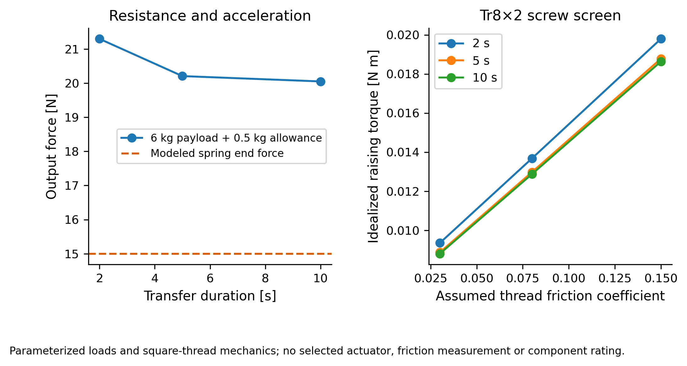

108 common load cases retain force, energy, speed, torque, spring shear, scissor input and arrest sensitivities. The spring has 86.4 N/m stiffness, 32.28 N initial and 15 N end force, 4.728 J release energy and approximately 1032 MPa initial calculated wire shear. No fatigue/material allowable exists. It stalls the 20/50 N resistance screens even when a gross energy comparison appears sufficient. Scissor input rises as 3F cot θ at the 10° lower-angle assumption. Pawl delay/compliance estimates are travel and mean force, not measured peak contact loads.

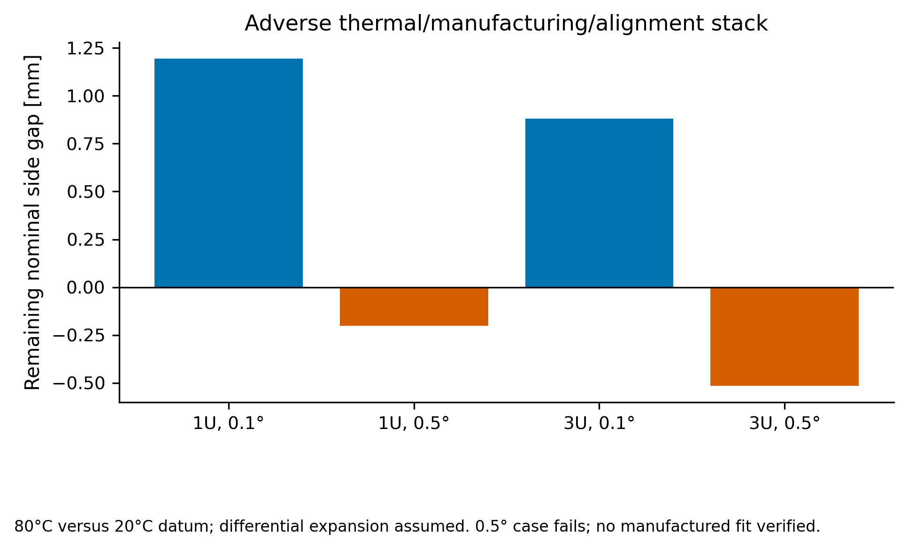

The fit stack subtracts two 0.15 mm manufacturing allowances, 200 tan θ and assumed differential thermal expansion from a 2 mm nominal side gap. The 0.1° band retains positive nominal gap; adverse 0.5° cases fail. Loaded deflection, real payload expansion, geometric tolerances and actual rail alignment require further analysis.

# Native structural screen

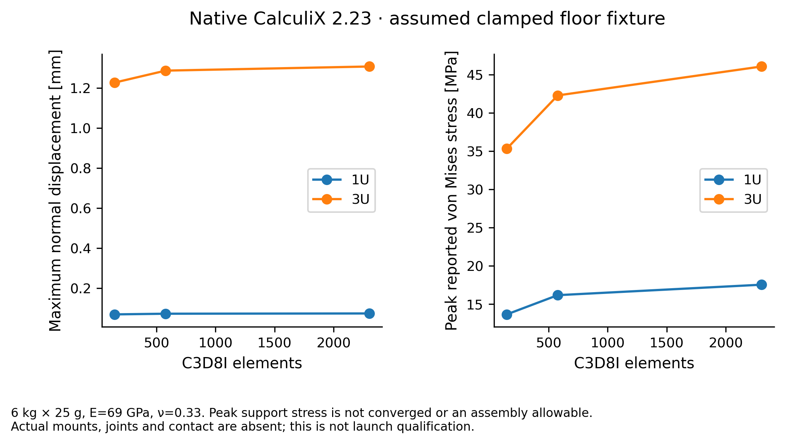

CalculiX 2.23 ran six C3D8I solid cases. The floor blank uses assumed E = 69 GPa and ν = 0.33, uniform 6 kg × 25 g load (1471 N), with both short edges fully fixed. This is an explicit fixture, not the real mounting interface. The finest 3U maximum normal displacement is approximately 1.308 mm; its last displacement change is approximately 1.58%. Peak support stress remains mesh-sensitive. No strength margin, allowable, assembly qualification or payload safety follows. Raw INP, DAT, FRD and solver logs are retained.

# Fault containment and operating sequence

The required sequence is storage locked → fork captures → storage gate opens → supervised transfer → receiver captures → fork releases/retracts → cell closes → shot enabled → carrier captured/home → reset. Every transition needs a positively retained payload and independently verified path. The CAD seated pose is not proof of that transition sequence. In particular, the front-barrier retraction, receiver capture and fork return need full kinematic/contact implementation.

Thirty-six state/fault requirement records include power loss, stall, sensor disagreement, timeout, double feed and reset. Their containment statements assume the stipulated barrier actually holds. They do not prove that a modeled pawl is engaged. Other cells remain inhibited until supervised safe-path verification. FMEA.json records principal failure modes without invented probabilities. Single-barrier failure can defeat containment; this is a design requirement, not a demonstrated redundant mechanism.

# Capture-tooth sizing failure

The modeled rack tooth is 8 mm wide, 1 mm thick at the root and 3 mm high. A rectangular cantilever sensitivity uses the calculated mean arrest forces, assumed steel E=200 GPa and 250/500/1000 MPa yield bands. Across 972 cases, maximum mean force is 876.9 N and nominal root bending is 1973 MPa. Cases exceed even the 1000 MPa band. These are not material allowables or peak impact forces. The present pawl is not engaged; neither the tooth nor a positive retention path is accepted. Larger section, controlled stopping energy and real engagement/contact require redesign. ARREST_TOOTH.json retains every case.

# Weighted trade and decision

Safety 35%, packaging/mass 25%, positioning 20%, cycle/power 10%, manufacture 10%. The earlier ordinal 1–5 scores and ±1 intervals remain hypotheses. Quantitative CAD/load evidence is reported separately so that unmeasured reliability is not converted into false numerical confidence.

| Candidate | Hypothesis /5 | ±1 interval | Baseline eligible |
|:--|--:|:--|:--|
| Fixed-cell captive lead screw | 3.650 | 2.650–4.650 | No |
| Fixed-cell spring follower and two gates | 3.075 | 2.075–4.075 | No |
| Indexed rack and pawl | 2.925 | 1.925–3.925 | No |
| Geneva indexed drum or tray | 2.500 | 1.500–3.500 | No |
| Segmented pantograph | 2.325 | 1.500–3.325 | No |
| Nested telescoping carriage | 2.650 | 1.650–3.650 | No |
| Belt or cable shuttle | 2.525 | 1.700–3.525 | No |

The lead screw remains a useful reversible transfer reference; spring/two-gate remains the low-drive-energy challenger and pantograph the compact-linkage challenger. This is a study recommendation, not final selection. The score intervals overlap and none has complete same-boundary installed mass, source-rated drive, full-cycle clearance, loaded restraint/contact or fault proof. The evidence is insufficient to release a controlled feeder baseline. No alternative is falsely marked rejected. All remain preserved in Labs.

# Corrective actions and verification

| ID | Finding and disposition |
|:--|:--|
| FDR-I01 | Previous common side caps intersected side walls. Fused one-piece L sections and gate slots. **corrected within stated geometry check**. Current exact B-rep stations and payload sweep. |
| FDR-I02 | Receiver gate crossed fork at handoff. Seated snapshot retracts fork before receiver barrier closes. **full handoff transition open**. Snapshot checked only; transition not verified. |
| FDR-I03 | Disconnected crosshead/link/rear fork. One connected overhead fork frame and nut-mount bridge in FDR08. **fork and bearing housing connected joint ratings open**. Native connected-solid assertion; current intersections; joint/contact ratings still open. |
| FDR-I04 | Power-off pawl engagement not represented. No assumed engagement; spring-applied capture is a requirement. **open safety critical**. Counterexample remains when sole restraint is lost. |
| FDR-I05 | 0.5 degree adverse tolerance stack loses side gap. Require tighter datum alignment or redesign gap; 0.1 degree band screened. **open until interface and deflection defined**. 12 parametric stacks; not measured fit. |
| FDR-I06 | Spring force insufficient at end of travel. Reject this spring sizing for those bands; re-size with governor/material fatigue checks. **failed case retained**. 108 analytical cases and wire geometry identity. |
| FDR-I07 | Unrated drive and receiver parts. Use computed demands as component procurement requirements. **open no build release**. Zero-envelope mass shown explicitly in BOM. |
| FDR-I08 | Common-cycle and indexing evidence incomplete. Keep all seven as research candidates; no baseline lock. **open**. Bounded sweep explicitly excludes nonlinear motion. |
| FDR-I09 | Fixture FEA is not assembly FEA. Retain mesh trends and no strength/qualification pass. **bounded fixture result only**. Six native CalculiX inputs/DAT/FRD/logs. |
| FDR-I10 | Raw material mass is not equal-boundary installed mass. No raw-mass winner; four/twelve bookkeeping remains lower-bound material only. **open system comparison**. Material CG/inertia/BOM identity. |

# Candidate geometry views

These orthographic wireframes are generated from independent native STEP readback. They are not solver screenshots or hardware photographs. JPEG previews are accompanied by vector SVG/PDF. The assembly bounding boxes and datums are recorded in STEP_VIEWS.json. No manufacturing tolerance/finish approval is implied.

## Lead Screw

## Spring Dual Gate
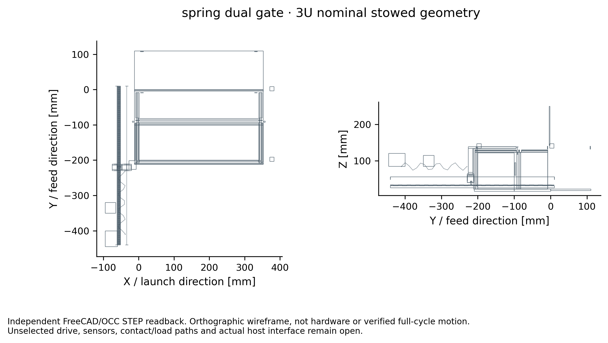

## Rack Pawl
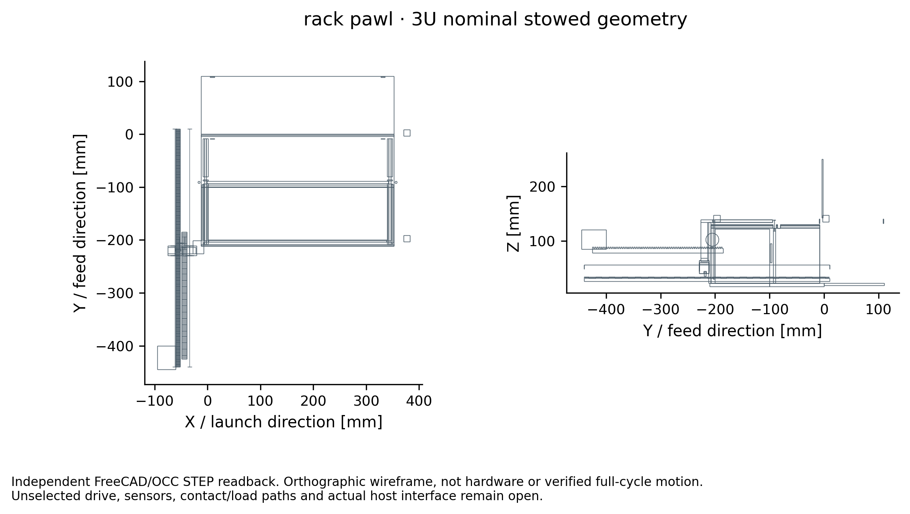

## Indexed Drum
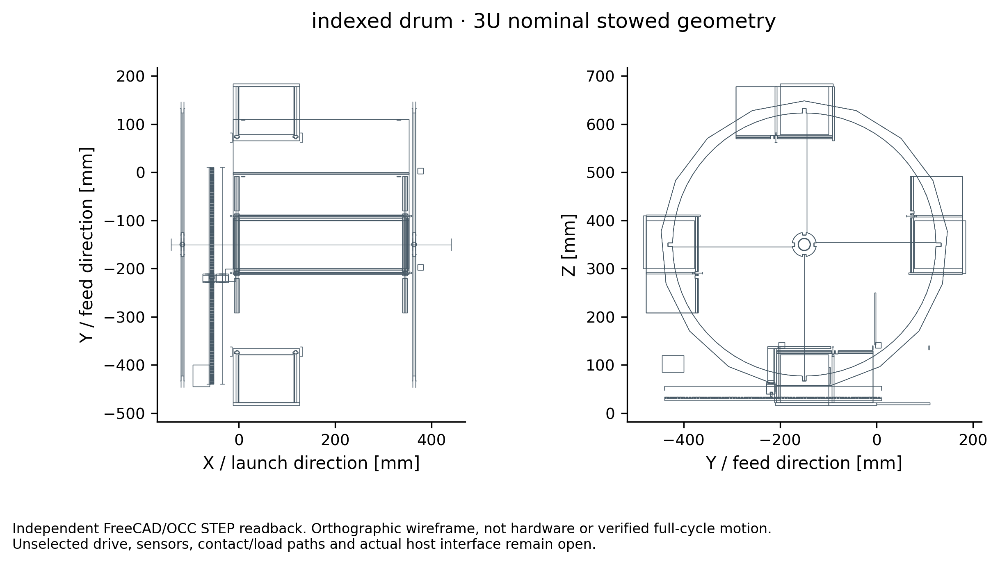

## Pantograph
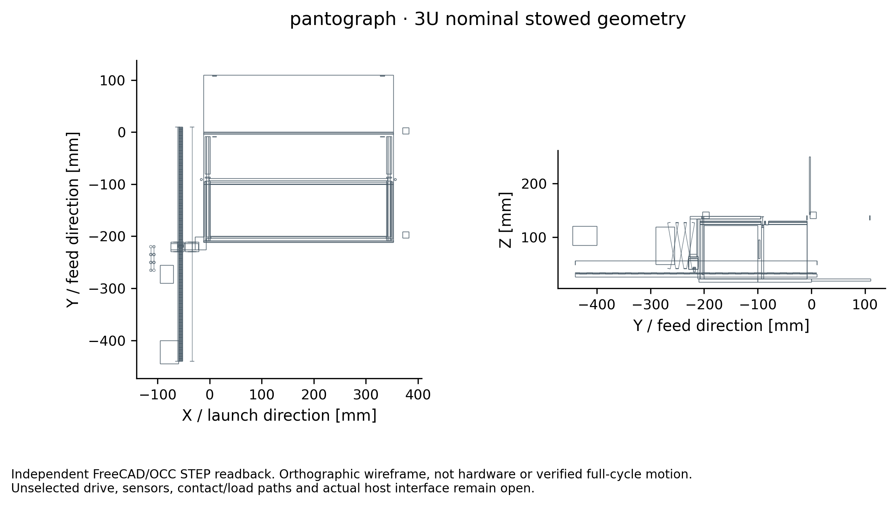

## Telescopic
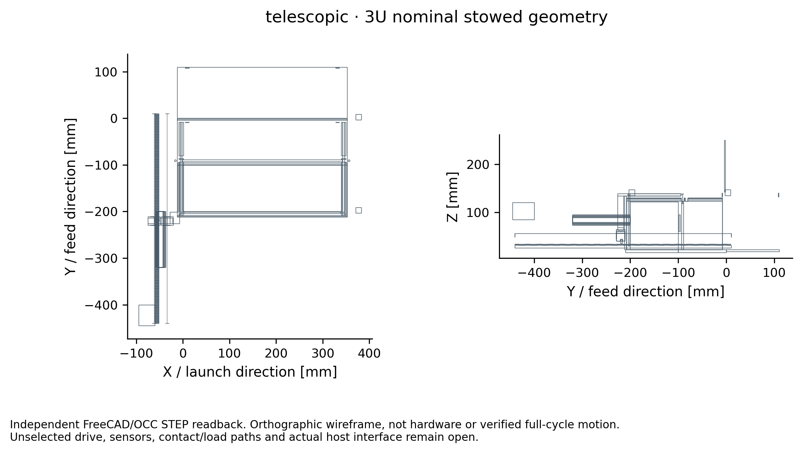

## Belt Shuttle
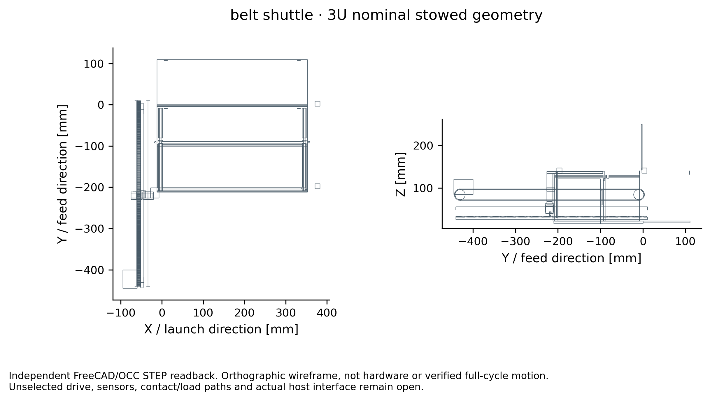

# Research basis

The prior concept/trade/load records are retained in docs/GEN6_FEEDER_CONCEPT_TRADE.md, GEN6_FEEDER_WEIGHTED_TRADE_2026_10_12.md and GEN6_FEEDER_LOAD_SCREEN.md. The seven concepts are engineering analogies; none inherits flight heritage merely from using screws, springs or a familiar indexer.

Fusaro and Khonsari, *Liquid Lubrication for Space Applications*, NASA TM-105198 (1992), public NTRS record 19920022596, discusses vacuum/environmental effects, bearing anomalies, lubricant/material selection and life. Selected full-text passages were examined for mechanism implications; it does not supply VOLLEY friction or life data. https://ntrs.nasa.gov/citations/19920022596

The *46th Aerospace Mechanisms Symposium Proceedings* (2022), NTRS 20220006415, includes *Engineering Design of a Thruster Pointing Mechanism (TPM-250) for Deep Space and IOS Nanosats*, pp.143–158. Its lead-screw/worm sizing explicitly accounts for efficiency/backlash and measured friction factors; these values are specific to its mechanism and are not transferred to VOLLEY. The GRASS rotation-mechanism paper (pp.159–172) highlights mounting-induced stress/alignment sensitivity. These findings support including tribology, installed mounting and backlash in the remaining verification. https://ntrs.nasa.gov/citations/20220006415

The review is not ECSS/NASA compliance certification, an independent expert review or a claim of P-POD-class reliability. Acceptance is limited to the stated computational boundaries; no build release is granted.

# Genuine native application and result views

The following FreeCAD image is the actual Python-hosted Qt/Coin application viewport of the stored native candidate. It is not a Blender render or fabricated application UI.

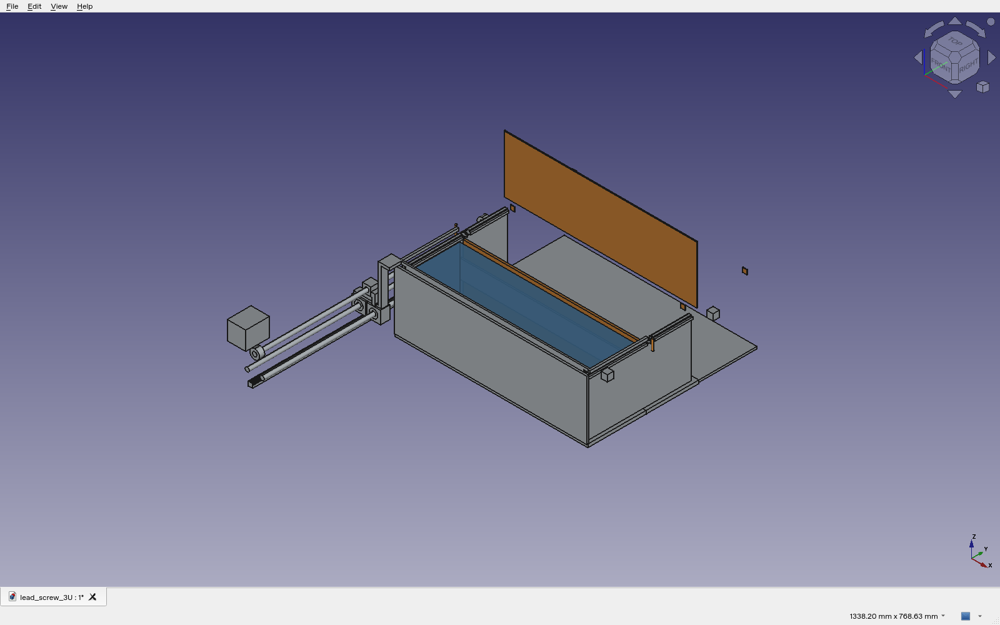

The Gmsh native viewport below displays the actual CalculiX C3D8I input mesh and DAT displacement norm in metres, on undeformed geometry. It remains the assumed clamped-floor fixture; no actual mounting or assembly qualification follows.

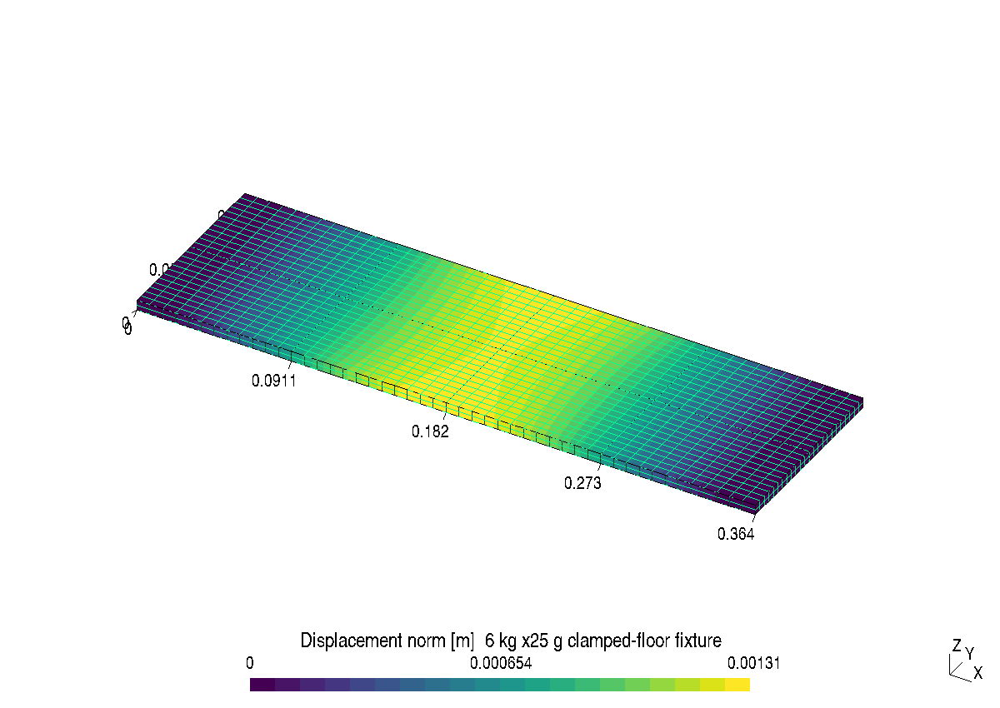

# Reproduction

Install the versions in requirements-python.txt for numerical reports/plots. Native CAD uses FreeCAD1.0/OpenCascade7.8.1 and its system Python; run build.py, metrology.py and project_step.py in that environment. Run analyze.py, arrest_tooth.py, plot.py and review.py using the numerical environment. fea_floor.py requires the CalculiX2.23 executable in CCX and its native runtime dependencies; retained inputs/DAT/FRD/logs permit inspection without rerunning the solver. view_fea.py uses Gmsh4.14.1 to display those actual results. capture_native.py requires the FreeCAD Qt display. No native GUI capture is generated by Matplotlib. Compile this README to PDF with pandoc/XeLaTeX, using this directory as the resource path.
