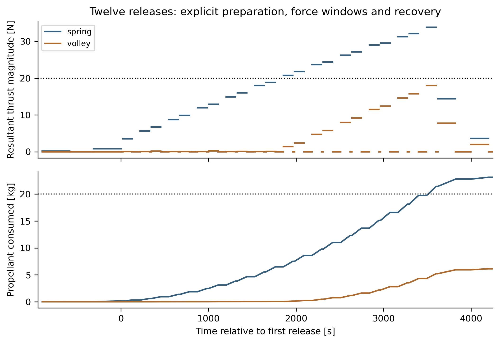
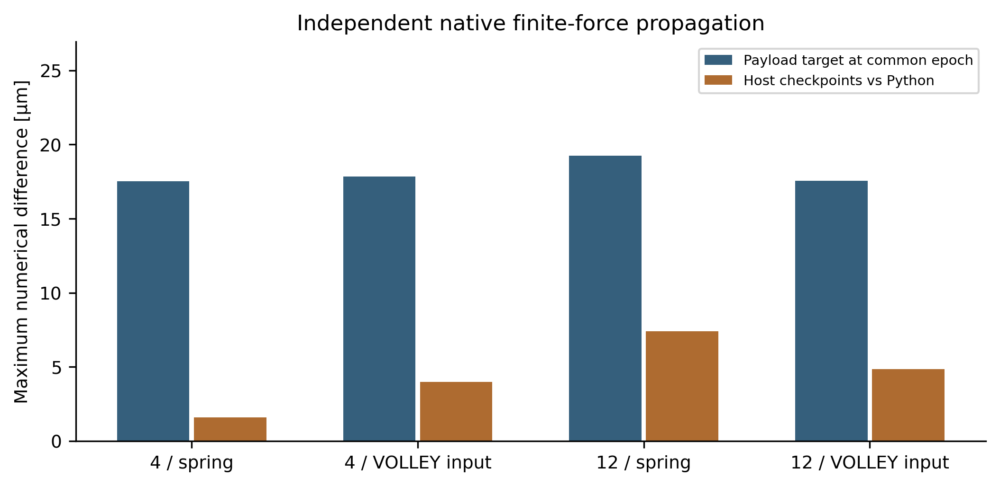
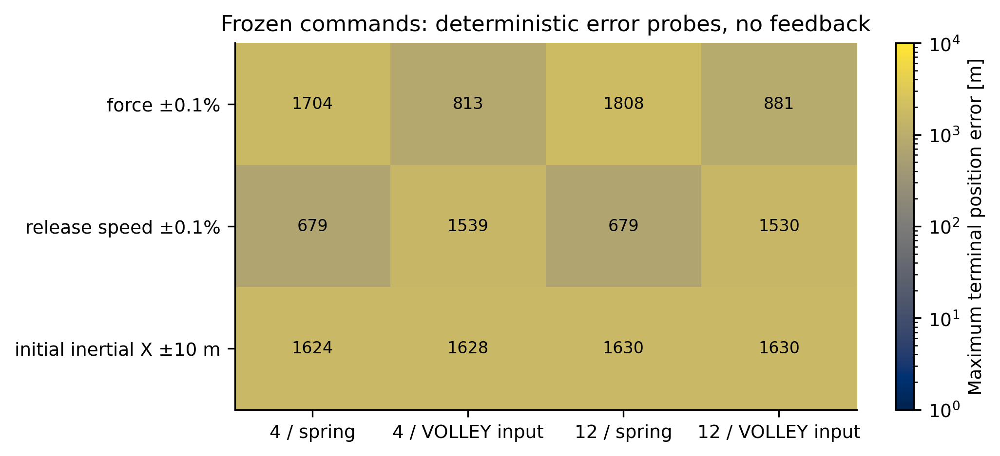
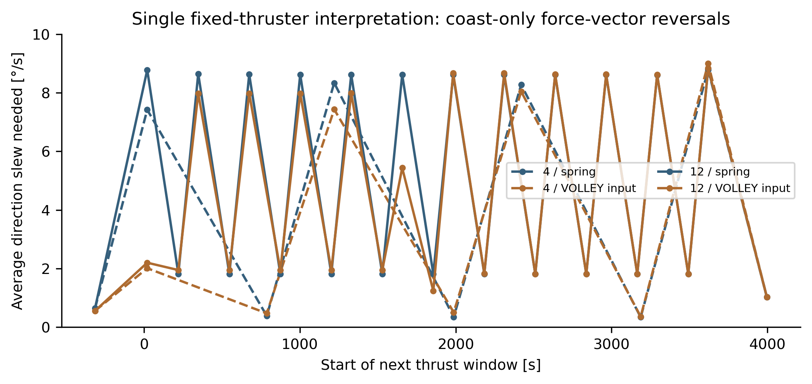

# Scope and principal finding

FBR-01 replaces the archived instantaneous host-burn sequence with targeted, finite-duration constant-inertial-force windows and continuous propellant consumption. It is a point-mass control feasibility study, separately versioned from the evaluated Gen5. The release inputs remain imposed: 2.5 m/s for spring and 3–6 m/s for VOLLEY. No selected motor, host propulsion system, flight pointing capability or physical release is established.

For the declared 35%/35% two-window policy, both four-release comparisons meet the illustrative 20 N / 10 kg fuel screen. The twelve-release VOLLEY-input case meets the 20 N / 20 kg screen; the corresponding spring case fails both. A common 30 kg reserve and 100 N limit permits **both** twelve-release policies in the translational model. This rules out a claim that a competent spring/host service cannot perform the constructed mission.

Whole-host slews would need approximately 9°/s mean force-vector reversal in some 20 s gaps for a single fixed thruster. No host is selected with this capability. Opposed thrusters or another force allocation could avoid whole-body reversals, but that requires an actual propulsion, attitude, plume and mass architecture. The model therefore does not close operational host compatibility.

# Requirements and common boundary

The reference is 500 km altitude, 97.4° inclination, Earth-centred inertial Cartesian axes, with a fixed inertial +Z J2 axis. Constants are μ = 3.986004418×10¹⁴ m³/s², equatorial radius 6378137 m and J2 = 1.08262668×10⁻³. This explicitly simplified force model omits drag, higher-order gravity, Sun/Moon perturbations and Earth-orientation effects. The arbitrary epoch is 29 September 2026 00:00:00 TAI; no geographic service window is claimed.

Four releases alternate 1.33 kg 1U and 4 kg 3U surrogates; twelve use six of each. Releases span 0–3600 s. Every payload is assessed at the same 90000 s epoch, 24 h after the final nominal release. Targets and release vectors are preserved byte-for-byte from the archived matched study; reverse propagation supplies the desired release states. Target construction is therefore shared evidence, not an independently optimized customer mission.

Host dry mass is 300 kg, with device mass proxies 16 kg spring or 30 kg VOLLEY per four cells. Initial fuel is 10 kg for four and 20 kg for twelve, with an additional matched 30 kg twelve-release countercase. These are study assumptions, not measured installed hardware. Specific impulse is a constant 220 s for both.

# Finite-force formulation

During a force window, the integrated state is (r, v, M):

$$\dot{\mathbf r}=\mathbf v,\qquad \dot{\mathbf v}=\mathbf a_{J2}(\mathbf r)+\mathbf F/M,\qquad \dot M=-\|\mathbf F\|/(I_{sp}g_0).$$

Each leg has two independently constant inertial force vectors. Each force window occupies a declared fraction f of the leg; the intervening zero-force coast occupies 1−2f. Six force components are solved for the six endpoint constraints using nonlinear shooting. Controls are solved without hard thrust saturation and then screened against the declared limits. This is one constructed policy, not a globally optimal solution or a proof of infeasibility for other schedules.

The first preparatory leg starts at −900 s on the reference orbit; its fuel and thrust are counted. Every release is followed by a 20 s zero-force guard. The final host recovery ends at 4200 s; the host then coasts to the same 90000 s epoch. No velocity reset, instantaneous preburn or later host-state reset is used between finite arcs. Preparation before the first release is an explicit additional operational allowance.

At a point-centre release of mass m and prescribed relative velocity u, child velocity is v + (1−m/M)u and parent velocity is v − (m/M)u. The parent loses the payload mass. The targeter includes endpoint mass in this recoil relation. This instantaneous release boundary does not model the contact interval or the physical launcher body.

# Results and retained failures

| Case | Peak resultant [N] | Total fuel [kg] | Declared thrust/fuel screen |
|:--|--:|--:|:--|
| 4 / spring | 13.36 | 6.056 | Pass |
| 4 / VOLLEY input | 6.50 | 1.895 | Pass |
| 12 / spring | 33.83 | 23.122 | Fail |
| 12 / VOLLEY input | 18.00 | 6.123 | Pass |

The twelve-spring 20 kg formal solution exhausts its reserve at 3509.06 s, before the final release. Later portions are retained **only as mathematical diagnostics**; the complete prescribed campaign is infeasible under that resource budget. Nominal endpoint agreement must not be used to claim operation after fuel exhaustion.

The 18 targeted solutions include f = 0.20, 0.35 and 0.45 for four common comparisons, four 30 s step retargets, and two common 30 kg reserve cases. Shorter force windows reduce propellant in this family but increase peak resultant force. The retained 20% twelve-VOLLEY case needs 26.12 N and therefore fails the 20 N screen; selecting only the favorable 35% case would conceal this dependence.

The matched 30 kg reserve comparison at a common 100 N illustrative limit is:

| Twelve-release input | Peak force [N] | Fuel used [kg] | Fuel remaining [kg] |
|:--|--:|--:|--:|
| spring | 34.74 | 23.729 | 6.271 |
| volley | 18.43 | 6.270 | 23.730 |

VOLLEY's additional device proxy is 42 kg for twelve cells. Its propellant saving in the common 30 kg countercase is 17.460 kg. The added proxy mass exceeds that saving by 24.540 kg. This is a resource comparison, not an optimized installed mass or a priced service-value calculation. Precision, throughput, host wear and customer delivery requirements remain unmeasured.

# Independent native replay and numerical sensitivity

SciPy DOP853 integrates and targets the Python model. A separately written Java implementation uses Orekit 13.1.6, Hipparchus 4.0.3, NumericalPropagator, J2OnlyPerturbation and a custom ForceModel with an integrated mass derivative. It starts once at −900 s and follows the captured finite force/release sequence without later state resets or access to the Python targeter. Both solvers use DOP853; the shared integration family and common targets limit independence.

Forty-six actual native runs comprise 18 nominal/revised solutions, four same-command 60-to-30 s refinements, and 24 deterministic error probes. Across all 18 nominal replays, the largest payload terminal difference from the archived target is 22.11 µm. The largest payload change in the eight numerical refinements is 12.94 µm. The retained capture check applies 1 cm / 10⁻⁵ m/s numerical tolerances, mass-flow/recoil identities and exact file hashes. These are numerical consistency checks, not flight accuracy or a rigorous continuous error enclosure.

The 24 probes apply common force magnitude ±0.1%, imposed release speed ±0.1%, or initial inertial X displacement ±10 m, one source at a time. No feedback or retargeting follows the perturbation. Results are deterministic sensitivities, not probability distributions or simultaneous uncertainty bounds.

# Host pointing and force allocation

For a single fixed thruster, changing the thrust direction entails rotating the vehicle. The angle between consecutive nonzero force vectors divided by the intervening zero-force time gives a **necessary average direction slew**, with instantaneous acceleration/deceleration and no settling allowance. It excludes payload release alignment and any pointing-knowledge error. The highest averages are 8.78–9.00°/s for the four primary comparisons.

A slew-rate limit below these values rejects this specific single-thruster interpretation. Multi-axis or opposed thrusters may produce a different resultant without rotating the host through every reversal; they add valves, propellant/pressurant plumbing, dry mass, plume exclusions, thermal limits and fault allocation. Either route needs a controlled host design before it can close an engineering gate.

# Disposition

Finite-duration translational targeting and continuous mass consumption have now been run and independently replayed for the declared policy family. The older summed-thrust-time calculation remains a necessary screen for its frozen impulse schedule, not the result of this new retargeted policy.

Still open are actual host thrust/attitude allocation and slew dynamics; finite release-body and plume clearance; navigation feedback and covariance; drag and higher-fidelity environment; actual installed mass, power and thermal control; motor/circuit ratings and measured release precision; selected customer targets; and the feeder/retention hardware. No product, flight readiness, calibrated precision or globally superior service is concluded.

# Reproduction and source record

1. Verify MANIFEST.json and run check_capture.py using standard Python.
2. Install requirements-python.txt; use target.py and run_matrix.py for the captured target family, then export.py.
3. Run download_jars.py for the exact SHA-256-locked public dependencies. Set OREKIT_CLASSPATH to jars/*, use Java 21 with its compiler module, and run run_native.py.
4. Run summarize.py and report.py. Compile README.md using Pandoc/XeLaTeX for the report PDF.

Native CSVs and logs are genuine software outputs; scientific plots are derived from those outputs and are not application screenshots. No software interface is synthesized. Source identities identify the archived targets. Rebuilding a PDF can change its metadata, so the manifest records the reviewed captured bytes.

Primary software references: [Orekit ForceModel API](https://www.orekit.org/static/apidocs/org/orekit/forces/ForceModel.html), [Orekit J2OnlyPerturbation API](https://www.orekit.org/static/apidocs/org/orekit/forces/gravity/J2OnlyPerturbation.html), and [SciPy solve_ivp](https://docs.scipy.org/doc/scipy/reference/generated/scipy.integrate.solve_ivp.html). Dependency versions and hashes are separately pinned in SOFTWARE_LOCK.json.
