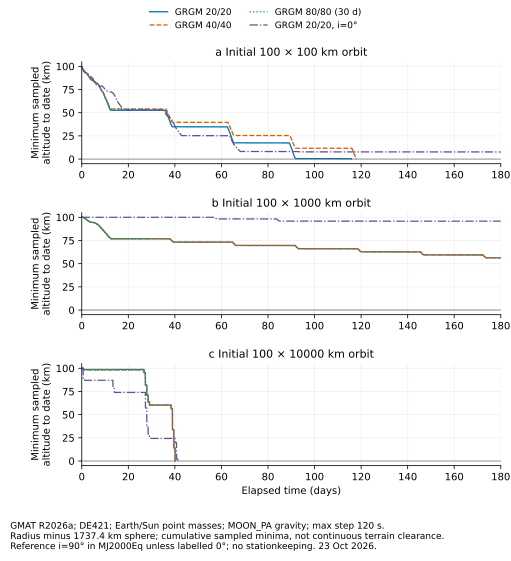
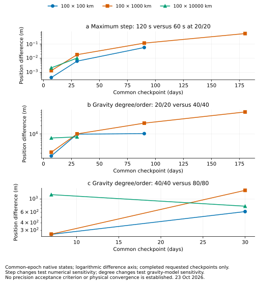

# Native lunar coast and refinement study

Provisional computational evidence · 23 October 2026 · GMAT R2026a

18 of 18 prescribed native coast attempts have captured histories: 7 terminate at the 1737.4 km spherical radius, 11 reach their requested final horizon, and 0 are unfinished or failed. These results describe the declared initial states and force models. They do not qualify a lunar mission lifetime or continuous terrain clearance.

Of the 12 attempts requesting 180 days, 7 stop at the sphere and 5 reach 180 days. The 6 shorter high-degree/alternative-field attempts reach their requested 30 days.

The i=90° MJ2000Eq circular reference reaches the spherical stop at **115.859 days** with GRGM 20/20 and **117.984 days** with GRGM 40/40. Neither reaches the requested 180-day horizon. The separate i=0° circular 20/20 case reaches 180 days; the fixed initial plane materially changes this bounded outcome.

At the common 90-day circular checkpoint, reducing the maximum step from 120 to 60 s changes position by **0.0575 m**. Changing gravity from 20/20 to 40/40 changes position by **10.3 km**. This separates the small observed numerical sensitivity of that 20/20 case from the much larger gravity-model sensitivity; it does not establish physical convergence.

## Model and provenance

- Epoch: **23 Oct 2026 00:00:00.000 TAI Gregorian**. The three initial orbits are 100 × 100 km, 100 × 1000 km and 100 × 10000 km above a 1737.4 km spherical reference. Initial position is on +X in **LunaMJ2000Eq**, with origin Luna and MJ2000Eq axes. The initial velocity lies in the XZ plane for i=90°, or XY for i=0°. These inclinations are relative to MJ2000Eq and are not labels for lunar-equator or lunar-polar mission planes.
- Initial Cartesian states use the common reference μ = **4902.79996708864 km³/s²** from the installed GRGM900C header. The Moon reference radius and zero flattening are explicitly set. All model/degree/step comparisons within a plane start from the same Cartesian state.
- Primary gravity is the installed **GRGM900C** coefficient file, truncated in the distribution to degree/order 360. This study requests 20/20, 40/40 and bounded 80/80 runs. The gravity-file reference radius is **1738 km**, distinct from the 1737.4 km spherical stop/altitude reference. The alternative **LP165P** file contains 165/165 coefficients. GMAT uses primary-body constants from the potential file: GRGM μ = 4902.79996708864 and LP165P μ = **4902.801056 km³/s²**. The LP comparison therefore changes both coefficients and the file μ; it is a model sensitivity test, not a pure degree refinement.
- Lunar body-fixed rotation is explicitly **SPICE / MOON_PA**, using the installed lunar PCK and frame kernel. This is the adopted coefficient-frame alignment. Its physical accuracy and compatibility with each historical field have not been independently validated here.
- Earth and Sun are differential point-mass perturbations with native DE421 ephemerides and zero ephemeris update interval. Earth μ = **398600.435507 km³/s²**, Sun μ = **132712440017.99 km³/s²**. No Earth harmonics, SRP, drag, tides, relativity, stationkeeping, maneuvers, payload release or attitude control is included.
- Integration: **PrinceDormand78**, native RSSStep error control, Accuracy=1e-11, initial step 60 s, minimum step 0.001 s, maximum step 120 or 60 s, maximum 50 attempts, stop on accuracy violation. Native stop tolerance is 1e-6 in the corresponding stop parameter units. ElapsedSecs stop values are **segment durations**; segment durations 7/23/60/90 days implement cumulative checkpoints 7/30/90/180 days. The 80/80 and LP165P cases stop at 30 days.
- Earth orientation settings are explicit: NutationUpdateInterval=0 and the installed EOP file. Native scalar inspection records RA constant 0°, RA rate −0.641°/century, DEC constant 90°, DEC rate −0.557°/century, rotation constant 190.147°, rotation rate 360.9856235°/day, Earth radius 6378.1363 km and flattening 0.0033527. These stored body values are captured in [native_body_parameters.txt](runs/native_body_parameters.txt). Earth is used only as a point mass, so its body orientation does not enter an Earth harmonic acceleration in this study.
- [SOURCE_IDENTITY.json](SOURCE_IDENTITY.json) records SHA-256 identities of the actual executable/libraries, gravity fields, DE421 data, SPICE/time/EOP files, installed examples and local reference documentation. [CASES.json](CASES.json), [EXECUTIONS.json](EXECUTIONS.json) and each native configuration capture identify the actual inputs and commands. GMAT reports console build **30 Mar 2026 10:09:27**.

## Coast outcomes

“Sphere stop” means a native root of r=1737.4 km, not a topographic impact prediction. “Min altitude” is the minimum of native sampled radii minus the reference radius. A reached horizon indicates only completed propagation for this case.

| Initial orbit (km) | i (deg) | Field / degree | Max step (s) | End (days) | Outcome | Reached horizons (days) | Min altitude (km) | Eccentricity range |
|---|---:|---|---:|---:|---|---|---:|---|
| 100 × 100 | 90 | GRGM 20/20 | 120 | 115.859 | Sphere stop | 7, 30, 90 | 0.000 | 0.00000–0.05438 |
| 100 × 100 | 90 | GRGM 20/20 | 60 | 115.859 | Sphere stop | 7, 30, 90 | 0.000 | 0.00000–0.05438 |
| 100 × 100 | 90 | GRGM 40/40 | 120 | 117.984 | Sphere stop | 7, 30, 90 | 0.000 | 0.00000–0.05462 |
| 100 × 100 | 90 | GRGM 80/80 | 120 | 30.000 | Requested horizon | 7, 30 | 53.910 | 0.00000–0.02504 |
| 100 × 100 | 90 | LP165P 20/20 | 120 | 30.000 | Requested horizon | 7, 30 | 51.896 | 0.00000–0.02614 |
| 100 × 100 | 0 | GRGM 20/20 | 120 | 180.000 | Requested horizon | 7, 30, 90, 180 | 7.680 | 0.00000–0.05027 |
| 100 × 1000 | 90 | GRGM 20/20 | 120 | 180.000 | Requested horizon | 7, 30, 90, 180 | 56.290 | 0.19623–0.21582 |
| 100 × 1000 | 90 | GRGM 20/20 | 60 | 180.000 | Requested horizon | 7, 30, 90, 180 | 56.229 | 0.19623–0.21582 |
| 100 × 1000 | 90 | GRGM 40/40 | 120 | 180.000 | Requested horizon | 7, 30, 90, 180 | 56.394 | 0.19623–0.21576 |
| 100 × 1000 | 90 | GRGM 80/80 | 120 | 30.000 | Requested horizon | 7, 30 | 76.853 | 0.19623–0.20681 |
| 100 × 1000 | 90 | LP165P 20/20 | 120 | 30.000 | Requested horizon | 7, 30 | 76.790 | 0.19623–0.20684 |
| 100 × 1000 | 0 | GRGM 20/20 | 120 | 180.000 | Requested horizon | 7, 30, 90, 180 | 95.828 | 0.18701–0.19845 |
| 100 × 10000 | 90 | GRGM 20/20 | 120 | 40.102 | Sphere stop | 7, 30 | 0.000 | 0.70740–0.74428 |
| 100 × 10000 | 90 | GRGM 20/20 | 60 | 40.102 | Sphere stop | 7, 30 | 0.000 | 0.70740–0.74428 |
| 100 × 10000 | 90 | GRGM 40/40 | 120 | 40.102 | Sphere stop | 7, 30 | 0.000 | 0.70740–0.74430 |
| 100 × 10000 | 90 | GRGM 80/80 | 120 | 30.000 | Requested horizon | 7, 30 | 60.279 | 0.70740–0.73504 |
| 100 × 10000 | 90 | LP165P 20/20 | 120 | 30.000 | Requested horizon | 7, 30 | 60.655 | 0.70739–0.73504 |
| 100 × 10000 | 0 | GRGM 20/20 | 120 | 41.272 | Sphere stop | 7, 30 | 0.000 | 0.69357–0.74519 |

[PDF](figures/lunar_sampled_altitude.pdf) · [300 dpi PNG](figures/lunar_sampled_altitude.png)

## Refinement and field sensitivity

The comparisons below use native Cartesian states at common completed checkpoints. Full values, velocity differences and actual epoch differences are in [COMPARISONS.csv](COMPARISONS.csv). No precision acceptance criterion was supplied; small time-step changes alone do not validate the force model.

| Comparison | Initial orbit (km) | Day | Position difference (m) | Velocity difference (mm/s) |
|---|---|---:|---:|---:|
| max_step_120_vs_60_s | 100 × 100 | 7 | 0.000434565 | 0.000382601 |
| max_step_120_vs_60_s | 100 × 100 | 30 | 0.00626228 | 0.00565534 |
| max_step_120_vs_60_s | 100 × 100 | 90 | 0.0575185 | 0.0507106 |
| degree20_vs_degree40 | 100 × 100 | 7 | 1603.55 | 1692.46 |
| degree20_vs_degree40 | 100 × 100 | 30 | 9898.92 | 10147.7 |
| degree20_vs_degree40 | 100 × 100 | 90 | 10347.5 | 18805.9 |
| degree40_vs_degree80 | 100 × 100 | 7 | 257.977 | 139.639 |
| degree40_vs_degree80 | 100 × 100 | 30 | 618.89 | 598.181 |
| GRGM900C_vs_LP165P_degree20 | 100 × 100 | 7 | 10256.9 | 9204.65 |
| GRGM900C_vs_LP165P_degree20 | 100 × 100 | 30 | 43409.6 | 38855.7 |
| max_step_120_vs_60_s | 100 × 1000 | 7 | 0.00134117 | 0.000754209 |
| max_step_120_vs_60_s | 100 × 1000 | 30 | 0.0179136 | 0.0118156 |
| max_step_120_vs_60_s | 100 × 1000 | 90 | 0.117536 | 0.0646024 |
| max_step_120_vs_60_s | 100 × 1000 | 180 | 0.555726 | 0.37668 |
| degree20_vs_degree40 | 100 × 1000 | 7 | 2184.26 | 1211.96 |
| degree20_vs_degree40 | 100 × 1000 | 30 | 10114.7 | 6613.79 |
| degree20_vs_degree40 | 100 × 1000 | 90 | 24848.4 | 13662.2 |
| degree20_vs_degree40 | 100 × 1000 | 180 | 63161.8 | 42839.9 |
| degree40_vs_degree80 | 100 × 1000 | 7 | 260.077 | 150.041 |
| degree40_vs_degree80 | 100 × 1000 | 30 | 1398.32 | 920.048 |
| GRGM900C_vs_LP165P_degree20 | 100 × 1000 | 7 | 10415.3 | 5924.71 |
| GRGM900C_vs_LP165P_degree20 | 100 × 1000 | 30 | 53449.6 | 35139.8 |
| max_step_120_vs_60_s | 100 × 10000 | 7 | 0.00211124 | 0.000698768 |
| max_step_120_vs_60_s | 100 × 10000 | 30 | 0.0102454 | 0.0010314 |
| degree20_vs_degree40 | 100 × 10000 | 7 | 7169.34 | 2373.48 |
| degree20_vs_degree40 | 100 × 10000 | 30 | 7901.08 | 756.709 |
| degree40_vs_degree80 | 100 × 10000 | 7 | 1185.8 | 401.669 |
| degree40_vs_degree80 | 100 × 10000 | 30 | 760.634 | 105.622 |
| GRGM900C_vs_LP165P_degree20 | 100 × 10000 | 7 | 40865.3 | 13427.7 |
| GRGM900C_vs_LP165P_degree20 | 100 × 10000 | 30 | 41727.7 | 4227.26 |

[PDF](figures/lunar_refinement.pdf) · [300 dpi PNG](figures/lunar_refinement.png)

## Data handling and integrity

Raw native histories, checkpoint reports, stdout, GMAT logs and runtime configuration captures remain under `runs/`. The canonical package stores native histories as lossless `.csv.gz`; their decompressed bytes retain the recorded native SHA-256. Histories have native comma-separated headers; GMAT manual checkpoint reports repeat a whitespace-formatted header before each numeric row. The `_canonical_checkpoints.csv` files normalize only those headers. No orbit data are interpolated for the comparison tables. Epoch ordering and duplicate/rewound samples are checked explicitly; any removals are counted in RESULTS.json, and the original data are retained.

Sampled minima depend on sampling even when checkpoint states agree closely. For example, the 100 × 1000 km 20/20 runs give 56.290 km with the 120 s cap and 56.229 km with the 60 s cap. This roughly 61 m difference is not a measured clearance or a continuous lower bound. The native spherical-radius stop is a separate root condition.

The completed captures contain 1,700,890 raw samples. The time-order filter removed 0 samples. Maximum reconstruction differences are 1.27e-11 km for radius and 2.11e-15 for eccentricity. These checks recompute invariants from the same native Cartesian states and configured reference μ. They establish internal consistency rather than independent physical validation.

The early multi-segment attempt is preserved in `archive_duration_semantics/`. It incorrectly supplied cumulative ElapsedSecs stop values. A guard then permitted an extra segment after the first spherical stop in some circular cases. Those runs, including their below-sphere continuation, are excluded from all final coast/refinement tables. The corrected decks use segment durations and were checked against actual 7/30/90/180-day native checkpoint epochs.

## Limits and next work

The 100 km circular target and two staging ellipses remain prescribed coast examples. The study does not calculate the arrival/targeting maneuver, circularization, stationkeeping budget, maneuver errors or a delivered payload state. A first-sphere stop is an adverse result for that particular model, while a 30- or 180-day coast is only a finite-horizon result.

Gravity degree, coefficient model, plane and initial epoch can change the result. Only two fixed MJ2000Eq planes and one epoch are represented. The 80/80 and LP165P evidence is bounded to 30 days. No terrain model, independent coefficient-frame validation, continuous minimum-altitude certificate, parameter/phase ensemble, long-term disposal assessment or customer/provider acceptance is supplied. The full lunar lifetime and mission qualification work remains open.

## Reproduce

Use the pinned installed runtime and data referenced in SOURCE_IDENTITY.json. `python -B run_cases.py` regenerates and executes the prescribed decks with two native workers and a 240 s per-case wall limit. `python -B analyze.py` parses actual histories and exports figures; `python -B write_report.py` updates this report. The console runs from the existing GMAT `bin` directory with a private startup/output path. No download or installation is required.

Analysis environment: Python 3.12.14, NumPy 2.3.5, Matplotlib 3.10.8.
