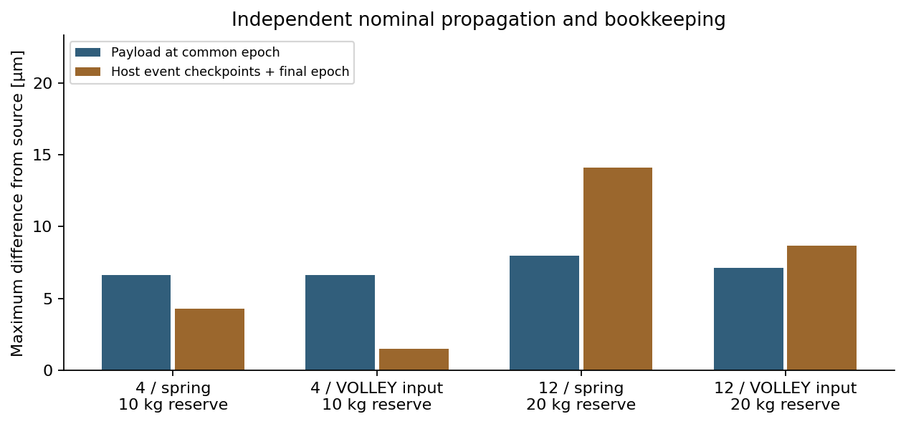
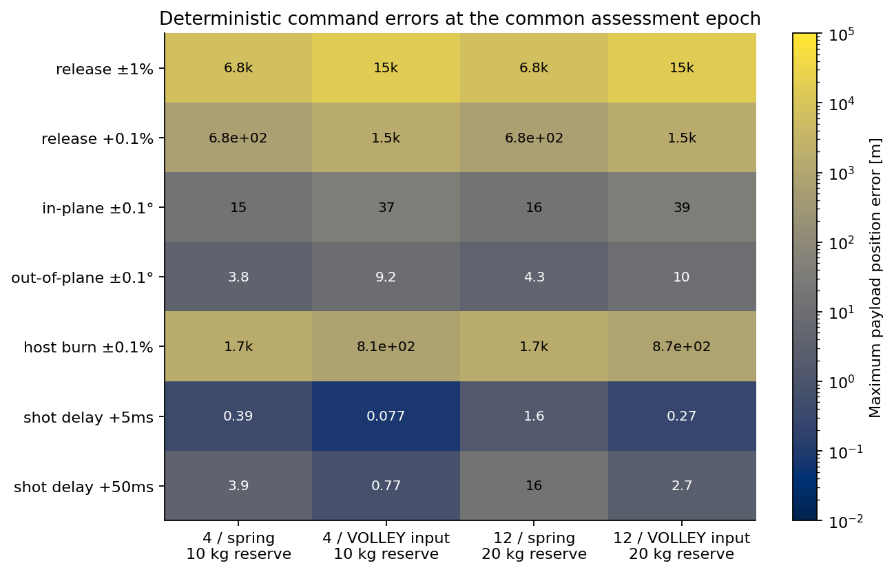
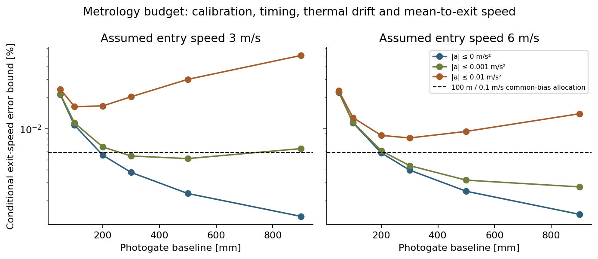
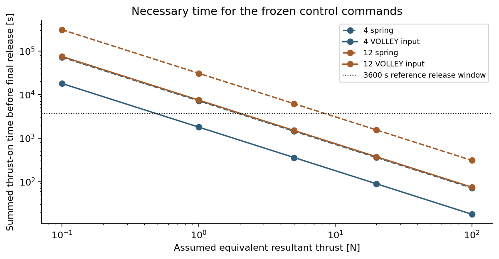

# Purpose and configuration

CNR-01 independently propagates the prescribed host burns and finite-mass releases from the earlier four/twelve-payload construction. It then probes command errors and derives provisional metrology and thrust-time requirements. This is numerical verification and requirements development for a surrogate mission. Motor performance, delivered flight accuracy and hardware compatibility remain unvalidated.

| Input | Declared basis |
|:--|:--|
| Reference orbit | 500 km, 97.4°; fixed inertial +Z J2 |
| Gravity | μ = 3.986004418×10¹⁴ m³/s²; radius 6378137 m; J2 = 1.08262668×10⁻³ |
| Manifest | Four: two 1U at 1.33 kg and two 3U at 4 kg; twelve: six of each |
| Release schedule | Nominal 0–3600 s; common assessment at 90000 s |
| Targets | Constructed 3–9 m/s prograde increments from reference-host states; not customer target states |
| Release inputs | Spring 2.5 m/s; VOLLEY imposed 3–6 m/s with host assistance |
| Host | 300 kg dry surrogate; ideal Isp 220 s; device proxies 16/30 kg per four payloads |
| Reference reserves | 10 kg for both four-release cases; 20 kg for both twelve-release cases |

The source control law returns the host to reference positions and restores its final state. The force model is distinct from the earlier 450 km, shared-pole GMAT–Orekit benchmark. No Earth-orientation, drag or atmosphere accuracy is inferred from agreement here. The API epoch is a time origin for this time-independent surrogate, not a selected launch date.

# Independent full-sequence calculation

The included event-export derivative retains the earlier source's gravity, targeting, rocket and recoil calculations. It adds explicit burn/release records and omits the later dense-output/clearance-reporting stage. The derivation patch and upstream source identities are included. Recomputed fuel amounts exactly reproduce the archived reference cases in this environment. The twelve-spring case with 10 kg reserve still fails at transfer 10; its 20 kg countercase completes.

Orekit 13.1.6 starts from **one initial host state**, propagates between every event, independently applies rocket mass loss and parent/child recoil, and propagates each released payload to the common epoch. It never resets a later host or payload arc to a source sample. The control vectors and targets are shared inputs; the target construction and control optimization are not independently solved. SciPy and Hipparchus both use DOP853, with separate force and bookkeeping implementations.

For a relative release vector u, mass m and pre-release total M, the implementation uses v_child =v_host +(1−m/M)u and v_parent =v_host −(m/M)u. The comoving kinetic-energy identity is ½m(M−m)|u|²/M. Burn mass follows M_after =M_before exp(−|Δv|/(Isp g0)). These are point-mass, ideal-impulse relationships.

51 native cases cover five nominal baselines, two step refinements and 44 deterministic probes. The four matched comparisons are:

| Case | Native fuel used [kg] | Maximum payload target difference [µm] | Final host difference [µm] |
|:--|--:|--:|--:|
| 4 spring 10kg | 4.355163 | 6.628 | 4.317 |
| 4 volley 3 6 10kg | 1.328501 | 6.628 | 1.492 |
| 12 spring 20kg | 15.352517 | 7.978 | 14.124 |
| 12 volley 3 6 20kg | 4.049854 | 7.134 | 8.657 |

The largest nominal payload difference in these matched comparisons is 7.978 µm. Halving the maximum step from 60 to 30 s in the two twelve-release comparisons changes payload positions by up to 16.133 µm. Mass, momentum and comoving-energy residuals are retained in raw output and checked. The numerical consistency threshold is 1 cm position and 10⁻⁵ m/s velocity; these thresholds are not flight accuracy specifications or rigorous continuous error enclosures.

# Command-error sensitivity

The probes vary one input at a time: common release-speed bias ±1% and +0.1%; in-plane/out-of-plane direction error ±0.1°; host-burn magnitude bias ±0.1%; and shot latency 5/50 ms. Every case uses the original commands, without navigation feedback or retargeting. Delayed shots also delay the following transfer burn, retaining the 20 s post-release coast. Assessment remains at the nominal common 90000 s epoch.

These are deterministic assumptions rather than measured distributions. The matrix reports the largest payload error across each stated signed probe, not a global uncertainty bound. Source-state differences at shifted intermediate events are not numerical residuals; nominal consistency and perturbed terminal errors are evaluated separately.

An illustrative 100 m / 0.1 m/s full-state box gives the following first-order allocation to a common release bias when **all other errors are set to zero**. It is not a customer requirement. The linearity ratio compares ten times the+0.1% position response with the+1% response; a ratio near one supports the local approximation over those probes.

| Case | Common release-bias allocation | Linearity ratio |
|:--|--:|--:|
| 4 spring 10kg | 0.01339% | 0.99999 |
| 4 volley 3 6 10kg | 0.00588% | 1.00001 |
| 12 spring 20kg | 0.01338% | 0.99999 |
| 12 volley 3 6 20kg | 0.00593% | 1.00001 |

The 10 m / 0.01 m/s and 1000 m / 1 m/s alternatives are in SUMMARY.json. Their purpose is to connect mission targets to actuator and measurement requirements. A controller must estimate the host state, account for actual pointing and manage release velocity. Published model-versus-test error in another deployer is not a measurement of VOLLEY repeatability.

# Velocity measurement budget

For two photogates with baseline L and transit time t, the constant-speed estimate is L/t. The 324 static intervals use speeds 3/6/9 m/s, baselines 50/100/200 mm, calibration bounds 5/10/50 µm, individual timestamp bounds 0.1/1/10 µs and residual temperature bounds 0/0.1/1/10 K. Aluminium-like CTE 23×10⁻⁶/K is assumed. Nine m/s remains a study point beyond the first-article objective.

The exact constant-speed interval is (L−δL)/(t+2δt) to (L+δL)/(t−2δt). Temperature drift adds CTE×L×δT to the distance bound. These are prescribed bounds, not statistical standard deviations or actual detector specifications.

A further 108 cases include mean-to-exit velocity and frame compensation. With |a_relative|≤a and positive monotonic motion, the transit-time comparison bounds are2L/(v0+√(v0²±2aL)). The difference between mean transit speed and exit speed is bounded by a×t_max/2. A rate-knowledge bound adds δω×r for a 0.5 m lever arm. Exact constant-acceleration corner checks exercise the interval arithmetic.

A longer baseline reduces calibration/timestamp contributions but increases the mean-to-exit contribution when relative acceleration is present. The required quiet/coasting measurement zone, baseline thermal calibration, detector response, payload edge geometry, tip-off and frame-rate compensation must be implemented and tested. Post-release measurements support verification and calibration; they cannot correct a passive satellite already released. Closed-loop acceleration and release control require their own sensors and design.

# Necessary thrust-time screen

For an equivalent constant-thrust engine, the nominal impulse fuel amount implies thrust-on time Δm×Isp×g0/F. Twenty cases use 0.1/1/5/20/100 N. This is a necessary time calculation for the **frozen reference commands**; it does not integrate finite burns or optimize another spring/VOLLEY policy.

| Case at 5 N | Thrust-on time before final release [s] | Total-time screen |
|:--|--:|:--|
| 4 spring 10kg | 1432.7 | Not excluded by total time alone |
| 4 volley 3 6 10kg | 356.4 | Not excluded by total time alone |
| 12 spring 20kg | 6134.9 | Exceeds reference window |
| 12 volley 3 6 20kg | 1487.6 | Not excluded by total time alone |

Passing the summed-time screen is insufficient: each finite burn must fit the chronology and avoid incompatible operations. Alternative controls/release epochs can change these demands. A low-thrust failure here does not prove every competent spring-host strategy fails. The device mass proxies still leave VOLLEY heavier despite lower fuel consumption. A selected host, installed system and optimized service comparison remain necessary before a product advantage is claimed.

# Verification status and remaining engineering

| Verified within this study | Still required |
|:--|:--|
| Prescribed full host/release sequence in independent native code | Customer target states and acceptable errors |
| Rocket/recoil/mass/energy identities and step comparison | Finite-burn targeting, attitude/slew and navigation feedback |
| Deterministic terminal-error responses | Calibrated sensor/actuator/error distributions |
| Conditional metrology and total-thrust-time calculations | Actual measurement architecture and source-rated hardware |
| Retained failed low-reserve spring campaign | Body/contact/near-field clearance and fault recovery |

The earlier conditional point-centre clearance screen remains conditional. Numerical agreement at events and the common epoch does not prove the assumed 1 cm continuous state-error enclosure, physical separation geometry or conjunction probability. All 51 trajectories use imposed release velocities; they do not establish a motor rating.

# Reproduction

1. Inspect the reports, raw event/host/payload CSVs and exact source identities.
2. Run check_capture.py with standard Python for integrity and independent bookkeeping checks.
3. Run download_jars.py to obtain the pinned public Orekit/Hipparchus dependencies; set OREKIT_CLASSPATH to jars/* and use Java 21 with its source-file compiler module.
4. Run run_full_campaign.py for the native cases, then summarize.py and report.py for budgets and figures. Install the pinned numerical packages when regenerating the source events with instrument_campaign.py and export_events.py.
5. Compile this Markdown with pandoc and XeLaTeX for the PDF. The manifest records the captured environment and exact inputs/outputs; rerunning does not imply bit-identical PDF metadata.
