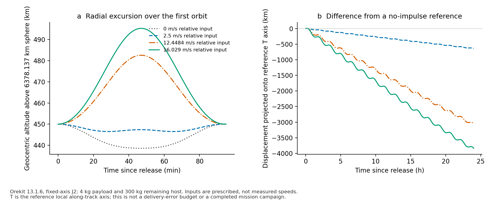
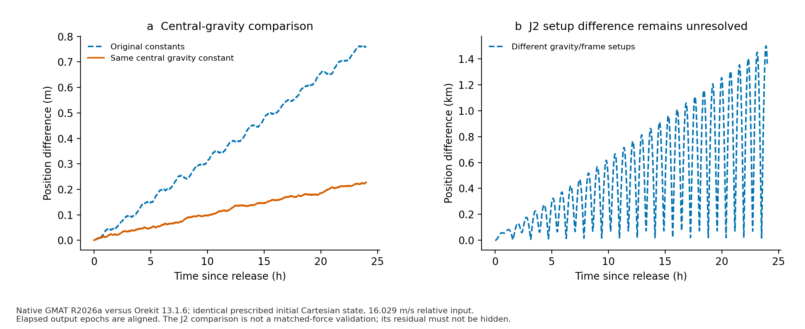
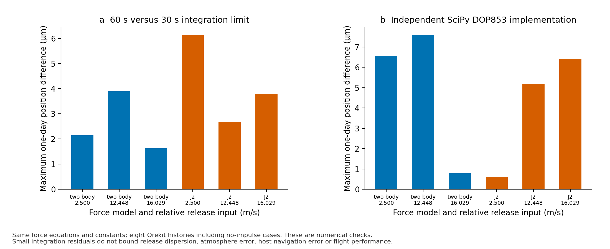
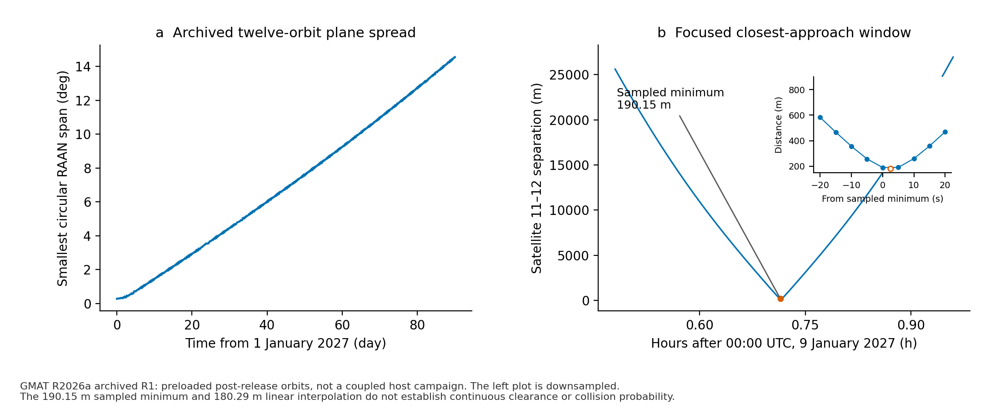

# Orbital analysis: what was run and what it establishes

**18 October 2026 — computational evidence supplement.** This package contains fresh Orekit 13.1.6 and GMAT R2026a runs, together with a readable extract of an earlier GMAT campaign. No spacecraft or deployment hardware was tested. The evaluated Gen5 record remains unchanged; the new results supplement its software evidence.

[Offline interactive orbit explorer](orbit-explorer.html) · [Five-page PDF](ORBIT_EVIDENCE_BRIEF.pdf)

## 1. Start with the physical question

A 4 kg payload is released from a 300 kg remaining host at a prescribed relative speed u. Conservation of momentum gives the payload inertial increment `300/304 * u`; 16.029 m/s relative therefore means 15.818092105 m/s inertial. The original orbit is circular at 450 km and 51.6 degrees inclination. These are study inputs, not measured separation speeds or an approved mission.

The first plot shows the radial excursion over one orbit and the one-day displacement relative to a no-impulse reference. Its local T-axis projection is a coordinate component of relative position, not a guaranteed along-track delivery accuracy. A release changes the orbit and creates evolving relative motion; a graph of that motion alone does not establish customer value.

## 2. Fresh native solver checks

| Work | Actual execution | Meaning |
|---|---|---|
| Queued Orekit single-release input | Orekit 13.1.6, one nominal orbital period, J2 | The prepared Java case now executes; not a hardware validation. |
| Orekit history study | Four relative inputs: 0, 2.5, 12.448437 and 16.029 m/s; central gravity and fixed-axis J2; 24 h each | Eight prescribed-state histories. The two non-spring inputs are numerical scenarios, not rated speeds. |
| Integration refinement | Maximum step 60 s versus 30 s; same 60 s output grid | Largest position difference: 6.12996e-06 m. This estimates numerical sensitivity within the model. |
| Independent equations | SciPy DOP853, separate Cartesian central/J2 implementation | Largest difference from Orekit: 1.07433e-05 m. Shared constants and physics remain assumptions. |
| GMAT central gravity | Native R2026a, same numerical initial Cartesian state, 24 h | With central constant harmonized, maximum position difference is 0.227043 m after output-epoch alignment. |
| GMAT degree-2/order-0 versus Orekit fixed-axis J2 | Both execute, but force frames and gravity definitions differ | Maximum difference is 1.4990 km. **Not a matched-force validation.** |

The two-body original-constant comparison uses 398600.4418 versus 398600.4415 km³/s². Harmonizing that value reduces the residual; it does not eliminate all numerical and clock handling differences. The first exploratory GMAT loop accumulated approximately 0.17 ms of reported epoch drift. The final scripts stop at absolute epochs; their largest reported offset from the intended output grid is 7.82311e-07 s. Failed input attempts and exploratory outputs are retained in the private evidence archive.

The original queued GMAT input also used a reserved object name (`Report`) and unsupported periapsis/apoapsis report fields. The working input uses `OrbitReport` and reports semi-major axis and eccentricity directly. Apsis radii can then be derived explicitly; no failed run is relabeled successful.

The 18 October J2 comparison required a controlled follow-up: harmonize gravity coefficients, equatorial radius, pole/frame transformation, epoch/time scale and integrator settings, then isolate each change. That original comparison did not isolate a root cause. The [19 October harmonization follow-up](../orbit_harmonization/README.md) now isolates the dominant pole/gravity mismatch and repeated-stop history, with approximately 1.285 mm maximum residual in a matched continuous-arc case. It does not change the original captured outputs. It cannot support an accuracy, lifetime or clearance claim.

Thresholds were not preregistered before exploratory execution. These tables report observed residuals and conservative limits of interpretation; they are not qualification acceptance results. Energy and axial angular-momentum drift are recorded per case in [the numerical results](ORBIT_RESULTS.json).

## 3. Archived 90-day GMAT campaign

This is a different case: twelve preloaded post-release orbits at a common 1 January 2027 epoch, propagated for 90 days with the archived force model. It is not a coupled simulation of the host releasing twelve real payloads. The 2027 dates are simulation epochs, not flight history.

The summary retains every 60th source row plus the final row. The original source has 59,590 rows per satellite. The complete raw-file hashes and sampling procedure are in [the archive record](ARCHIVE_SAMPLING.json). The plot shows the smallest circular RAAN span; angles near 0 and 360 degrees must not be subtracted as an ordinary range.

The focused satellite 11–12 window retains all 347 five-second samples. Its sampled minimum is 190.149944 m. The earlier straight-line interpolation gives 180.285836 m between adjacent samples; the hollow inset marker denotes that interpolation, not another native observation. Neither establishes continuous minimum separation or collision probability. A global continuous-event search, covariance and actual host/release uncertainty remain absent.

## 4. Reproduce or inspect

- [Java history source](OrbitEvidence.java), [original queued Java case](OrekitReleaseCrosscheck.java), [pinned JAR versions and hashes](OREKIT_RUNTIME.json).
- [GMAT central script](gmat_two_body.script), [GMAT J2 script](gmat_J2.script), [repaired queued script](gmat_release_crosscheck.script).
- [Orekit 30 s refinement](orekit_30s.csv), [Orekit 60 s refinement](orekit_60s.csv), [central-constant comparison](orekit_gmat_mu.csv).
- [GMAT central output](gmat_two_body.txt), [GMAT J2 output](gmat_J2.txt), [queued-case output](gmat_release_crosscheck.txt).
- [Archive summary CSV](gmat_archive_sampled.csv), [five-second close-approach CSV](gmat_close_approach.csv).
- [Analysis and conservation checks](analyze.py), [figure generator](plot.py), [figure conventions](../../docs/FIGURE_STANDARD.md).

Run `python validation/orbit_evidence/analyze.py --check` to recompute the captured numerical comparison; run `python validation/orbit_evidence/plot.py` to export editable SVG, PDF and PNG figures. Native re-execution requires Java with the compiler module, the eight exact JARs in OREKIT_RUNTIME.json, and GMAT R2026a. Run GMAT scripts from its `bin` directory; relative report filenames are written under its configured output directory. Orekit J2 here needs no external Earth-orientation data because its symmetry axis is explicitly fixed.

**Remaining engineering:** harmonized higher-fidelity propagation, atmospheric lifetime correlation, continuous clearance, coupled host maneuvers and reaction, release-state uncertainty, actual payload/provider interfaces, and physical separation tests. The software results do not close those gates.
