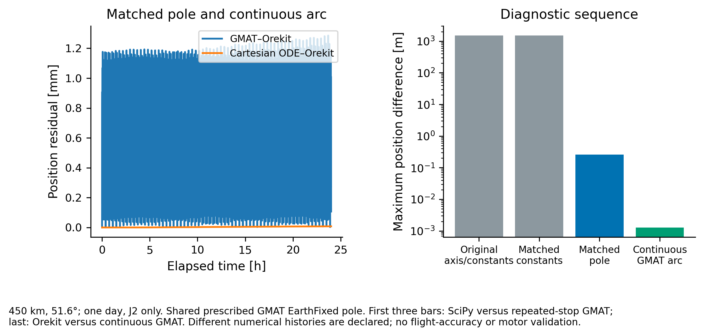

# Result and boundary

GMAT R2026a and Orekit 13.1.6 agree to approximately **1.285 mm maximum position difference** over one day in this matched, prescribed-axis J2 case. The terminal residual is approximately **0.107 mm**. An independent Cartesian SciPy integration differs from Orekit by approximately **7.66 micrometres**, and reducing Orekit's maximum step from 30 to 15 s changes position by approximately **1.93 micrometres**.

These are numerical consistency results for a declared force model. They do not establish physical orbit accuracy, Earth-orientation accuracy, a motor rating, atmospheric lifetime, payload delivery precision or mission safety.



# Why the earlier comparison disagreed

The earlier 18 October record compared GMAT's EarthFixed gravity axis against a fixed reference-frame z axis. At this epoch their poles differ by approximately **0.14974 degrees**. Matching only gravity constants leaves about 1.499 km of discrepancy. Prescribing GMAT's exported pole removes the dominant difference. GMAT scripts that repeatedly stop at absolute epochs retain a decimetre-scale integration-history difference. A single continuous arc with accepted-step reports reduces the inter-code maximum to the millimetre range. The ablation values are recomputed in analyze.py against the retained native histories, rather than inserted as an asserted result.

The first three diagnostic bars compare independent SciPy trajectories with repeated-stop GMAT; the last compares Orekit with continuous GMAT. They have different numerical histories and are not four measurements of one fixed discretization.

# Controlled inputs

- 29 September 2026, 00:00:00 **TAI**, EarthMJ2000Eq native initial state.
- 450 km circular reference at 51.6 degrees, with the earlier prescribed 16.029 m/s relative input converted through a 4 kg payload / 300 kg remaining-host split. This speed is an imposed input, not an achieved release.
- GMAT JGM2.cof constants: μ = 3.986004415 × 10^14 m³/s²; radius = 6378136.3 m; normalized C20 = −4.8416539 × 10^-4; J2 = √5 |C20|.
- Degree 2/order 0, no drag, third bodies, SRP, higher harmonics or tides.
- GMAT EarthFixed z is exported in EarthMJ2000Eq every 60 s. Both independent calculations linearly interpolate that vector and normalize it. This **shared prescribed orientation** is not an independent EOP/frame validation. Coordinates are compared in the declared common exported basis.
- GMAT continuous accepted-step history supplies the exact 2881 comparison epochs. Orekit uses Cartesian DOP853 with 30/15 s maximum steps; SciPy uses independent explicit Cartesian J2 equations with 15 s maximum step.

# Reproduction and provenance

The native scripts, raw GMAT histories, Orekit Java source, raw Orekit histories, scalar results and residual CSV are local to this directory. OREKIT_RUNTIME.json records Maven artifact versions and hashes. RUN_COMPLETION.json retains the original full-run log hashes and verbatim completion lines; private runtime paths and installation diagnostics are excluded from the public report.

Install GMAT R2026a with its JGM2 gravity and Earth-orientation data. Run gmat_J2_pole.script and gmat_J2_continuous.script from GMAT's bin directory using `GmatConsole --run <script> --exit`, then copy the named output histories here. Runtime data changes can change the prescribed pole and must be recorded. Reproduce the captured Orekit comparison with Java 21 source launch, using the jars in OREKIT_RUNTIME.json on the classpath:

```sh
java -cp "$OREKIT_CLASSPATH" MatchedJ2.java \
  gmat_J2_pole.txt orekit_matched_native.csv 30 \
  gmat_J2_continuous.txt
java -cp "$OREKIT_CLASSPATH" MatchedJ2.java \
  gmat_J2_pole.txt orekit_matched_native_15.csv 15 \
  gmat_J2_continuous.txt
python analyze.py
python plot.py
```

The exported histories permit result/plot regeneration without installing either native propagator. Remaining millimetre-scale residuals include numerical and epoch-representation effects; their complete attribution is not established. This is a separate follow-up and does not alter the frozen Gen5 technical record or erase the earlier unmatched comparison.
