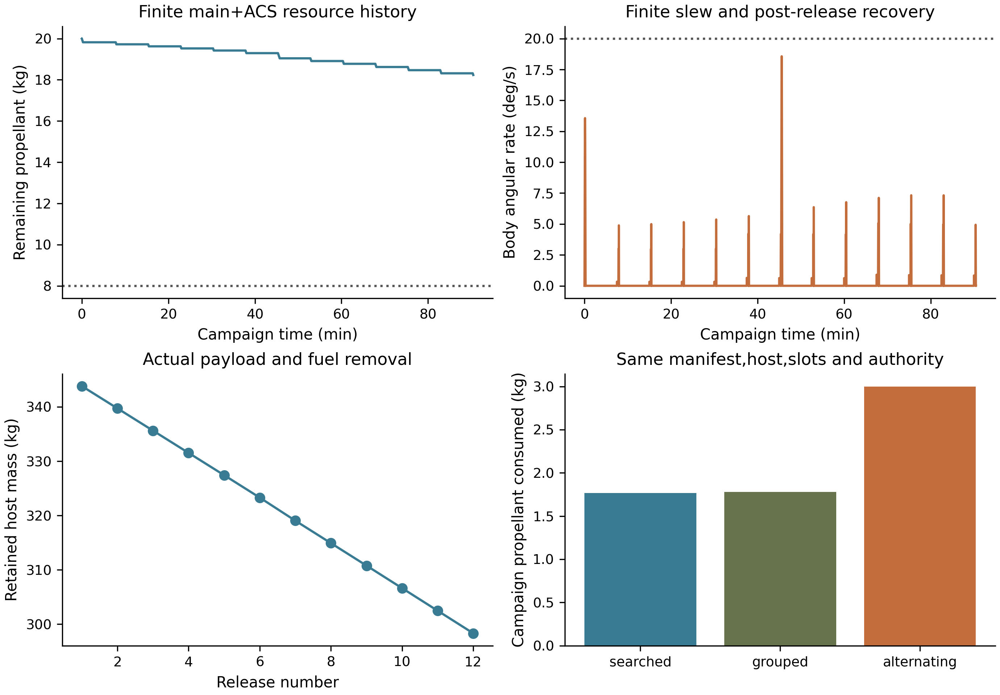

# Coupled lunar deployment campaign

This is the existing C5 investigation for LUNAR-PCS-01. All 12 payloads are 4 kg 3U surrogates, with actual ACR1 storage/release coordinates and a 280 kg retained dry core plus 20 kg initial propellant. The complete retained-core inertia tensor is declared in campaign_inputs.json, not measured or assigned to a provider. The source-calibrated point-event map includes the 13.127806 kg retained sled/pallet; the current 1–3 m/s source command is not equated to the final payload/host relative speed.

The campaign starts at the existing 100×1,000 km lunar staging orbit and source-pinned 25 October 2026 UTC epoch. It requires six prograde and six retrograde useful bound-orbit departures at 450 s slots. Each selected cell is unique. Source custody uses 355 s inside 400 s zero-force loading, with 5 s pre-release and 20 s post-release guards. Finite slews, angular-momentum removal and body-axis recoil recovery compete for the remaining preparation time. Rest-to-rest transport holding torque is bounded from the 7.573 kg payload/cradle source and consumes ACS propellant; this is a kinematic envelope, not a contact-solver replay.

The search evaluates **7,152** cell/order/sign/roll choices in a 12-level, width 32 beam. The best proxy candidate is then evaluated with the actual coupled model beside alternating and grouped baselines. This is a finite search, not a global-optimum or global-infeasibility proof.

The surviving tested reference uses 20 N body-axis propulsion/220 s Isp,5 N·m attitude torque,20°/s rate authority,60 s ACS Isp and 0.5 m couple arm. It releases all 12 payloads, uses **1.766371 kg** propellant and leaves **18.233629 kg**, above the 8 kg independent disposal floor. The actual sampled peak rate is **18.567°/s**. This is a demanding allocated host envelope; no actual host has demonstrated it here.

At 5 N·m/5°/s, the searched order stops after six releases when the sign reversal violates the next loading-coast deadline. Doubling the reference inertia also stops after six. At 1 N·m/5°/s, the searched order reaches five, while the alternating baseline reaches one. Infeasible policies preserve their states, remaining payloads, fuel and exact missed-window reason.

| Authority case | Policy | Released | Propellant remaining (kg) | Result |
|---|---|---:|---:|---|
| T0p2_R1 | searched | 0 | 19.98688 | retained failure |
| T0p2_R1 | alternating_baseline | 0 | 19.98688 | retained failure |
| T0p2_R1 | grouped_baseline | 0 | 19.98688 | retained failure |
| T1_R5 | searched | 5 | 19.65472 | retained failure |
| T1_R5 | alternating_baseline | 1 | 19.80728 | retained failure |
| T1_R5 | grouped_baseline | 2 | 19.80127 | retained failure |
| T5_R5 | searched | 6 | 19.24667 | retained failure |
| T5_R5 | alternating_baseline | 1 | 19.78204 | retained failure |
| T5_R5 | grouped_baseline | 6 | 19.16502 | retained failure |
| T5_R20 | searched | 12 | 18.23363 | pass |
| T5_R20 | alternating_baseline | 12 | 17.00276 | pass |
| T5_R20 | grouped_baseline | 12 | 18.22095 | pass |
| T5_R20_I2 | searched | 6 | 18.53865 | retained failure |
| T5_R20_I2 | alternating_baseline | 1 | 19.17917 | retained failure |
| T5_R20_I2 | grouped_baseline | 6 | 18.45093 | retained failure |
| T5_R20_I0p5 | searched | 12 | 18.53080 | pass |
| T5_R20_I0p5 | alternating_baseline | 12 | 17.93261 | pass |
| T5_R20_I0p5 | grouped_baseline | 12 | 18.51799 | pass |
| T5_R20 | pre_command_isolated_cell_failure | 11 | 18.29283 | retained failure |
| T5_R20 | unresolved_shared_path_failure | 5 | 19.29425 | retained failure |

Every release records the carrier position/velocity, mass, quaternion, full updated inertia/CG, angular momentum and body rate. Exact finite-position linear/angular momentum splitting precedes finite recovery. The largest linear and angular residuals are 1.16e-10 kg·m/s and 4.14e-09 kg·m²/s; mass closure is 8.12e-14 kg. A halved integration step changes final position by 6.51e-09 m. Euler/quaternion slew trajectories include anisotropic inertia, gyroscopic torque and fuel-dependent inertia, with checked torque/rate bounds.

| Release | Cell | Direction | Relative speed after arrest (m/s) | Host mass after release (kg) | Immediate body rate (°/s) | Osculating perilune (km) |
|---:|---|---:|---:|---:|---:|---:|
| 1 | Bank_north_L3_Stored_3U | +1 | 0.961716 | 343.82176 | 0.32913 | 104.813 |
| 2 | Bank_south_L3_Stored_3U | +1 | 0.961255 | 339.72295 | 0.32368 | 104.626 |
| 3 | Bank_north_L0_Stored_3U | +1 | 0.960784 | 335.62403 | 0.32507 | 104.316 |
| 4 | Bank_south_L0_Stored_3U | +1 | 0.960300 | 331.52370 | 0.32628 | 103.888 |
| 5 | Bank_north_L4_Stored_3U | +1 | 1.919678 | 327.42113 | 0.63785 | 106.687 |
| 6 | Bank_south_L4_Stored_3U | +1 | 1.918654 | 323.29425 | 0.62235 | 105.402 |
| 7 | Bank_north_L1_Stored_3U | -1 | 1.917572 | 319.04256 | 0.61924 | 95.971 |
| 8 | Bank_south_L1_Stored_3U | -1 | 1.916492 | 314.91085 | 0.61562 | 97.432 |
| 9 | Bank_north_L5_Stored_3U | -1 | 2.873143 | 310.77545 | 0.89373 | 98.129 |
| 10 | Bank_south_L5_Stored_3U | -1 | 2.871427 | 306.62108 | 0.86220 | 99.543 |
| 11 | Bank_north_L2_Stored_3U | -1 | 2.869663 | 302.46747 | 0.84780 | 99.996 |
| 12 | Bank_south_L2_Stored_3U | -1 | 2.867850 | 298.31507 | 0.83233 | 99.347 |

## Independent native astrodynamics

The identical-point-gravity GMAT replay agrees with the Python host within 0.01114 m and 8.72e-06 m/s at its actual terminal stop time. The accumulated stop-time difference is 7.43e-06 s. The native replay independently applies finite main-engine mass flow and every source-frozen separation jump. Zero-resultant ACS consumption is imposed from the Python attitude solution. GMAT is an independent astrodynamics solver; it does not independently validate the attitude controller or release contact.

GRGM900C 20/20 and 40/40 plus Earth/Sun DE421 runs replay the actual frozen campaign controls and released states. At 30 days, **12/12** and **12/12** payloads meet the 20 km minimum sampled reference-sphere floor; minima are 75.664 km and 75.637 km. Native host endpoint differences measure open-loop environment sensitivity, not closed-loop retargeting. The two gravity degrees are sensitivity runs, not a claim of physical convergence or terrain clearance.

The 40/40 host endpoint differs from the point-gravity planner by about 1633.6 m and 1.494 m/s. That exceeds the 10 m/0.01 m/s navigation inputs assumed by the standalone covariance. The coarse useful-orbit criterion passes; accurate customer placement requires a full-force navigation/planning/feedback solution. The standalone 1 km covariance result is not silently promoted to a full-campaign accuracy guarantee.

## Faults and unresolved physical acceptance

The pre-command isolated-cell fault at slot 6 leaves one payload captive and releases 11; it assumes the shared path never becomes occupied. The unresolved shared-path capture fault inhibits subsequent releases after five successful departures and retains seven. No successful automatic jam reset is invented. Both preserve finite host states and independent disposal resources. The earlier engine-only disposal sweep already covers all 12 payloads retained with zero release-recoil credit.

The three actual nominal/fault terminal states are additionally propagated to the next apolune, prepared with finite attitude authority, and burned with a fixed inertial body-axis 20 N engine command. Independent native 40/40+Earth/Sun replays all reach the reference sphere within 24 hours using at most 6.510957 kg additional propellant, below the 8 kg reserved floor. This connects campaign recovery to a surviving engine-only disposal path without release credit. Site/terrain/policy/engine acceptance remains external.

The source event is imposed after arrest; the finite pulse/contact/retention dynamics are not solved by these operational campaigns. Full manufacturing/measurement correlation and real provider/customer control/service/thermal/EMC/acceptance inputs remain external. Mission targets are declared energy classes and a useful bound-orbit floor, not customer full-state/time targets. Those limits remain visible in the C7 flowdown and original N/P gates.

Attitude dynamics in this investigation include release angular momentum and finite commanded control; gravity-gradient, SRP, magnetic and plume disturbance torques are omitted and require a host-specific disturbance margin. The point-gravity controller is not a validated flight ACS.

Sources/results: campaign_inputs.json, lunar_campaign.py, CAMPAIGN_RESULTS.json, campaign/, campaign_native.py, CAMPAIGN_NATIVE_RESULTS.json, campaign_native/. Existing standalone 20/40-degree coast and engine-only disposal captures are preserved.
