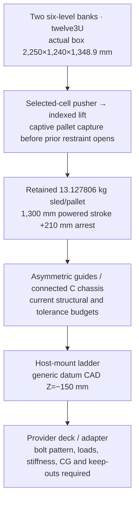
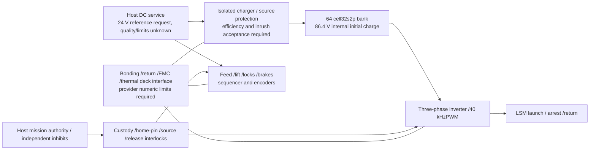

# H5 notional load-path and service interfaces

This sketch references the actual ACR1 source coordinates and solid-signature box. It does not define an approved provider ICD ormanufacturing bolt pattern. Coordinates are CAD millimetres; the intended host mounting datum is Z=−150 mm. The represented ladder occupies Z=−190..−150 mm. Final bracket/bolt/grounding/keep-out design needs provider inputs.

Payload axial reaction and LSM source reactions close through the carrier/guide/chassis supports and the host-mount ladder. Payload departure creates a net host impulse; internal sled motion creates a larger transient reaction and then returns momentum during arrest. The retained captive pallet stays onthe carrier. A payload-proxy envelope is not a load-bearing provider bracket. Launch restraint paths and external access remain tobe defined with the host.

The home-index interface is a retracting 6 mm pin in a 6.2 mm carrier bore; the current model identifies this as external host-provided hardware, unselected. Clear retraction is required before carrier travel. Power/thermal integration must add the unlocated 7 kg source/control package and numeric services listed in H0. No unused CAD volume is automatically credited as radiator, harness clearance orspace-qualified electronics packaging.

The mission interface is an individually authorized separation vector plus finite recoil/recovery budget. Keep the generic 500 kg LEO host and the separate 300 kg-wet lunar reference distinct. A supplied provider state, ICD, attitude/thrust authority, plume/visibility constraints and independent disposal approval are required before adopting either reference.

Sources:inputs/PARAMETERS.json; inputs/RESOURCE_LEDGER.json; inputs/SIGNATURES_home.json; inputs/SIGNATURES_release.json; STUDY_RESULTS.json; HARDWARE_FLOWDOWN.json. The diagrams are notional interface sketches, not CAD orsolver screenshots.
