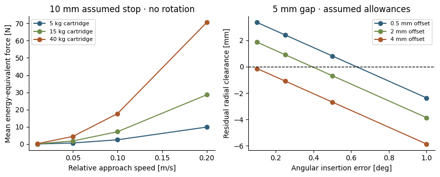

# Decision and service boundary

**No-go for an operational in-orbit replenishment claim in the current VOLLEY baseline.** A cooperative, preloaded cartridge is a credible subject for later interface development, but the present fixed cassette/floor, transfer mechanism and host surrogate do not supply a removable cartridge interface, servicing access or a verified custody chain. This is a bounded feasibility/interface investigation with a negative integration disposition, not a working reload system. Ground reloading remains the assumed method between campaigns.

The proposed service is exchange of a closed, individually restrained payload cartridge after all VOLLEY release operations have stopped. The hypothetical host maintains attitude and authorizes servicing. A separate servicer delivers and manipulates the cartridge; its rendezvous, robotic arm and docking hardware are outside this limited concept. Passive 1U/3U spacecraft remain inside the cartridge. No claim is made that they can be grasped directly without an approved spacecraft interface.

# Architecture alternatives

| Option | Advantages | Principal burden | Disposition |
|:--|:--|:--|:--|
| Ground reload before launch | Access, inspection and controlled cleanliness; no new on-orbit capture | Host campaign capacity is fixed | Current baseline assumption, not a demonstrated build |
| Exchange one sealed cartridge | Small exchanged unit, payload retention separated from robot | Added guide, locks, access, custody and servicing interfaces | Preferred *concept for later study*, not hardware selected |
| Exchange entire multi-cell magazine | Fewer exchanges per campaign | Higher mass/inertia, larger approach/access envelope and common-cause loss | Retain alternative; comparable assembly missing |
| Insert bare CubeSats individually | Potentially less disposable cartridge mass | Direct spacecraft contact, exposure, alignment and capture risks | Not preferred without approved payload interfaces |

# Provisional interface definition

This interface is a requirements proposal, not an adopted provider standard. A notional 3U cartridge envelope is 364.5 × 140 × 160 mm (8.165 L rectangular envelope), excluding grapple fixtures and approach volume. The payload reference is 340.5 × 100 × 100 mm. Cartridge mass sensitivities of 5/15/40 kg bracket unselected single/multi-payload and handling structures; these are not CAD-derived installed masses.

| Interface | Required definition / verification |
|:--|:--|
| Datum A: seating plane | Three hard pads; actual flatness, thermal range, preload and stiffness remain to be designed |
| Datums B/C: lateral and clocking | Non-interchangeable key and two guide features; prevent rotated/wrong-class insertion; actual dimensions provisional |
| Soft capture | Chamfer/cone and compliant travel separate alignment from final structural lock; contact force and rebound unresolved |
| Hard retention | Independent positive cartridge locks; no reliance on robot force, friction alone or electrical power for long-term custody |
| Payload retention | Cartridge stays closed throughout exchange; feed permission only after hard-lock and enclosure proof |
| Manipulation | Dedicated grapple feature outside spacecraft keep-out; accessibility and robot singularities unverified |
| Electrical | Passive identification or isolated low-voltage contact only after mechanical seat; launcher pulse path disconnected throughout servicing |
| Contamination | Covers/shutters, controlled materials and retained debris; no exposed lubricated guide surface directed at payload/optics |
| Separation/custody | At least one verified holder at every transition; robot release requires independently verified cartridge retention |
| Host structure | Servicing torque/load, collision keep-out and harness clearance need a host-specific ICD and structural assessment |

# Quantitative sensitivities

analyze.py evaluates 108 cooperative-capture cases and 36 insertion-fit cases. The host surrogate is 300 kg. Relative approach speeds are 0.01/0.05/0.10/0.20 m/s; stopping travels are 5/10/20 mm. Pitch-rate sensitivities are 0/1/5°/s. Linear capture uses reduced mass mM/(m+M); rotational energy uses an explicitly assumed rectangular-cartridge inertia. Energy divided by stopping travel is a **mean energy-equivalent force**, not a peak contact prediction. There is no selected damper, impact factor or acceptable host load.

At the upper translational case, a 40 kg cartridge and 300 kg host at 0.20 m/s have approximately 0.706 J of relative translational energy and 7.059 Ns of impulse. Angular energy is included separately in the raw results. By comparison, a 40 kg cartridge retained at a provisional 25 g sensitivity produces 9.807 kN. Soft capture and long-term/launch retention therefore require different load cases; low approach energy does not size the structural latch.

The fit model adds translational offset, 364.5 sin(angular error) mm, 0.30 mm manufacture allowance and 0.20 mm thermal allowance. It compares 0.5/2/4 mm offsets and 0.1/0.25/0.5/1° angular errors against 3/5/10 mm radial clearance hypotheses. Several cases fail; no operational navigation or capture envelope is approved. Real full-pose contact, compliance and thermal datums must replace these bounds before design selection.

# Operations and custody sequence

1. End the deployment campaign; lock all stored payloads and secure the sled.
2. Discharge/isolate the pulse source and verify no shot command can energize it.
3. Host establishes a servicing attitude, keep-out zone and abort authority.
4. Servicer approaches under its own independently qualified navigation/control.
5. Identify cartridge class, geometry and orientation while every payload remains closed.
6. Robot/grapple establishes custody; verify restraint before releasing transport locks.
7. Present the cartridge to guides and achieve compliant soft capture.
8. Seat against structural datums; close hard locks and independently verify them.
9. Release servicer custody only after actual hard retention is established.
10. Verify enclosure, alignment, identification and safe electrical interfaces.
11. Retreat the servicer; re-establish host control and independently prove the launch path.
12. Permit transfer/charge only after separate recommissioning checks; retain a stop/abort route.

No duration, throughput, autonomous success probability or delivery service is claimed for this sequence.

# Fault and contamination assessment

| Failure | Consequence | Required response / evidence |
|:--|:--|:--|
| Loss of power during capture | Dropped or incompletely seated cartridge | Positive holding in both handlers; demonstrate fail-safe custody |
| False hard-lock indication | Robot releases an unretained cartridge | Independent retention sensing and physical load verification |
| Excess offset/rate | Impact, rebound or guide jam | Abort limits tied to contact analysis and navigation uncertainty |
| Partial latch / thermal distortion | Misalignment or feed jam | Reject feed permission, retain robot custody and retreat safely |
| Wrong cartridge / clocking | Payload/track incompatibility | Mechanical keys and independent class identification |
| Uncommanded shot / charged store | Hazard to servicer and host | Physical/electrical source isolation with independent verification |
| One payload restraint fails | Loose spacecraft inside cartridge | Independent cells, secondary enclosure and no hatch opening |
| Shared-path obstruction | Later cells cannot feed | Isolate cartridge; supervise recovery; prove clear path before continuation |
| Debris, wear or lubricant migration | Optics/electronics contamination, increased friction | Sealed covers, material screening, particle control and retained wear products |
| Host/robot control disagreement | Structural overload or collision | One authorized control mode and force/motion limits |
| Servicer cannot retreat | Host operational loss | Define hold state, interfaces and mission-level recovery before approval |
| Cartridge depletion/reuse ambiguity | Incorrect manifest or unrestrained empty hardware | Positive manifest/state accounting and inspected reload configuration |

# Feasibility disposition and reopening criteria

The concept is **not intrinsically prohibited by capture energy alone** within the assumed low-speed range. That finding does not demonstrate docking or a worthwhile service. Current VOLLEY has no demonstrated detachable cartridge load path, robot access, controlled soft capture, double custody, isolation hardware, independent sensing or host/provider acceptance. Operational integration is therefore rejected for the current evaluated baseline.

Reopen only with: a named cooperative host/servicer and ICD; a controlled removable-cartridge assembly; installed mass, CG, inertia and load paths; continuous collision/contact/custody analysis; controller and power-loss validation; contamination/thermal/environmental requirements; and a same-mission resource/economic comparison with ground-loaded host campaigns. Repeatable physical servicing trials and environmental qualification remain later prerequisites for operational hardware.

# Research basis and limits

[ESA, *On-Orbit Servicing Prepared Platforms*](https://blogs.esa.int/cleanspace/2019/09/23/on-orbit-servicing-prepared-platforms/) (23 September 2019), describes cooperation, dedicated servicing interfaces, markers and attitude requirements. It supports treating the host/servicer boundary as a system interface; it supplies no VOLLEY dimensions or performance data.

[ESA, *Docking mechanism could lead to refuelling satellites still in orbit*](https://www.esa.int/Enabling_Support/Space_Engineering_Technology/Shaping_the_Future/Docking_mechanism_could_lead_to_refuelling_satellites_still_in_orbit) (16 July 2019), reports a breadboard and environmental/dynamic testing of ASSIST. This is a refuelling/berthing analogy, not evidence of CubeSat cartridge loading or inherited flight heritage.

[NASA NTRS 20210019023](https://ntrs.nasa.gov/citations/20210019023), Bo Naasz, *Design of Space Systems to Enable In-space Assembly and Servicing* (2021), public presentation abstract/record inspected. The record lists no downloadable full text; no full-paper review is claimed.

# Reproduction

Run analyze.py, plot.py and check_capture.py with Python/Matplotlib. RESULTS.json retains every input and failed fit; the linear momentum/energy identity is asserted independently for each capture case. This is not a trajectory, robotics or contact simulation. The concept report may be compiled from this Markdown using pandoc and XeLaTeX.
