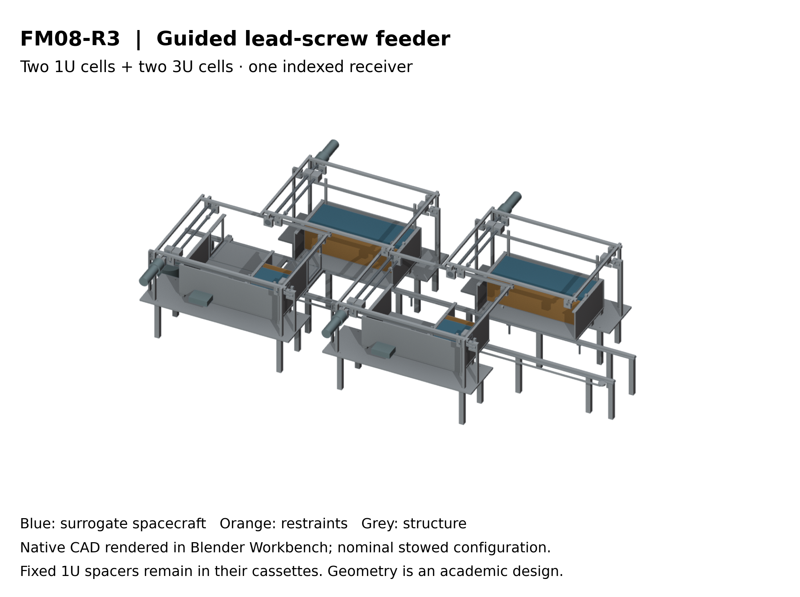
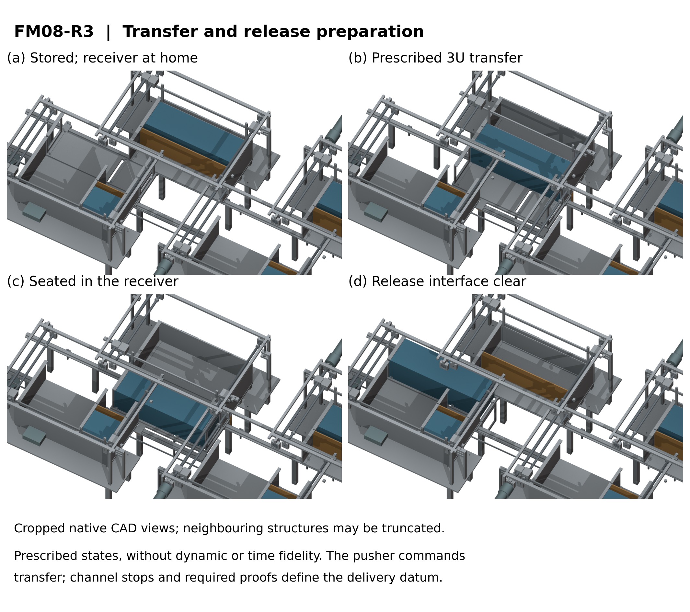

# FM08-R3 — Selected mixed-size CubeSat feeder

FM08-R3 selects a **guided lead-screw pusher**, independently restrained fixed cells, capped transfer channels and one **belt-indexed receiver** for the academic Gen6 design. The manifest holds two 1U and two 3U passive rectangular surrogates. The original evaluated Gen5 remains a separate fixed computational study.

[Mechanical design, sequence and dimensions](cad/README.md) · [Quantitative trade and actuation analysis](verification/REPORT.md) · [Independent STEP readback](step_exchange/INDEPENDENT_STEP.json)

## Design decision

The declared safety-led weighted judgments rank lead screw7.30, rack/pawl7.10 and spring/two-gate6.90 out of10. The top-three study uses common 200mm transfer,30s motion and50/100N resistance assumptions. Equal or different weights can change the ranking. Rack/pawl is retained as the runner-up; none of these scores is a measured reliability.

The selected system uses fixed 1U spacers, twin guide shafts, a supported10×2mm screw and a separate toothed-belt index drive. Receiver far-side stops must be proved before feeding; the capped channel bounds the transfer path. Seating and capture must be proved before pusher withdrawal. The pusher cannot pull a free spacecraft. Feed is restricted to host coast; the index clutch must disengage before electromagnetic launch.

*Blender Workbench renders of native CAD, with cropped detail views. Prescribed nominal poses have no dynamic or time fidelity. [Discrete-pose illustration](cad/figures/FM08_prescribed_sequence.gif).*

## Evidence and reproduction

- `cad/release/`: editable FreeCAD documents, neutral STEP exchanges, geometric audits, represented mass properties and part index.
- `cad/release/MOTION_VERIFICATION.json`: installed sequence and clearance checks, with each sampling/sweep method stated.
- `verification/results/`: deterministic drive/load/tolerance screens and executable four/twelve-cell interlock checks.
- `step_exchange/`: separately imported STEP validity and aggregate-volume checks against the captured native states. Both importers use the Open CASCADE family.
- `cad/figures/`: source-identified native-CAD renders, editable-label SVG/PDF plates and their provenance records.

Run `python check_capture.py` using Python3. The local capture check verifies exact hashes and the analytical/logic replay; rebuilding native geometry requires FreeCAD. Follow the component READMEs for the software-specific build commands. The rendered scene and source scripts are retained.

## Interpretation

This is a selected academic mechanism design with nominal geometry and declared analytical assumptions. Catalog limits use their actual ambient reference conditions; vacuum, lubrication, life, end-stop impact and measured positioning performance remain unqualified. Represented custom material and primary catalog masses are separated from omitted equipment. The package does not establish a complete installed spacecraft mass, approved host fit, flight reliability or component-rated electromagnetic launch speed. The earlier unconverged contact model supplies no precision or design-load rating for this design.
