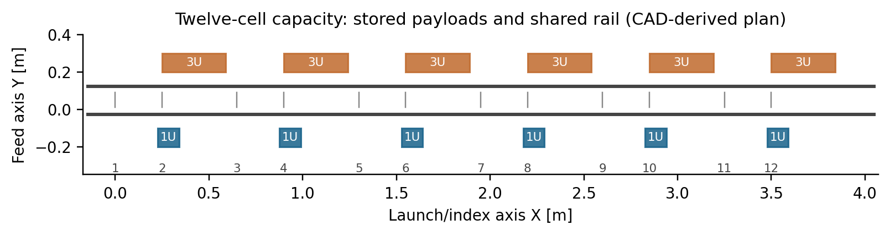
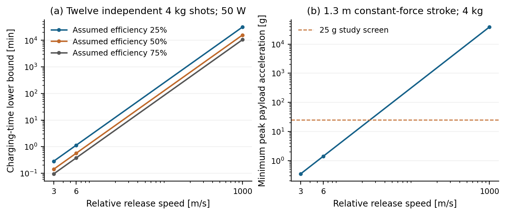
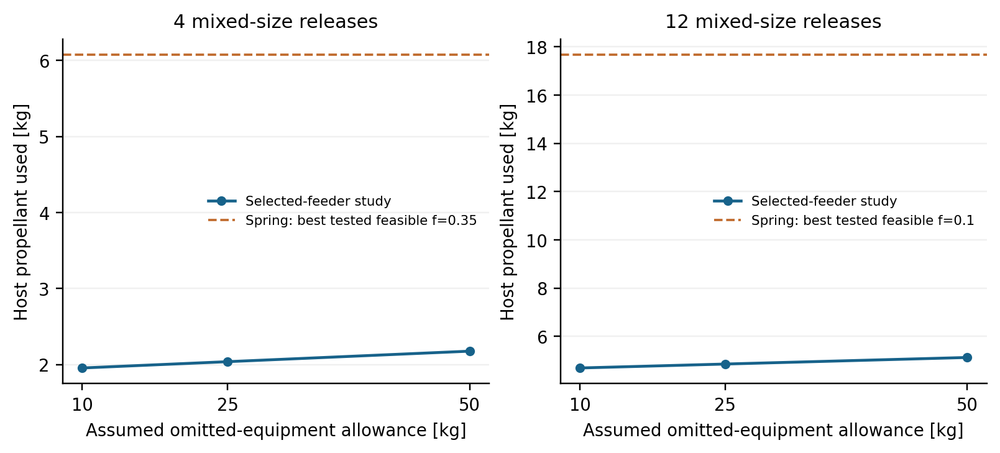
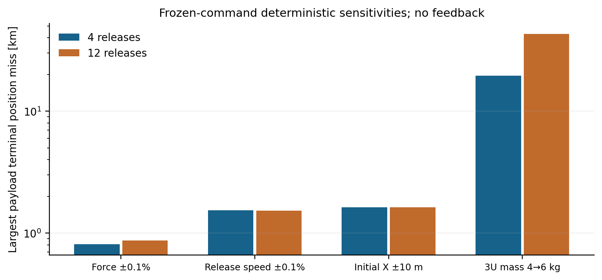
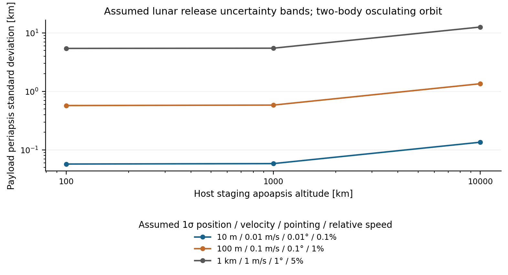

# Scope and method

The selected guided lead-screw pusher feeds dedicated fixed 1U/3U cells through continuously capped channels into one indexed receiver. The receiver far-side stops close before transfer begins; near-side capture closes after sensed arrival and settling, before the pusher retracts. The payload remains geometrically contained, but the pusher cannot pull or enforce deceleration of a freely moving payload. Nominal transfer is therefore restricted to host zero-force coast windows; end-stop impact and sensed-settling acceptance require later validation. This assessment evaluates the associated capacity scaling and resource requirements. The evaluated Gen5 record is retained; the selected feeder and capacity studies are separately versioned Gen6 academic design work. No physical prototype or flight qualification is claimed.

Resource requirements follow two-body separation momentum and energy conservation. For retained host mass $M$, payload mass $m$ and relative release speed $u$, $\alpha=M/(M+m)$, $E=\tfrac12 m\alpha u^2$, and the constant-force relative stroke obeys $s\ge\alpha u^2/(2a_{payload,max})$. Bus-energy requirements are at least $E/\eta$ for assumed efficiency $\eta$. These equations exclude retained moving-body acceleration, feed/index actuation, catcher losses and standby services.

# Capacity geometry

The twelve-cell scaling assembly contains six 1U and six 3U payload envelopes, twelve dedicated feed cells, and one receiver. Its twelve docking stations span 3,500 mm on a 4,200 mm rail. The geometry is generated explicitly from the selected four-cell source; it is not a threefold mass multiplication or three independent launchers.

| Quantity | Twelve-cell assembly |
|---|---:|
| Represented custom-material mass | 72.730463 kg |
| Uniform payload surrogate mass | 31.980 kg |
| Custom material + uniform payloads | 104.710463 kg |
| Represented-material centre of gravity | (1,883.728, 52.088, 57.072) mm |
| Geometric bounding envelope | 4,210.0 × 877.8 × 388.0 mm |
| Represented envelope volume | 1,433.869 L |
| Native geometric features | 398 |

Payload and catalog-package masses are excluded from this material total. Complete installed mass requires the separately identified catalog equipment, fasteners, harness, gate actuation, electromagnetic launcher, source and host interface. A 4.2 m rail is a packaging requirement; no selected host has been demonstrated to accept it.

Exact rectangular-payload linear sweeps were evaluated against the frozen feed-phase environment at all twelve docking stations: 12 of 12 had no positive-volume interference. The active moving pusher was excluded from this particular sweep; full moving-mechanism and loaded/tolerance acceptance must be assessed separately. Native/STEP state checks and all retained intersections are recorded in the machine-readable report.

The full represented-material inertia tensor about its computed centre of gravity is supplied in `TWELVE_ASSEMBLY_REPORT.json`. The material ledger and excluded-mass boundary accompany both native and STEP exports.

The represented local moving material plus the 6 kg upper payload study totals at most 6.238929 kg, below the 7.5 kg actuator-study mass. The corresponding receiver subtotal is 6.984248 kg, below its 10 kg study mass. Unmodeled moving actuators, harness and fasteners must fit the remaining headroom or the drive model must be rerun. At the prescribed pusher peak speed, the ideal kinetic energy of a 6 kg payload is 0.533333 mJ. This conditional energy requirement does not establish a contact peak load, a safe impact or controlled payload deceleration.

# Separation energy, charging and thermal requirements

SYS-01 comprises 108 energy/charging cases, 18 force/stroke cases, 36 single-axis angular-impulse cases and 54 optimistic heat-rejection cases. Net efficiencies of 25/50/75%, charging powers of 25/50/100 W, radiator areas of 0.25/1/4 m², and host inertias of 20/100/500 kg·m² are sensitivity inputs. They are not measured values or selected component ratings.

| Twelve independent 4 kg shots; 300 kg retained-host reference | 6 m/s | 1,000 m/s |
|---|---:|---:|
| Ideal relative energy per shot | 71.053 J | 1,973,684.211 J |
| Bus-energy lower bound at assumed 50% efficiency | 1,705.263 J | 47,368,421.053 J |
| Charging-time lower bound at assumed 50 W | 34.105 s | 947,368.421 s |

At 1 km/s, the retained 25 g study screen requires 2.013 km of ideal constant-force relative stroke for the 4 kg / 300 kg case. The compact/high-speed/low-acceleration requirement combination is therefore incompatible under these assumptions. The 3–6 m/s range remains an imposed mission study input; the calculations do not prove an electromagnetic motor or release mechanism can achieve it.

The radiation screen assumes emissivity 0.8, a zero-temperature deep-space sink and a constant declared radiator temperature. It excludes sunlight, planetary heating, conduction, changing view factors, thermal interfaces and radiator mass. It provides an optimistic heat-rejection requirement, rather than a complete thermal design. The angular-impulse screen similarly assumes a single host inertia and a specified release-axis offset; zero offset produces zero point-mass angular impulse, while an offset requires attitude recovery.

# Finite-force mission comparison

FBR-02 retargets each finite-force leg after changing the declared device burden. It preserves the captured full position/velocity targets, common 90,000 s terminal epoch, release vectors, continuous mass flow and recoil relation. The spring comparator retains its declared installed-mass proxy. The selected-feeder cases use the represented material boundary and explicitly stated allowances; they do not establish a complete installed device mass.

All cases include a 5 s zero-force guard before release and a 20 s guard afterward. The twelve-cell VOLLEY policy uses 10% force windows to reserve 241.818 s of inter-window coast for a conservative 223.556 s full feeder/index-return allocation. The 18.263 s remaining allowance must also cover the applicable launch, charging, reset and operational services; those services are not collectively qualified here. Conventional spring deployment is additionally evaluated with 20% and 35% force windows, so it does not inherit VOLLEY-specific handling constraints.

| Case | Declared device burden [kg] | Peak resultant force [N] | Fuel [kg] | Translational screen |
|---|---:|---:|---:|---|
| 4 / spring proxy / f=0.35 | 16.000 | 13.356 | 6.076 | Pass |
| 4 / selected feeder + 10 kg allowance | 39.837 | 6.692 | 1.956 | Pass |
| 4 / selected feeder + 25 kg allowance | 54.837 | 6.979 | 2.039 | Pass |
| 4 / selected feeder + 50 kg allowance | 79.837 | 7.457 | 2.177 | Pass |
| 12 / spring proxy / f=0.1 | 48.000 | 93.657 | 17.676 | Pass |
| 12 / spring proxy / f=0.2 | 48.000 | 52.044 | 19.769 | Pass |
| 12 / spring proxy / f=0.35 | 48.000 | 35.858 | 24.100 | Pass |
| 12 / selected feeder + 10 kg allowance | 93.331 | 50.154 | 4.689 | Pass |
| 12 / selected feeder + 25 kg allowance | 108.331 | 51.884 | 4.852 | Pass |
| 12 / selected feeder + 50 kg allowance | 133.331 | 54.769 | 5.124 | Pass |

The reported forces are constant inertial resultant controls in a simplified J2 point-mass model. Thrust/attitude allocation, plume clearance, navigation feedback, drag, physical release dynamics and source-rated host hardware remain outside that model. A translational pass establishes consistency of this constructed policy, rather than global optimality or mission/provider approval.

The minimum-fuel feasible captured spring policy is used for the conditional resource comparison. This is the best known member of the tested policy family, rather than a global optimum. Extra device burden and propellant use remain separate quantities; the study does not infer a priced service or optimized launch wet mass.

| Conditional 25 kg omitted-equipment case | Four releases | Twelve releases |
|---|---:|---:|
| Extra declared device dry burden versus spring proxy | 38.837 kg | 60.331 kg |
| Lower host propellant use versus best tested spring policy | 4.036 kg | 12.824 kg |

The declared device dry penalty exceeds the propellant-use reduction in these cases. A mission-level installed-mass advantage is therefore not established. Both campaigns begin with the same prescribed fuel allocation; reduced consumption is not automatically a reduction of launch wet mass. A product decision additionally requires credible precision, throughput or host-service value sufficient to justify the added hardware.

26 actual new Orekit replays cover nominal campaigns, time-step refinements and deterministic sensitivity cases. The largest nominal payload terminal position difference is 19.726 µm. Native mass-flow, recoil, continuity and pre-release guard checks pass within their recorded numerical criteria. Frozen-command probes vary force or release speed by ±0.1%, initial inertial X by ±10 m, and actual 3U payload mass from 4 to 6 kg. These deterministic probes are not calibrated probability distributions or flight delivery accuracy.

# Lunar delivery uncertainty

LNS-01 evaluates three explicitly assumed uncertainty bands at apolune release from 100 × 100, 100 × 1,000 and 100 × 10,000 km lunar staging orbits. Each of nine cases contains 8,192 fixed-seed samples. Independent Gaussian position/velocity/pointing inputs have standard deviations 10 m / 0.01 m/s / 0.01°, 100 m / 0.1 m/s / 0.1°, and 1 km / 1 m/s / 1°, respectively. Relative-speed standard deviations are 0.1/1/5%. These are uncalibrated investigation bands; no measured performance or probability of successful delivery is claimed.

The negative 4.569852 m/s relative command from the 100 × 10,000 km ellipse gives nominal two-body periapsis altitude 43.619 km. The widest assumed band has linearized periapsis standard deviation 12.681 km. Three Jacobian refinement comparisons differ by less than $10^{-4}$ relatively, with actual differences below $10^{-9}$. Numerical derivative consistency does not establish physical model fidelity.

# Applicability and research boundary

The lunar uncertainty output is an osculating two-body periapsis distribution at release. Reference-sphere crossing is distinct from terrain impact, a useful-lifetime limit or controlled disposal. No new 7/30/90/180-day high-fidelity lunar lifetime calculation is claimed. Connected epoch-targeted carrier burns, measured correlated delivery uncertainties, a lunar failed-shot campaign, operational disposal and source-rated hardware deltas remain necessary for the extended lunar service architecture. The separate ideal capture/disposal and high-speed bounds retain their original source and criteria identities.

# Reproduction and sources

Run `system_screens.py` and `lunar_navigation_sensitivity.py` to reproduce the numerical sensitivity studies. Run `plot_screens.py` for the analytical figures. The capacity builder takes an exact copied FM08-R3 source file; source hashes identify its geometry revision. The finite-force targeter is a recorded derivative of the captured FBR-01 source, adding a declared pre-release zero-force guard. Its wrapper records the exact source-input hash, guard duration and device-mass replacement. Actual native replay commands and CSV outputs are retained with each new run. Scientific plots are derived from numerical data; no software interface is synthesized.

- JPL, DE440 astrodynamic parameters: <https://ssd.jpl.nasa.gov/astro_par.html>. Constants and reference radii are the retained C0-S1/C0-S2 inputs.
- Orekit 13.1.6 ForceModel and J2OnlyPerturbation APIs: <https://www.orekit.org/static/apidocs/>. Exact public dependency versions/hashes are retained in `mission/SOFTWARE_LOCK.json`.
- SciPy `solve_ivp` numerical integration: <https://docs.scipy.org/doc/scipy/reference/generated/scipy.integrate.solve_ivp.html>.
- FreeCAD/Open CASCADE native geometry and STEP exchange: source revision and software identities accompany the generated assembly report.
